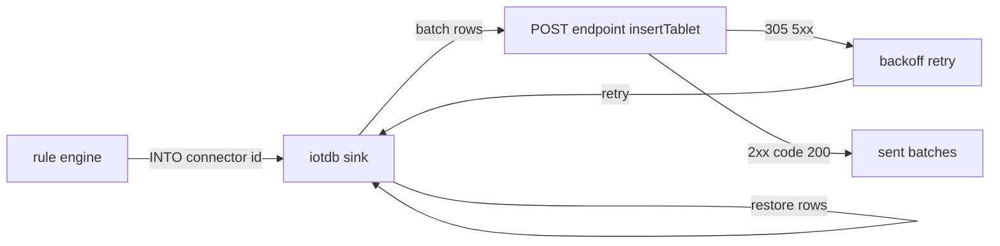

# IoTDB connector

The IoTDB connector writes each rule result as one tablet row. It groups rows by device and posts tablets to `insertTablet`. It authenticates with Basic auth.

Use it when metrics must land in IoTDB time series. You get one HTTP post per device group with your own device mapping.



## Before you start

- Run IoTDB with the REST service enabled. Note the endpoint.
- Create the database. Note the device root.
- This kind ships in the default build. No feature flag is necessary.

## Settings

Set `kind` to `iotdb`.

| Setting | Required | Meaning |
|---|---|---|
| `endpoint` | yes | HTTP base of the REST API, `http://` or `https://`. The sink posts to `{endpoint}/insertTablet`. |
| `device_path_template` | yes | Device path rooted at `root.`. Accepts `${topic}`, `${client_id}`, `${qos}`, `${timestamp}`, `${payload.<field>}`. |
| `auth` | yes | Object with `username` and `password`. An empty `username` is refused. It sends a Basic header. |
| `is_aligned` | no | Aligned time-series layout. Default `false`. |
| `measurements` | yes | Column names. Each name matches `[A-Za-z0-9_]+`. An empty list is refused. |
| `data_types` | yes | One type per column: `BOOLEAN`, `INT32`, `INT64`, `FLOAT`, `DOUBLE`, `TEXT`. The count must match `measurements`. |
| `batch_size` | no | Rows per flush. Default 200. A value of 0 is refused. `null` means no bound. |
| `batch_bytes` | no | Batch byte limit. Default 2097152. A value of 0 is refused. `null` means no bound. |
| `linger_ms` | no | Linger before a partial batch flushes. Default 10. |
| `max_retries` | no | Retries on 305 and 500 to 504. Default 3. `null` means no bound. 0 means no retry. |
| `initial_backoff_ms` | no | First retry delay. Default 100. A value below 1 reads as 1. |
| `max_backoff_ms` | no | Retry delay ceiling. Default 2000. A value below 1 reads as 1. |
| `timeout_ms` | no | Request deadline in ms. Default 5000. A value below 1 reads as 1. |

Example:

```json
{
  "id": "iotdb-1",
  "kind": "iotdb",
  "config": {
    "endpoint": "http://127.0.0.1:18080/rest/v2",
    "device_path_template": "root.factory.plant1",
    "auth": {"username": "root", "password": "root"},
    "is_aligned": false,
    "measurements": ["temperature"],
    "data_types": ["DOUBLE"],
    "batch_size": 50,
    "batch_bytes": 65536,
    "linger_ms": 10,
    "max_retries": 2,
    "initial_backoff_ms": 10,
    "max_backoff_ms": 100,
    "timeout_ms": 5000
  }
}
```

> [!NOTE]
> The docs run creates this shape. Creation validates only; it writes no row. The send path needs an IoTDB server. See the failure record in [Verification failures](../_verification/failures.md).

## Check that it works

Create the connector. The broker answers 201 with the kind.

```toml test
[node]
id = "docs-connector-iotdb"

[listeners.tcp]
bind = "0.0.0.0:1883"

[listeners.api]
bind = "0.0.0.0:18083"

[logging]
level = "warn"

[auth]
allow_anonymous = true
```

```sh test
python3 - <<'PY'
import json, os, urllib.request
port = os.environ.get("API_PORT", "18083")
key = os.environ["API_KEY"]
body = json.dumps({"id": "iotdb-1", "kind": "iotdb",
                   "config": {"endpoint": "http://127.0.0.1:18080/rest/v2",
                              "device_path_template": "root.factory.plant1",
                              "auth": {"username": "root", "password": "root"},
                              "is_aligned": False,
                              "measurements": ["temperature"],
                              "data_types": ["DOUBLE"],
                              "batch_size": 50, "batch_bytes": 65536,
                              "linger_ms": 10, "max_retries": 2,
                              "initial_backoff_ms": 10,
                              "max_backoff_ms": 100,
                              "timeout_ms": 5000}}).encode()
req = urllib.request.Request(
    f"http://127.0.0.1:{port}/api/v1/connectors", data=body, method="POST",
    headers={"Authorization": f"Bearer {key}", "Content-Type": "application/json"})
with urllib.request.urlopen(req, timeout=5) as res:
    assert res.status == 201
    print(json.load(res)["kind"])
PY
```

```output
iotdb
```

## Limits

- An endpoint without an `http://` or `https://` prefix is refused with 400.
- An empty template, a path outside `root.`, an unknown variable, or an unclosed variable is refused with 400.
- A path with empty segments is refused. Illegal chars become `_`. A leading digit gains a `_` prefix.
- An empty `username`, empty `measurements`, or bad measurement name is refused with 400.
- A `measurements` and `data_types` length mismatch is refused with 400.
- A `batch_size` or `batch_bytes` of 0 is refused with 400.
- A payload that is not UTF-8 JSON is refused. A missing measurement field fails the row.
- A `BOOLEAN` needs a bool. An `INT32` needs an int in range. An `INT64` needs an int. `FLOAT` and `DOUBLE` need a number. `TEXT` needs a string.
- An empty topic fails the row.
- A 305 or 500 to 504 status retries with backoff. Other 4xx statuses fail fast. A 200 answer with a failing code fails fast.
- A failed flush keeps rows and engages backoff. Flushes fail fast during backoff.

## Next steps

- Feed the connector from a rule in [Actions](../rules/actions.md).
- See every kind in [Connectors](./index.md).
