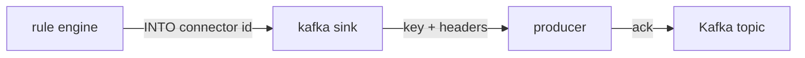

# Kafka connector

The Kafka connector publishes rule results as Kafka records. The action names the topic, the key, the headers, and the strategy. The driver waits for the configured ack.

Use it when an event pipeline or a stream processor reads broker data. You get keyed records into a Kafka topic.



## Before you start

- Run a Kafka cluster. Note its `bootstrap_hosts`.
- Create the target topic, or allow auto-creation.
- For a full build, enable the feature: `--features kafka`. The default build answers 400 and names the feature.

## Settings

Set `type` to `kafka` (`kafka_producer` is accepted too).

Connector settings:

| Setting | Required | Meaning |
|---|---|---|
| `bootstrap_hosts` | yes | Broker list, `host:port` pairs. |
| `authentication` | no | Only `none` is supported. SASL is refused. |

Action settings:

| Setting | Required | Meaning |
|---|---|---|
| `topic` | yes | Target topic template, `${topic}` supported. |
| `message.key` | no | Record key template (`${topic}`, `${payload}`, `${payload.<field>}`, `${client_id}`). Absent means a null key. |
| `partition_strategy` | no | `random` (default) or `key_dispatch` (sticky murmur2 hash). |
| `required_acks` | no | `all_isr` (default), `leader_only`, or `none`. |
| `kafka_headers` | no | One template rendered to a JSON object or array of key/value pairs. |
| `kafka_ext_headers` | no | Array of `{kafka_ext_header_key, kafka_ext_header_value}` templates. |
| `kafka_header_value_encode_mode` | no | `none` (default) or `json`. |
| `query_mode` | no | `async` (default) or `sync`. Delivery always awaits the broker ack. |

Example:

```json
{
  "type": "kafka",
  "name": "kafka-out",
  "bootstrap_hosts": "127.0.0.1:9092"
}
```

```json
{
  "type": "kafka",
  "name": "kafka-act",
  "connector": "kafka-out",
  "parameters": {
    "topic": "events",
    "message": {"key": "${payload.device_id}"},
    "partition_strategy": "key_dispatch",
    "required_acks": "all_isr"
  }
}
```

> [!NOTE]
> The docs run creates this shape. Creation validates only; it opens no socket and sends no record. The send path needs a Kafka cluster.

## Check that it works

Create the connector. The broker answers 201 with the kind when the build holds Kafka, else 400 naming the feature. Both answers print `ok`. A body without hosts answers 400 naming the field.

```toml test
[node]
id = "docs-connector-kafka"

[listeners.tcp]
bind = "0.0.0.0:1883"

[listeners.api]
bind = "0.0.0.0:18083"

[logging]
level = "warn"

[auth]
allow_anonymous = true
```

```sh test
python3 - <<'PY'
import json, os, urllib.request
port = os.environ.get("API_PORT", "18083")
key = os.environ["API_KEY"]
def post(body):
    req = urllib.request.Request(
        f"http://127.0.0.1:{port}/api/v5/connectors", data=json.dumps(body).encode(), method="POST",
        headers={"Authorization": f"Bearer {key}", "Content-Type": "application/json"})
    try:
        with urllib.request.urlopen(req, timeout=5) as res:
            return res.status, json.load(res)
    except urllib.error.HTTPError as err:
        return err.code, json.load(err)
status, created = post({"name": "kafka-run-ok", "type": "kafka",
                        "bootstrap_hosts": "127.0.0.1:9092"})
assert status in (201, 400), (status, created)
if status == 201:
    assert created.get("type") == "kafka_producer", created
else:
    assert "feature" in str(created).lower(), created
status, body = post({"name": "kafka-run-bad", "type": "kafka"})
assert status == 400 and "bootstrap_hosts" in body["message"], body
print("ok")
PY
```

```output
ok
```

## Limits

- SASL is refused with 400. The driver dials plaintext with no SASL wiring yet.
- `message.value` supports only the whole message. A custom value is refused.
- Producer buffer tuning belongs to `resource_opts`. A present value is refused.

## Next steps

- Feed the action from a rule in [Actions](../rules/actions.md).
- See every kind in [Connectors](./index.md).
