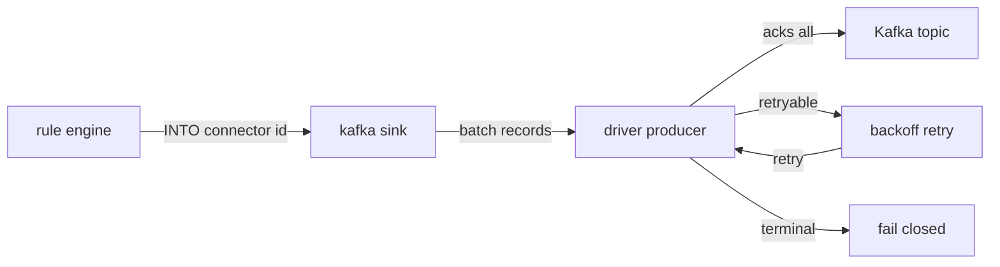

# Kafka connector

The Kafka connector publishes each rule result as one Kafka record. It batches records and places them with murmur2. It waits for the configured `acks`.

Use it when an event pipeline or a stream processor reads broker data. You get batched records in a Kafka topic through the maintained driver.



## Before you start

- Run a Kafka cluster. Note its `bootstrap_servers`.
- Create the target topic with 6 partitions, or allow auto-creation.
- For a full build, enable the feature: `--features kafka`. The default build answers 400 and names the feature.

## Settings

Set `kind` to `kafka`.

| Setting | Required | Meaning |
|---|---|---|
| `bootstrap_servers` | yes | Broker list, `host:port` pairs. An empty value is refused. |
| `topic_template` | yes | Target topic with `${topic}` substitution. An empty value is refused. `/` becomes `.`. Other chars outside `[A-Za-z0-9._-]` become `_`. The result truncates to 249 chars. An empty result or `.` or `..` becomes `indramqtt-invalid-topic`. |
| `client_id` | yes | Producer client id. The driver sends it as `client.id`. |
| `acks` | yes | `all`, `-1`, `1`, or `0`. Other values are refused. `all` and `-1` request a quorum. |
| `partition_key_field` | no | Top-level JSON field used as the record key. Default is none. A missing field or a non-JSON payload means a null key. A null key lands on partition 0. |
| `partitions` | no | Partition count hint for murmur2 modulo. Default 1. Must exceed 0. |
| `batch_max_records` | no | Flush trigger record count. Default 500. Must exceed 0. The default keeps the rule worker small. |
| `batch_max_bytes` | no | Flush trigger byte limit. Default 262144. Must exceed 0. The default keeps the rule worker small. Bytes count value plus key. |

Example:

```json
{
  "id": "kafka-sink-1",
  "kind": "kafka",
  "config": {
    "bootstrap_servers": "127.0.0.1:9092",
    "topic_template": "out-${topic}",
    "client_id": "indra",
    "acks": "all",
    "partition_key_field": "device_id",
    "partitions": 6,
    "batch_max_records": 500,
    "batch_max_bytes": 262144
  }
}
```

> [!NOTE]
> The docs run creates this shape. Creation validates only; it opens no socket and sends no record. The send path needs a Kafka cluster. See the failure record in [Verification failures](../_verification/failures.md).

## Check that it works

Create the connector. The broker answers 201 with the kind when the build holds Kafka, else 400 naming the feature. Both answers print `ok`.

```toml test
[node]
id = "docs-connector-kafka"

[listeners.tcp]
bind = "0.0.0.0:1883"

[listeners.api]
bind = "0.0.0.0:18083"

[logging]
level = "warn"

[auth]
allow_anonymous = true
```

```sh test
python3 - <<'PY'
import json, os, urllib.request
port = os.environ.get("API_PORT", "18083")
key = os.environ["API_KEY"]
body = json.dumps({"id": "kafka-sink-1", "kind": "kafka",
                   "config": {"bootstrap_servers": "127.0.0.1:9092",
                              "topic_template": "out-${topic}",
                              "client_id": "indra",
                              "acks": "all",
                              "partition_key_field": "device_id",
                              "partitions": 6,
                              "batch_max_records": 500,
                              "batch_max_bytes": 262144}}).encode()
req = urllib.request.Request(
    f"http://127.0.0.1:{port}/api/v1/connectors", data=body, method="POST",
    headers={"Authorization": f"Bearer {key}", "Content-Type": "application/json"})
try:
    with urllib.request.urlopen(req, timeout=5) as res:
        status, created = res.status, json.load(res)
except urllib.error.HTTPError as err:
    status, created = err.code, json.load(err)
assert status in (201, 400), (status, created)
if status == 201:
    assert created["kind"] == "kafka", created
else:
    assert "kafka" in created["error"], created
print("ok")
PY
```

```output
ok
```

## Limits

- An empty `bootstrap_servers` or `topic_template` is refused with 400.
- A wrong `acks` value is refused. Use `all`, `-1`, `1`, or `0`.
- `partitions`, `batch_max_records`, and `batch_max_bytes` must exceed 0.
- A string key sends raw bytes. A number or bool sends its JSON spelling. An object sends its JSON form.
- Each record carries headers `mqtt.topic`, `mqtt.qos`, and `mqtt.timestamp`.
- The driver sets `message.timeout.ms` to 30000 and `socket.timeout.ms` to 30000. Idempotence turns on only with quorum `acks`.
- A flush retries a retryable fault up to 200 times. Delays run from 100 ms to 1000 ms. Terminal faults fail fast: auth, SSL, and oversize records.
- A failed flush restores rows and engages backoff. Flushes fail fast during backoff.
- The connector runs behind the rule engine bounded queue. A slow cluster sheds load; it never stalls publishers.
- The tier is community. The kind needs the `kafka` feature build.

## Next steps

- Feed the connector from a rule in [Actions](../rules/actions.md).
- See every kind in [Connectors](./index.md).
