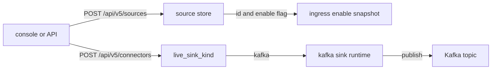

# Kafka consumer

The `kafka_consumer` name is the documented Kafka ingress source. This build has no Kafka pull loop, so create and update refuse the source name. The v5 connectors route still accepts the name and maps it to the `kafka` sink runtime. The v1 connectors route does not accept the name.

Use it only when a tool sends the documented consumer name. The broker refuses the source name and stores nothing. This build has no Kafka pull loop, so the broker does not read a topic.



## Before you start

- Note the Kafka bootstrap hosts and the topic name.
- For the connector route, run a Kafka cluster.
- For a full build, enable the feature: `--features kafka`. The default build answers 400 and names the feature.
- The v1 connectors route does not accept `kafka_consumer`. Use the v5 routes for this name.

## Settings

`POST /api/v5/sources` refuses the source name.

| Setting | Required | Meaning |
|---|---|---|
| `id` or `name` | yes | Source id. Its length is capped at 256 bytes. |
| `type` | yes | Source type. Use `kafka_consumer`. |
| `enable` | no | Enable flag. Default `true`. |
| `connector` | no | Documented connector reference. Default empty. |
| `parameters` | no | Object of source parameters. Default empty. |
| `resource_opts` | no | Object of resource options. Default empty. |

Create and update refuse the type because this build has no ingress runtime. Nothing is stored. The store holds at most 512 sources.

The v5 connectors route runs the `kafka` runtime. It reads `bootstrap_hosts` or `servers` (default `127.0.0.1:9092`). It fixes `topic_template` to `events-${topic}`, `partition_key_field` to none, `partitions` to 1, and `client_id` to `indramqtt-<name>`. It fixes `acks` to `1`, `batch_max_records` to 1, and `batch_max_bytes` to 65536. It registers the name and the alias `kafka:name`.

The `kafka` page documents the full sink settings.

Example:

```json
{
  "id": "kafka-consumer-1",
  "name": "kafka-consumer-1",
  "type": "kafka_consumer",
  "enable": true,
  "parameters": {
    "bootstrap_hosts": "127.0.0.1:9092",
    "topic": "events"
  },
  "resource_opts": {}
}
```

> [!NOTE]
> The docs run refuses the source name and creates the connector name. The default build refuses the connector route with 400 and names the `kafka` feature. A full build returns 201. The pull path does not exist in this build. See the record in [Verification failures](../_verification/failures.md).

## Check that it works

Register the source and create the connector name. The source answers 400. The connector route answers 201 or 400. Both answers print `ok`.

```toml test
[node]
id = "docs-connector-kafka-consumer"

[listeners.tcp]
bind = "0.0.0.0:1883"

[listeners.api]
bind = "0.0.0.0:18083"

[logging]
level = "warn"

[auth]
allow_anonymous = true
```

```sh test
python3 - <<'PY'
import json, os, urllib.request, urllib.error
port = os.environ.get("API_PORT", "18083")
key = os.environ["API_KEY"]

def call(method, path, body=None):
    data = None if body is None else json.dumps(body).encode()
    req = urllib.request.Request(
        f"http://127.0.0.1:{port}{path}", data=data, method=method,
        headers={"Authorization": f"Bearer {key}",
                 "Content-Type": "application/json"})
    try:
        with urllib.request.urlopen(req, timeout=5) as res:
            return res.status, json.load(res)
    except urllib.error.HTTPError as err:
        return err.code, json.load(err)

status, types = call("GET", "/api/v5/source_types")
assert status == 200, (status, types)
assert "kafka_consumer" not in types, types

s1, b1 = call("POST", "/api/v5/sources",
              {"id": "kafka-consumer-1",
               "type": "kafka_consumer",
               "parameters": {"bootstrap_hosts": "127.0.0.1:9092",
                              "topic": "events"}})
assert s1 == 400, (s1, b1)
assert "ingress runtime" in json.dumps(b1).lower(), b1

s2, b2 = call("POST", "/api/v1/connectors",
              {"id": "kafka-consumer-v1",
               "kind": "kafka_consumer",
               "config": {"bootstrap_hosts": "127.0.0.1:9092"}})
assert s2 == 400, (s2, b2)
assert "unknown connector kind" in json.dumps(b2).lower(), b2

s3, b3 = call("POST", "/api/v5/connectors",
              {"name": "kafka-consumer-2",
               "type": "kafka_consumer",
               "bootstrap_hosts": "127.0.0.1:9092"})
assert s3 in (201, 400), (s3, b3)
if s3 == 201:
    assert b3["type"] == "kafka_consumer", b3
else:
    assert "kafka" in json.dumps(b3).lower(), b3
print("ok")
PY
```

```output
ok
```

## Limits

- The source id must not be empty and must not exceed 256 bytes. A duplicate id is refused. A full store refuses the create at 512 entries.
- The source store validates only the type. It stores `parameters` and `resource_opts` as objects and rejects a non-object value.
- The source name lists in `GET /api/v5/source_types`. This build has no Kafka pull loop, so the source reads no topic.
- The v1 connectors route refuses `kafka_consumer`. It accepts only `kafka`.
- The v5 connectors route maps the name to the `kafka` runtime. It ignores the caller `topic_template`, `partition_key_field`, `partitions`, `acks`, and batch fields. It always uses one record per batch and a 65536 byte limit.
- The connector runs behind the rule engine bounded queue. A slow cluster never stalls publishers.
- The base `kafka` runtime is community. The consumer name needs the `kafka` feature build for the connector route.

## Next steps

- Read the sink settings in [Kafka](./kafka.md).
- Feed the sink from a rule in [Actions](../rules/actions.md).
- See every kind in [Connectors](./index.md).
