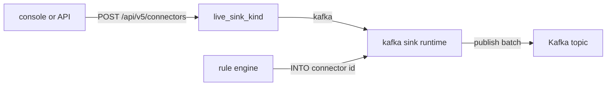

# Kafka producer connector

The `kafka_producer` name is the documented name for the Kafka sink. The v5 connectors route accepts the name and maps it to the `kafka` runtime. The v1 connectors route does not accept the name.

Use it when a tool sends the documented producer name. You get a stored connector row that publishes to a Kafka topic through the `kafka` sink.



## Before you start

- Note the Kafka broker list (`host:port` pairs) and the target topic.
- Run a Kafka cluster for the send path.
- For a full build, enable the feature: `--features kafka`. The default build answers 400 and names the feature.
- The v1 connectors route does not accept `kafka_producer`. Use the v5 route for this name.

## Settings

Create the connector with `POST /api/v5/connectors`.

| Setting | Required | Meaning |
|---|---|---|
| `id` or `name` | yes | Connector id. Its length is capped at 256 bytes. |
| `type` | yes | Connector type. Use `kafka_producer`. |
| `enable` | no | Enable flag. Default `true`. |
| `bootstrap_hosts` or `servers` | no | Kafka broker list. Default `127.0.0.1:9092`. An empty value is refused. |

The v5 route runs the `kafka` runtime. It fixes `topic_template` to `events-${topic}`, `partition_key_field` to none, and `partitions` to 1. It fixes `client_id` to `indramqtt-<name>`, `acks` to `1`, `batch_max_records` to 1, and `batch_max_bytes` to 65536. It registers the name and the alias `kafka:name`.

The `kafka` page documents the full sink settings. The stored row keeps the type `kafka_producer`.

Example:

```json
{
  "id": "kafka-producer-1",
  "name": "kafka-producer-1",
  "type": "kafka_producer",
  "enable": true,
  "bootstrap_hosts": "127.0.0.1:9092"
}
```

> [!NOTE]
> The docs run creates this connector name. The default build refuses the route with 400 and names the `kafka` feature. A full build returns 201. The send path needs a Kafka cluster. See the record in [Verification failures](../_verification/failures.md).

## Check that it works

The v1 route refuses the name. The v5 route answers 201 or 400. Both answers print `ok`.

```toml test
[node]
id = "docs-connector-kafka-producer"

[listeners.tcp]
bind = "0.0.0.0:1883"

[listeners.api]
bind = "0.0.0.0:18083"

[logging]
level = "warn"

[auth]
allow_anonymous = true
```

```sh test
python3 - <<'PY'
import json, os, urllib.request, urllib.error
port = os.environ.get("API_PORT", "18083")
key = os.environ["API_KEY"]

def call(method, path, body=None):
    data = None if body is None else json.dumps(body).encode()
    req = urllib.request.Request(
        f"http://127.0.0.1:{port}{path}", data=data, method=method,
        headers={"Authorization": f"Bearer {key}",
                 "Content-Type": "application/json"})
    try:
        with urllib.request.urlopen(req, timeout=5) as res:
            return res.status, json.load(res)
    except urllib.error.HTTPError as err:
        return err.code, json.load(err)

s1, b1 = call("POST", "/api/v1/connectors",
              {"id": "kafka-producer-v1",
               "kind": "kafka_producer",
               "config": {"bootstrap_hosts": "127.0.0.1:9092"}})
assert s1 == 400, (s1, b1)
assert "unknown connector kind" in json.dumps(b1).lower(), b1

s2, b2 = call("POST", "/api/v5/connectors",
              {"name": "kafka-producer-1",
               "type": "kafka_producer",
               "bootstrap_hosts": "127.0.0.1:9092"})
assert s2 in (201, 400), (s2, b2)
if s2 == 201:
    assert b2["type"] == "kafka_producer", b2
else:
    assert "kafka" in json.dumps(b2).lower(), b2
print("ok")
PY
```

```output
ok
```

## Limits

- The connector id must not be empty and must not exceed 256 bytes. A duplicate id is refused.
- The v1 connectors route refuses `kafka_producer`. It accepts only `kafka`.
- The v5 route maps the name to the `kafka` runtime. It ignores the caller `topic_template`, `partition_key_field`, `partitions`, `acks`, and batch fields. It always uses one record per batch and a 65536 byte limit.
- An empty `bootstrap_hosts` value is refused.
- The connector runs behind the rule engine bounded queue. A slow cluster never stalls publishers.
- The base `kafka` runtime is community. The producer name needs the `kafka` feature build for the connector route.

## Next steps

- Read the sink settings in [Kafka](./kafka.md).
- Feed the sink from a rule in [Actions](../rules/actions.md).
- See every kind in [Connectors](./index.md).
