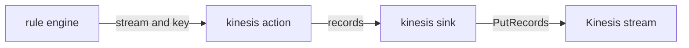

# Kinesis connector

The Kinesis connector writes rule results as records in one stream with `PutRecords`.

Use it for event streaming in AWS. The action names the stream and the partition key.



## Before you start

- Create a Kinesis stream.
- Create credentials with write access.
- For a full build, enable `--features kinesis`. The default build answers 400 and names the feature.

## Settings

| Connector setting | Required | Meaning |
|---|---|---|
| `endpoint` | yes | Kinesis endpoint URL. |
| `region` | no | AWS region. Default `us-east-1`. |
| `aws_access_key_id` | yes | Access key ID. |
| `aws_secret_access_key` | yes | Secret access key. |
| `session_token` | no | Session token for temporary credentials. |
| `timeout` | no | Request timeout in milliseconds. |

| Action setting | Required | Meaning |
|---|---|---|
| `stream_name` | yes | Target stream. |
| `partition_key` | yes | Partition key template. |

Example action:

```json
{
  "name": "kinesis-events",
  "type": "kinesis",
  "connector": "kinesis-local",
  "parameters": {
    "stream_name": "telemetry",
    "partition_key": "${client_id}"
  }
}
```

## Limits

- A missing stream or credential answers 400 and names the field.
- A failed batch counts one failed forward on the action.
- Live qualification runs at release. This build proves delivery with a loopback fake.

## Next steps

- Feed the connector from a rule in [Actions](../rules/actions.md).
- See every kind in [Connectors](./index.md).

## Check that it works

Create the connector. The broker answers 201 with the kind when the build holds the feature, else 400 names it. Both answers print `ok`.

```toml test
[node]
id = "docs-connector-kinesis"

[listeners.tcp]
bind = "0.0.0.0:1883"

[listeners.api]
bind = "0.0.0.0:18083"

[logging]
level = "warn"

[auth]
allow_anonymous = true
```

```sh test
python3 - <<'PY'
import json, os, urllib.request
port = os.environ.get("API_PORT", "18083")
key = os.environ["API_KEY"]
body = json.dumps({"name": "docs-kinesis-1", "type": "kinesis",
                   "endpoint": "http://127.0.0.1:4566", "region": "us-east-1",
                   "aws_access_key_id": "AKID",
                   "aws_secret_access_key": "secret"}).encode()
req = urllib.request.Request(
    f"http://127.0.0.1:{port}/api/v5/connectors", data=body, method="POST",
    headers={"Authorization": f"Bearer {key}", "Content-Type": "application/json"})
try:
    with urllib.request.urlopen(req, timeout=5) as res:
        status, created = res.status, json.load(res)
except urllib.error.HTTPError as err:
    status, created = err.code, json.load(err)
assert status in (201, 400), (status, created)
if status == 201:
    assert created["type"] == "kinesis", created
else:
    assert "kinesis" in created["message"], created
print("ok")
PY
```

```output
ok
```
