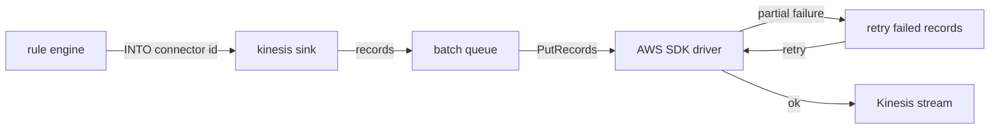

# Kinesis connector

The `kinesis` connector sends each rule result to an Amazon Kinesis stream. It batches records with `PutRecords` and signs each request with AWS Signature Version 4.

Use it when a stream processor must read broker data. You get batched records, a partition key, and retry of partial failures.



## Before you start

- Run an Amazon Kinesis stream, or a compatible endpoint. Note the stream name and the region.
- Keep an access key pair. Add a session token when the credentials are temporary.
- For a full build, enable the feature: `--features kinesis`. The default build answers 400 and names the feature.

## Settings

Set `kind` to `kinesis` on the v1 API. The v1 route also accepts `aws_kinesis`. It stores the runtime as `kinesis`.

| Setting | Required | Meaning |
|---|---|---|
| `stream_name` | yes | Target stream. An empty value is refused. It is capped at 128 characters. |
| `region` | yes | AWS region. An empty value is refused. |
| `endpoint` | no | Custom endpoint with `http://` or `https://`. Default `https://kinesis.{region}.amazonaws.com`. |
| `access_key_id` | yes | AWS access key id. An empty value is refused. |
| `secret_access_key` | yes | AWS secret access key. An empty value is refused. |
| `session_token` | no | STS session token for temporary credentials. Default none. |
| `partition_key_template` | no | Key template with `${topic}`, `${client_id}`, `${payload.<field>}`, `${timestamp}`, and `${seq}`. An empty template selects the MD5 hex of the topic. Default none. |
| `explicit_hash_key` | no | Explicit 128-bit hash key as an integer string. A non-number is refused. Default none. |
| `batch_size` | no | Records per `PutRecords` call. Default 500, the service cap. A value of 0 is refused. `null` means no item limit. |
| `batch_bytes` | no | Batch byte limit over base64 payloads. Default 4194304 (4 MiB). A value of 0 is refused. `null` means no byte limit. |
| `linger_ms` | no | Linger flush window in ms. Default 20. `null` means no time bound. |
| `max_retries` | no | Retries on throttles and partial failures. Default 5. `null` means no limit. A value of 0 means no retry. |
| `initial_backoff_ms` | no | First retry delay in ms. Default 100. |
| `max_backoff_ms` | no | Retry delay ceiling in ms. Default 3000. |
| `timeout_ms` | no | Request deadline in ms. Default 5000. A value below 1 becomes 1. |

The v5 route reads `stream_name` or `stream` (default `telemetry-stream`), `region` (default `us-east-1`), and `endpoint` or `url`. It also reads `access_key_id` (default `test`), `secret_access_key` (default `test`), and `timeout_ms`, `timeout`, or `request_timeout_ms`. It fixes `session_token` to none, `partition_key_template` to `${topic}`, and `explicit_hash_key` to none. It fixes `batch_size` to 1, `batch_bytes` to 4194304, and `linger_ms` to 10. It fixes `max_retries` to 3, `initial_backoff_ms` to 100, and `max_backoff_ms` to 2000. It registers the name and the alias `kinesis:name`.

Example:

```json
{
  "id": "kinesis-1",
  "kind": "kinesis",
  "config": {
    "stream_name": "telemetry-stream",
    "region": "us-east-1",
    "access_key_id": "AKID",
    "secret_access_key": "secret",
    "partition_key_template": "${topic}",
    "batch_size": 500,
    "batch_bytes": 4194304,
    "linger_ms": 20,
    "max_retries": 5,
    "initial_backoff_ms": 100,
    "max_backoff_ms": 3000,
    "timeout_ms": 5000
  }
}
```

> [!NOTE]
> The docs run creates this shape on the v1 and v5 routes. The default build refuses it with 400 and names the `kinesis` feature. A full build returns 201. The send path needs a Kinesis stream. See the record in [Verification failures](../_verification/failures.md).

## Check that it works

Create the connector on both routes. A build with the feature answers 201. The default build answers 400 and names the feature. An endpoint with a wrong scheme answers 400. All answers print `ok`.

```toml test
[node]
id = "docs-connector-kinesis"

[listeners.tcp]
bind = "0.0.0.0:1883"

[listeners.api]
bind = "0.0.0.0:18083"

[logging]
level = "warn"

[auth]
allow_anonymous = true
```

```sh test
python3 - <<'PY'
import json, os, urllib.request, urllib.error
port = os.environ.get("API_PORT", "18083")
key = os.environ["API_KEY"]

def call(method, path, body=None):
    data = None if body is None else json.dumps(body).encode()
    req = urllib.request.Request(
        f"http://127.0.0.1:{port}{path}", data=data, method=method,
        headers={"Authorization": f"Bearer {key}",
                 "Content-Type": "application/json"})
    try:
        with urllib.request.urlopen(req, timeout=5) as res:
            return res.status, json.load(res)
    except urllib.error.HTTPError as err:
        return err.code, json.load(err)

config = {"stream_name": "telemetry-stream", "region": "us-east-1",
          "access_key_id": "AKID", "secret_access_key": "secret",
          "partition_key_template": "${topic}", "batch_size": 500,
          "batch_bytes": 4194304, "linger_ms": 20, "max_retries": 5,
          "initial_backoff_ms": 100, "max_backoff_ms": 3000,
          "timeout_ms": 5000}
s1, b1 = call("POST", "/api/v1/connectors",
              {"id": "kinesis-1", "kind": "kinesis", "config": config})
assert s1 in (201, 400), (s1, b1)
if s1 == 201:
    assert b1["kind"] == "kinesis", b1
else:
    assert "kinesis" in json.dumps(b1).lower(), b1

s2, b2 = call("POST", "/api/v5/connectors",
              {"name": "kinesis-2", "type": "kinesis",
               "stream_name": "telemetry-stream", "region": "us-east-1",
               "access_key_id": "AKID", "secret_access_key": "secret",
               "timeout_ms": 5000})
assert s2 in (201, 400), (s2, b2)
if s2 == 201:
    assert b2["type"] == "kinesis", b2
else:
    assert "kinesis" in json.dumps(b2).lower(), b2

s3, b3 = call("POST", "/api/v1/connectors",
              {"id": "kinesis-bad-endpoint", "kind": "kinesis",
               "config": {**config, "endpoint": "ftp://example.com"}})
assert s3 == 400, (s3, b3)
assert "kinesis" in json.dumps(b3).lower(), b3
print("ok")
PY
```

```output
ok
```

## Limits

- An empty `stream_name`, `region`, `access_key_id`, or `secret_access_key` is refused with 400. A stream name longer than 128 characters is refused.
- An endpoint without `http://` or `https://` is refused. An explicit hash key that is not a 128-bit integer string is refused.
- On the v1 route, a template variable that is unknown or unclosed is refused at creation. Validation renders each template with a dummy payload.
- On the v1 route, a partition key template that renders empty falls back to the MD5 hex of the topic.
- Partial failures retry only the records that carry an error code. Throttles and transport errors retry the whole batch. A terminal fault fails the batch.
- The production path uses `SdkKinesisTransport` on the maintained AWS SDK driver. The hand-written HTTP transport serves offline unit tests only.
- The v5 route fixes one record per batch, a 4 MiB byte limit, and a `${topic}` partition key. It fixes the retry values and sets no session token or explicit hash key.
- The connector runs behind the rule engine bounded queue. A slow stream never stalls publishers.
- The tier is enterprise. The kind needs the `kinesis` feature build.

## Next steps

- Feed the connector from a rule in [Actions](../rules/actions.md).
- See every kind in [Connectors](./index.md).
