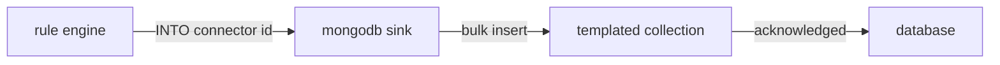

# MongoDB connector

The MongoDB connector writes rule results as documents. The connector holds the connection and database. The action holds the collection and document template. It uses the maintained MongoDB driver with acknowledged writes.

Use it when documents must hold telemetry with changing shape. You get one insert per send.



## Before you start

- Run MongoDB. Note the connection string.
- Pick the database and the collection template.
- For a full build, enable the feature: `--features mongodb`. The default build answers 400 and names the feature.

## Settings

Set the connector type to `mongodb`. The aliases `mongo` and `documentdb`
select the same runtime.

| Setting | Required | Meaning |
|---|---|---|
| `server` | yes | Host and port, or a full `mongodb://` URI. |
| `servers` | for `rs` and `sharded` | Comma-separated node list. |
| `database` | yes | Target database name. |
| `mongo_type` | no | `single`, `rs` or `sharded`. Default `single`. |
| `username` | no | Database user. |
| `password` | no | Database password. |
| `auth_source` | no | Authentication database. |

The action type is `mongodb`. It owns the target and the document.

| Action setting | Required | Meaning |
|---|---|---|
| `connector` | yes | Connector name. |
| `collection` | no | Collection template. Default `mqtt`. |
| `payload_template` | no | Document template. The result must be a JSON object. |

A document template that does not render a JSON object counts one failed
forward. The broker does not store the raw string.

Example connector:

```json
{
  "name": "mongo-docs",
  "type": "mongodb",
  "server": "127.0.0.1:27017",
  "database": "telemetry"
}
```

Example action:

```json
{
  "name": "mongo-docs-act",
  "type": "mongodb",
  "connector": "mongo-docs",
  "parameters": {
    "collection": "readings",
    "payload_template": "{\"v\":${payload.v}}"
  }
}
```

> [!NOTE]
> The docs run creates this shape. Creation validates only; it opens no socket. The send path needs a MongoDB server. See the failure record in [Verification failures](../_verification/failures.md).

## Check that it works

Create the connector. The broker answers 201 with the kind when the build holds MongoDB, else 400 naming the feature. Both answers print `ok`.

```toml test
[node]
id = "docs-connector-mongodb"

[listeners.tcp]
bind = "0.0.0.0:1883"

[listeners.api]
bind = "0.0.0.0:18083"

[logging]
level = "warn"

[auth]
allow_anonymous = true
```

```sh test
python3 - <<'PY'
import json, os, urllib.request
port = os.environ.get("API_PORT", "18083")
key = os.environ["API_KEY"]
def post(path, body):
    req = urllib.request.Request(
        f"http://127.0.0.1:{port}{path}", data=json.dumps(body).encode(), method="POST",
        headers={"Authorization": f"Bearer {key}", "Content-Type": "application/json"})
    try:
        with urllib.request.urlopen(req, timeout=5) as res:
            return res.status, json.load(res)
    except urllib.error.HTTPError as err:
        return err.code, json.load(err)
status, created = post("/api/v5/connectors", {"name": "mongo-docs", "type": "mongodb",
                                              "server": "127.0.0.1:27017",
                                              "database": "telemetry"})
assert status in (201, 400), (status, created)
if status == 201:
    assert created.get("type") == "mongodb", created
else:
    assert "feature" in str(created).lower(), created
status, body = post("/api/v5/connectors", {"name": "mongo-docs-bad", "type": "mongodb",
                                           "server": "127.0.0.1:27017"})
assert status == 400 and "database" in body["message"], body
print("ok")
PY
```

```output
ok
```

## Limits

- A missing `server` or `database` is refused with 400 naming the field.
- The default collection is `mqtt`.
- Writes use acknowledged write concern. A lost acknowledgement retries the batch.
- The bounded queue sheds past its bound. A slow cluster never stalls publishers.

## Next steps

- Feed the connector from a rule in [Actions](../rules/actions.md).
- See every kind in [Connectors](./index.md).
