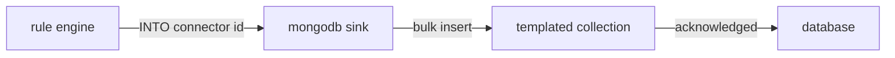

# MongoDB connector

The MongoDB connector bulk-inserts rule results as documents. It routes collections with a template. It uses the maintained MongoDB driver with acknowledged writes.

Use it when documents must hold telemetry with changing shape. You get one bulk insert per batch.



## Before you start

- Run MongoDB. Note the connection string.
- Pick the database and the collection template.
- For a full build, enable the feature: `--features mongodb`. The default build answers 400 and names the feature.

## Settings

Set `kind` to `mongodb`.

| Setting | Required | Meaning |
|---|---|---|
| `connection_string` | yes | Connection URI, `mongodb://` or `mongodb+srv://`. |
| `database` | yes | Target database name. |
| `collection_template` | yes | Collection name with `${topic}` substitution. |
| `operation` | no | Write operation; default inserts one document. |
| `batch_size` | no | Documents per bulk batch; default 500. |
| `batch_bytes` | no | Batch byte limit over BSON; default 4 MiB. |
| `linger_ms` | no | Linger before a partial batch flushes; default 20. |
| `max_retries` | no | Retries on transient faults; default 4. |

Example:

```json
{
  "id": "mongo-1",
  "kind": "mongodb",
  "config": {
    "connection_string": "mongodb://u:p@127.0.0.1:27017",
    "database": "telemetry",
    "collection_template": "readings",
    "operation": {"type": "insert_one"},
    "batch_size": 50,
    "batch_bytes": 65536,
    "linger_ms": 20,
    "max_retries": 2,
    "initial_backoff_ms": 10,
    "max_backoff_ms": 100
  }
}
```

> [!NOTE]
> The docs run creates this shape. Creation validates only; it opens no socket. The send path needs a MongoDB server. See the failure record in [Verification failures](../_verification/failures.md).

## Check that it works

Create the connector. The broker answers 201 with the kind when the build holds MongoDB, else 400 naming the feature. Both answers print `ok`.

```toml test
[node]
id = "docs-connector-mongodb"

[listeners.tcp]
bind = "0.0.0.0:1883"

[listeners.api]
bind = "0.0.0.0:18083"

[logging]
level = "warn"

[auth]
allow_anonymous = true
```

```sh test
python3 - <<'PY'
import json, os, urllib.request
port = os.environ.get("API_PORT", "18083")
key = os.environ["API_KEY"]
body = json.dumps({"id": "mongo-1", "kind": "mongodb",
                   "config": {"connection_string": "mongodb://u:p@127.0.0.1:27017",
                              "database": "telemetry",
                              "collection_template": "readings",
                              "operation": {"type": "insert_one"},
                              "batch_size": 50, "batch_bytes": 65536,
                              "linger_ms": 20, "max_retries": 2,
                              "initial_backoff_ms": 10,
                              "max_backoff_ms": 100}}).encode()
req = urllib.request.Request(
    f"http://127.0.0.1:{port}/api/v1/connectors", data=body, method="POST",
    headers={"Authorization": f"Bearer {key}", "Content-Type": "application/json"})
try:
    with urllib.request.urlopen(req, timeout=5) as res:
        status, created = res.status, json.load(res)
except urllib.error.HTTPError as err:
    status, created = err.code, json.load(err)
assert status in (201, 400), (status, created)
if status == 201:
    assert created["kind"] == "mongodb", created
else:
    assert "mongodb" in created["error"], created
print("ok")
PY
```

```output
ok
```

## Limits

- An empty `connection_string`, `database`, or `collection_template` is refused with 400.
- Writes use acknowledged write concern. A lost acknowledgement retries the batch.
- The bounded queue sheds past its bound. A slow cluster never stalls publishers.

## Next steps

- Feed the connector from a rule in [Actions](../rules/actions.md).
- See every kind in [Connectors](./index.md).
