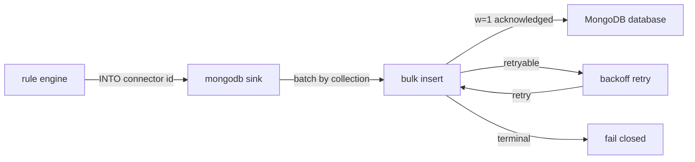

# MongoDB connector

The MongoDB connector writes each rule result as one document. It groups rows by collection and bulk-inserts them. It uses the maintained driver with acknowledged writes.

Use it when documents must hold telemetry with changing shape. You get one bulk insert per batch with your own collection mapping.



## Before you start

- Run MongoDB. Note the connection string.
- Pick the database and the collection template.
- For a full build, enable the feature: `--features mongodb`. The default build answers 400 and names the feature.

## Settings

Set `kind` to `mongodb`. The broker also accepts the aliases `mongo` and `documentdb`.

| Setting | Required | Meaning |
|---|---|---|
| `connection_string` | yes | URI, `mongodb://` or `mongodb+srv://`. A missing host or port text is refused. A missing port reads as 27017. Auth source defaults to `admin`. |
| `database` | yes | Target database name. An empty name, `/`, a space, or NUL is refused. |
| `collection_template` | yes | Collection name with `${topic}`, `${client_id}`, `${qos}`, `${timestamp}`. An unknown or unclosed variable is refused. An empty result, NUL, or `system.` prefix is refused. |
| `operation` | no | Write operation. Default inserts one document. `update_one` and `replace_one` need `filter_template` and `upsert`. The filter must render JSON. |
| `batch_size` | no | Documents per bulk batch. Default 500. A value of 0 is refused. `null` means no count bound. |
| `batch_bytes` | no | Batch byte limit over BSON. Default 4194304. A value of 0 is refused. `null` means no byte bound. |
| `linger_ms` | no | Linger before a partial batch flushes. Default 20. `null` means no time bound. |
| `max_retries` | no | Retries on transient faults. Default 4. `null` means no bound. A value of 0 means no retry. |
| `initial_backoff_ms` | no | First retry delay in ms. Default 100. A value below 1 reads as 1. |
| `max_backoff_ms` | no | Retry delay ceiling in ms. Default 3000. A value below 1 reads as 1. |
| `timeout_ms` | no | Socket and request deadline in ms. Default 5000. A value below 1 reads as 1. Reads use twice the value. Writes use four times the value. |

Example:

```json
{
  "id": "mongo-1",
  "kind": "mongodb",
  "config": {
    "connection_string": "mongodb://u:p@127.0.0.1:27017",
    "database": "telemetry",
    "collection_template": "readings",
    "operation": {"type": "insert_one"},
    "batch_size": 50,
    "batch_bytes": 65536,
    "linger_ms": 20,
    "max_retries": 2,
    "initial_backoff_ms": 10,
    "max_backoff_ms": 100,
    "timeout_ms": 5000
  }
}
```

> [!NOTE]
> The docs run creates this shape. Creation validates only; it opens no socket. The send path needs a MongoDB server. See the failure record in [Verification failures](../_verification/failures.md).

## Check that it works

Create the connector. The broker answers 201 with the kind when the build holds MongoDB, else 400 naming the feature. Both answers print `ok`.

```toml test
[node]
id = "docs-connector-mongodb"

[listeners.tcp]
bind = "0.0.0.0:1883"

[listeners.api]
bind = "0.0.0.0:18083"

[logging]
level = "warn"

[auth]
allow_anonymous = true
```

```sh test
python3 - <<'PY'
import json, os, urllib.request, urllib.error
port = os.environ.get("API_PORT", "18083")
key = os.environ["API_KEY"]
body = json.dumps({"id": "mongo-1", "kind": "mongodb",
                   "config": {"connection_string": "mongodb://u:p@127.0.0.1:27017",
                              "database": "telemetry",
                              "collection_template": "readings",
                              "operation": {"type": "insert_one"},
                              "batch_size": 50, "batch_bytes": 65536,
                              "linger_ms": 20, "max_retries": 2,
                              "initial_backoff_ms": 10,
                              "max_backoff_ms": 100,
                              "timeout_ms": 5000}}).encode()
req = urllib.request.Request(
    f"http://127.0.0.1:{port}/api/v1/connectors", data=body, method="POST",
    headers={"Authorization": f"Bearer {key}", "Content-Type": "application/json"})
try:
    with urllib.request.urlopen(req, timeout=5) as res:
        status, created = res.status, json.load(res)
except urllib.error.HTTPError as err:
    status, created = err.code, json.load(err)
assert status in (201, 400), (status, created)
if status == 201:
    assert created["kind"] == "mongodb", created
else:
    assert "mongodb" in created["error"], created
print("ok")
PY
```

```output
ok
```

## Limits

- An empty `connection_string`, `database`, or `collection_template` is refused with 400.
- A payload that is not UTF-8 or not JSON is refused. An object merges its fields. A scalar rides under `value`.
- Each document carries `_mqtt` with `topic`, `client_id`, `qos`, and `timestamp`. An insert adds an `_id` when the payload holds none. An explicit `_id` stays verbatim.
- Codes 11000, 11001, 12582, and 121 are terminal. They fail fast and keep the row.
- Other faults retry with backoff. The delay doubles from the initial value to the ceiling, plus jitter.
- A failed flush restores rows and engages backoff. Flushes fail fast during backoff.
- Writes use acknowledged write concern. A short count fails the batch as a connection fault.
- The bounded queue sheds past its bound. A slow cluster never stalls publishers.
- The tier is enterprise. The kind needs the `mongodb` feature build.

## Next steps

- Feed the connector from a rule in [Actions](../rules/actions.md).
- See every kind in [Connectors](./index.md).
