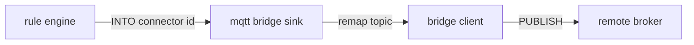

# MQTT bridge connector

The MQTT bridge connector forwards rule results to a remote broker. The action names the remote topic, the QoS, and the body. The remap keeps the bridged topic out of the local rule filter, so a bridged message is not bridged back.

Use it when two sites must share selected messages. You get a second publisher on the remote broker.



## Before you start

- Run the remote broker. Note its address.
- Pick a topic namespace the local rules do not select, so the bridge cannot loop.
- This kind ships in the default build. Plain TCP only: an `mqtts://` address fails closed with a clear error.

## Settings

Set `type` to `mqtt_bridge` (`mqtt` is accepted too).

Connector settings:

| Setting | Required | Meaning |
|---|---|---|
| `server` | yes | Remote `host:port`. Alias `broker_address`. |
| `clientid_prefix` | no | Egress client id prefix. |
| `username` | no | Remote username. |
| `password` | no | Remote password. |
| `proto_ver` | no | `v3`, `v4` (default), or `v5`. |

Action settings:

| Setting | Required | Meaning |
|---|---|---|
| `topic` | yes | Remote topic template. |
| `payload` | no | Body template, `${topic}` and `${payload}` supported. Absent forwards raw bytes. |
| `qos` | no | 0, 1 (default), or 2. |
| `retain` | no | Default false. |

Example:

```json
{
  "type": "mqtt_bridge",
  "name": "bridge-out",
  "server": "127.0.0.1:1883"
}
```

```json
{
  "type": "mqtt_bridge",
  "name": "bridge-act",
  "connector": "bridge-out",
  "parameters": {
    "topic": "remote/${topic}",
    "qos": 1,
    "retain": false
  }
}
```

> [!NOTE]
> The docs run creates this shape. Creation validates only; it opens no socket.

## Check that it works

Create the connector. The broker answers 201. A body without a server answers 400 naming the field. Both answers print `ok`.

```toml test
[node]
id = "docs-connector-bridge"

[listeners.tcp]
bind = "0.0.0.0:1883"

[listeners.api]
bind = "0.0.0.0:18083"

[logging]
level = "warn"

[auth]
allow_anonymous = true
```

```sh test
python3 - <<'PY'
import json, os, urllib.request
port = os.environ.get("API_PORT", "18083")
key = os.environ["API_KEY"]
def post(body):
    req = urllib.request.Request(
        f"http://127.0.0.1:{port}/api/v5/connectors", data=json.dumps(body).encode(), method="POST",
        headers={"Authorization": f"Bearer {key}", "Content-Type": "application/json"})
    try:
        with urllib.request.urlopen(req, timeout=5) as res:
            return res.status, json.load(res)
    except urllib.error.HTTPError as err:
        return err.code, json.load(err)
status, created = post({"name": "bridge-run-ok", "type": "mqtt_bridge",
                        "server": "127.0.0.1:1883"})
assert status == 201, (status, created)
assert created.get("type") == "mqtt_bridge", created
status, body = post({"name": "bridge-run-bad", "type": "mqtt_bridge"})
assert status == 400 and "server" in body["message"], body
print("ok")
PY
```

```output
ok
```

## Limits

- A bridged message is not bridged back: the remote topic must stay outside the local rule filter.
- A `qos` outside 0-2 is refused with 400.
- `mqtts://` addresses fail closed until a TLS backend lands. Use plain TCP today.

## Next steps

- Feed the action from a rule in [Actions](../rules/actions.md).
- See every kind in [Connectors](./index.md).
