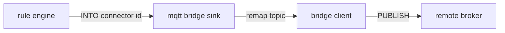
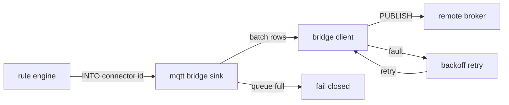

# MQTT bridge connector

The MQTT bridge connector forwards rule results to a remote broker. The action names the remote topic, the QoS, and the body. The remap keeps the bridged topic out of the local rule filter, so a bridged message is not bridged back.

Use it when two sites must share selected messages. You get a second publisher on the remote broker.



## Before you start

- Run the remote broker. Note its address.
- Pick a topic namespace the local rules do not select, so the bridge cannot loop.
- This kind ships in the default build. Plain TCP only: an `mqtts://` address fails closed with a clear error.

## Settings

Set `type` to `mqtt_bridge` (`mqtt` is accepted too).

Connector settings:

| Setting | Required | Meaning |
|---|---|---|
| `server` | yes | Remote `host:port`. Alias `broker_address`. |
| `clientid_prefix` | no | Egress client id. Default is the connector id. The field `client_id` is refused with 400. |
| `username` | no | Remote username. |
| `password` | no | Remote password. |
| `proto_ver` | no | `v3`, `v4` (default), or `v5`. `v5` uses MQTT 5.0 framing. |
| `keepalive` | no | Keep-alive seconds or a duration such as `60s`. Default 60. |
| `clean_start` | no | Default true. |

Action settings:

| Setting | Required | Meaning |
|---|---|---|
| `topic` | yes | Remote topic template. |
| `payload` | no | Body template, `${topic}` and `${payload}` supported. Absent forwards raw bytes. |
| `qos` | no | 0, 1 (default), or 2. |
| `retain` | no | Default false. |

Example:

```json
{
  "type": "mqtt_bridge",
  "name": "bridge-out",
  "server": "127.0.0.1:1883"
}
```

```json
{
  "type": "mqtt_bridge",
  "name": "bridge-act",
  "connector": "bridge-out",
  "parameters": {
    "topic": "remote/${topic}",
    "qos": 1,
    "retain": false
  }
}
```

> [!NOTE]
> The docs run creates this shape. Creation validates only; it opens no socket.

## Check that it works

Create the connector. The broker answers 201. A body without a server answers 400 naming the field. Both answers print `ok`.

```toml test
[node]
id = "docs-connector-bridge"

[listeners.tcp]
bind = "0.0.0.0:1883"

[listeners.api]
bind = "0.0.0.0:18083"

[logging]
level = "warn"

[auth]
allow_anonymous = true
```

```sh test
python3 - <<'PY'
import json, os, urllib.request
port = os.environ.get("API_PORT", "18083")
key = os.environ["API_KEY"]
def post(body):
    req = urllib.request.Request(
        f"http://127.0.0.1:{port}/api/v5/connectors", data=json.dumps(body).encode(), method="POST",
        headers={"Authorization": f"Bearer {key}", "Content-Type": "application/json"})
    try:
        with urllib.request.urlopen(req, timeout=5) as res:
            return res.status, json.load(res)
    except urllib.error.HTTPError as err:
        return err.code, json.load(err)
status, created = post({"name": "bridge-run-ok", "type": "mqtt_bridge",
                        "server": "127.0.0.1:1883"})
assert status == 201, (status, created)
assert created.get("type") == "mqtt_bridge", created
status, body = post({"name": "bridge-run-bad", "type": "mqtt_bridge"})
assert status == 400 and "server" in body["message"], body
print("ok")
PY
```

```output
ok
```

## Limits

- A bridged message is not bridged back: the remote topic must stay outside the local rule filter.
- A `qos` outside 0-2 is refused with 400.
- `mqtts://` addresses fail closed until a TLS backend lands. Use plain TCP today.

## Other names

This connector is also known as `mqtt`, `bridge`, and `mqtt_bridge`. Old links to `/connectors/mqtt/` redirect here.

The v5 route accepts connector type `mqtt`. The v1 route accepts `mqtt_bridge`. Both routes map to this bridge runtime.

## Next steps

- Feed the action from a rule in [Actions](../rules/actions.md).
- See every kind in [Connectors](./index.md).

## Reference form (v1 API)

The reference form uses the v1 connector API. The v5 form above uses connector and action documents. This section keeps the reference page.

The MQTT bridge connector forwards each rule result to a remote broker over plain TCP. It remaps the ingress topic with a prefix or a template. It keeps ingress QoS unless `qos_override` forces a value.

Use it when two sites must share selected messages. You get a second publisher on the remote broker with your own client id.



### Before you start

- Run the remote broker. Note its address.
- Pick a client id with `${timestamp}` or `${seq}` when several bridges share one broker.
- This kind ships in the default build with no feature flag. Plain TCP only: an `mqtts://` address fails closed with a clear error.

### Settings

Set `kind` to `mqtt_bridge`.

| Setting | Required | Meaning |
|---|---|---|
| `broker_address` | yes | Remote address: `mqtt://host:1883`, `mqtts://host:8883`, `host:port`, or bare `host`. A bare host reads as port 1883, or 8883 for `mqtts://`. An empty value, a wrong scheme, a bad port, port 0, an empty host, or a `/` in the address is refused. |
| `client_id` | yes | Bridge client id with `${timestamp}` and `${seq}` substitution. An empty or blank value is refused. An unknown, unclosed, or empty variable is refused. A value that resolves empty is refused. |
| `clean_start` | no | Clean start on the remote session. Default true. |
| `username` | no | Remote username. Default is none. |
| `password` | no | Remote password. Default is none. |
| `keep_alive_secs` | no | Keep-alive in seconds. Default 60. |
| `topic_prefix` | no | Prefix prepended to remapped topics. A trailing `/` is trimmed. An empty result is ignored. Default is none. |
| `topic_template` | no | Remap template with `${topic}`, `${qos}`, and `${timestamp}`. Default `${topic}`. An unknown, unclosed, or empty variable is refused. A result with `+` or `#`, or an empty result, is refused. |
| `qos_override` | no | Forced outbound QoS. Default preserves ingress. Must be 0, 1, or 2. A value above 2 is refused. |
| `retain_override` | no | Forced retain flag. Default false. |
| `max_inflight` | no | Max buffered rows before backpressure errors. Default 10000. `null` means no count bound. The default bounds one slow remote broker. |
| `max_batch_size` | no | Flush trigger row count. Default 100. Must exceed 0. `null` means no count bound. The default keeps the rule worker small. |
| `linger_ms` | no | Linger flush window in ms. Default 10. `null` means no time bound. The default keeps delay low. |
| `protocol` | no | Wire version: `v311` or `v50`. Default `v311`. Version `v50` adds a zero-length property field to each PUBLISH frame. |

Example:

```json
{
  "id": "bridge-1",
  "kind": "mqtt_bridge",
  "config": {
    "broker_address": "mqtt://127.0.0.1:1883",
    "client_id": "indra-bridge-test",
    "clean_start": true,
    "keep_alive_secs": 60,
    "max_inflight": 1000,
    "max_batch_size": 50,
    "linger_ms": 10,
    "protocol": "v311"
  }
}
```

> [!NOTE]
> The docs run creates this shape. Creation validates only; it opens no socket and sends no message. The send path needs a remote broker. See the failure record in [Verification failures](../_verification/failures.md).

### Check that it works

Create the connector. The broker answers 201 with the kind.

```toml test
# Reference form run.
[node]
id = "docs-connector-bridge"

[listeners.tcp]
bind = "0.0.0.0:1883"

[listeners.api]
bind = "0.0.0.0:18083"

[logging]
level = "warn"

[auth]
allow_anonymous = true
```

```sh test
python3 - <<'PY'
import json, os, urllib.request
port = os.environ.get("API_PORT", "18083")
key = os.environ["API_KEY"]
body = json.dumps({"id": "bridge-1", "kind": "mqtt_bridge",
                   "config": {"broker_address": "mqtt://127.0.0.1:1883",
                              "client_id": "indra-bridge-test",
                              "clean_start": True, "keep_alive_secs": 60,
                              "max_inflight": 1000, "max_batch_size": 50,
                              "linger_ms": 10, "protocol": "v311"}}).encode()
req = urllib.request.Request(
    f"http://127.0.0.1:{port}/api/v1/connectors", data=body, method="POST",
    headers={"Authorization": f"Bearer {key}", "Content-Type": "application/json"})
with urllib.request.urlopen(req, timeout=5) as res:
    assert res.status == 201
    print(json.load(res)["kind"])
PY
```

```output
mqtt_bridge
```

### Limits

- An empty `broker_address` or `client_id` is refused with 400.
- A wrong scheme, a bad port, port 0, an empty host, or a `/` in the address is refused with 400.
- An unknown, unclosed, or empty template variable is refused with 400.
- A remapped topic with `+` or `#`, or an empty remapped topic, is refused.
- A `qos_override` above 2 is refused with 400. A `max_batch_size` of 0 is refused with 400.
- `mqtts://` addresses fail closed with a clear error. Use plain TCP today or terminate TLS in a sidecar proxy.
- QoS 1 and QoS 2 use packet ids 1 through 65535. The ids cycle and never read as 0. QoS 0 uses no packet id.
- The driver request channel holds at most 10000 entries. The wire inflight window holds at most 65535. Both clamp to their ceiling when the sink runs unbounded.
- A row past `max_inflight` fails with an inflight-limit error. A slow remote broker never stalls publishers.
- A failed flush restores rows and engages backoff. Flushes fail fast during backoff.
- The connector runs behind the rule engine bounded queue. A slow remote broker sheds load; it never stalls publishers.
- The kind ships in the default build with no feature flag.

### Next steps

- Feed the connector from a rule in [Actions](../rules/actions.md).
- See every kind in [Connectors](./index.md).
