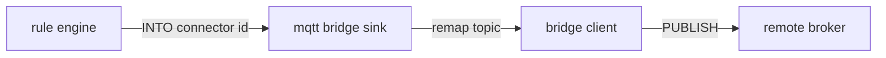

# MQTT bridge connector

The MQTT bridge connector forwards rule results to a remote broker over plain TCP. It remaps topics with a prefix or a template. It preserves ingress QoS unless `qos_override` forces a value.

Use it when two sites must share selected messages. You get a second publisher on the remote broker with your own client id.



## Before you start

- Run the remote broker. Note its address.
- Pick a client id with `${timestamp}` or `${seq}` when several bridges share one broker.
- This kind ships in the default build. Plain TCP only: an `mqtts://` address fails closed with a clear error.

## Settings

Set `kind` to `mqtt_bridge`.

| Setting | Required | Meaning |
|---|---|---|
| `broker_address` | yes | Remote `mqtt://host:1883` or `host:port`. |
| `client_id` | yes | Bridge client id with `${timestamp}` and `${seq}` substitution. |
| `clean_start` | no | Clean start; default true. |
| `username` | no | Remote username. |
| `password` | no | Remote password. |
| `keep_alive_secs` | no | Keep-alive in seconds; default 60. |
| `topic_prefix` | no | Prefix prepended to remapped topics. |
| `topic_template` | no | Remap template with `${topic}`; default identity. |
| `qos_override` | no | Force outbound QoS; default preserves ingress. Must be 0, 1, or 2. |
| `retain_override` | no | Force retain; default false. |
| `max_inflight` | no | Max buffered rows; default 10000. |
| `max_batch_size` | no | Flush trigger row count; default 100. |
| `linger_ms` | no | Linger flush window in ms; default 10. |
| `protocol` | no | Wire version; default 3.1.1. |

Example:

```json
{
  "id": "bridge-1",
  "kind": "mqtt_bridge",
  "config": {
    "broker_address": "mqtt://127.0.0.1:1883",
    "client_id": "indra-bridge-test",
    "clean_start": true,
    "keep_alive_secs": 60,
    "max_inflight": 1000,
    "max_batch_size": 50,
    "linger_ms": 10,
    "protocol": "v311"
  }
}
```

> [!NOTE]
> The docs run creates this shape. Creation validates only; it opens no socket. The send path needs a remote broker. See the failure record in [Verification failures](../_verification/failures.md).

## Check that it works

Create the connector. The broker answers 201 with the kind.

```toml test
[node]
id = "docs-connector-bridge"

[listeners.tcp]
bind = "0.0.0.0:1883"

[listeners.api]
bind = "0.0.0.0:18083"

[logging]
level = "warn"

[auth]
allow_anonymous = true
```

```sh test
python3 - <<'PY'
import json, os, urllib.request
port = os.environ.get("API_PORT", "18083")
key = os.environ["API_KEY"]
body = json.dumps({"id": "bridge-1", "kind": "mqtt_bridge",
                   "config": {"broker_address": "mqtt://127.0.0.1:1883",
                              "client_id": "indra-bridge-test",
                              "clean_start": True, "keep_alive_secs": 60,
                              "max_inflight": 1000, "max_batch_size": 50,
                              "linger_ms": 10, "protocol": "v311"}}).encode()
req = urllib.request.Request(
    f"http://127.0.0.1:{port}/api/v1/connectors", data=body, method="POST",
    headers={"Authorization": f"Bearer {key}", "Content-Type": "application/json"})
with urllib.request.urlopen(req, timeout=5) as res:
    assert res.status == 201
    print(json.load(res)["kind"])
PY
```

```output
mqtt_bridge
```

## Limits

- An empty `client_id` is refused with 400.
- A `qos_override` above 2 is refused with 400.
- `mqtts://` addresses fail closed until a TLS backend lands. Use plain TCP today.
- The bridge keeps the tenant of each message. It never delivers across tenants.

## Next steps

- Feed the connector from a rule in [Actions](../rules/actions.md).
- See every kind in [Connectors](./index.md).
