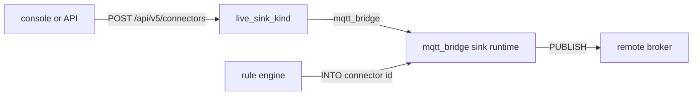

# MQTT connector

The `mqtt` name is the documented name for the MQTT bridge sink. The v5 connectors route accepts the name and maps it to the `mqtt_bridge` runtime. The v1 connectors route does not accept the name.

Use it when a tool sends the documented `mqtt` name. You get a stored connector row that publishes to a remote MQTT broker through the bridge sink.



## Before you start

- Run the remote MQTT broker. Note its address and port.
- Pick a client id for the bridge.
- The bridge ships in the default build with no feature flag. It uses plain TCP only.
- The v1 connectors route does not accept `mqtt`. Use the v5 route for this name.

## Settings

Create the connector with `POST /api/v5/connectors`.

| Setting | Required | Meaning |
|---|---|---|
| `id` or `name` | yes | Connector id. Its length is capped at 256 bytes. |
| `type` | yes | Connector type. Use `mqtt`. |
| `enable` | no | Enable flag. Default `true`. |
| `server` or `broker_address` | no | Remote address. Default `127.0.0.1:1883`. A wrong scheme, a bad port, port 0, an empty host, or a `/` is refused. |
| `clientid_prefix` | no | Bridge client id. Default is the connector name. The field `client_id` is not a reference field and is refused with 400. |
| `username` | no | Remote username. Default is none. |
| `password` | no | Remote password. Default is none. |

The v5 route runs the `mqtt_bridge` runtime. It fixes the remaining bridge fields.

| Field | Fixed value |
|---|---|
| `clean_start` | `true` |
| `keep_alive_secs` | `60` |
| `topic_prefix` | none |
| `topic_template` | none, so the ingress topic is kept |
| `qos_override` | none, so the ingress QoS is kept |
| `retain_override` | none, so retain is false |
| `max_inflight` | `1000` |
| `max_batch_size` | `1` |
| `linger_ms` | `10` |
| `protocol` | `v311` |

The route registers the name and the aliases `bridge:name` and `mqtt_bridge:name`. The `mqtt-bridge` page documents the full sink settings. The stored row keeps the type `mqtt`.

Example:

```json
{
  "id": "mqtt-1",
  "name": "mqtt-1",
  "type": "mqtt",
  "enable": true,
  "server": "127.0.0.1:1883",
  "clientid_prefix": "docs-bridge"
}
```

> [!NOTE]
> The docs run creates this connector name. The bridge runtime ships in the default build, so the v5 route returns 201. The send path needs a remote broker. See the record in [Verification failures](../_verification/failures.md).

## Check that it works

The v1 route refuses the name. The v5 route creates the connector. An empty client id is refused. All checks print `ok`.

```toml test
[node]
id = "docs-connector-mqtt"

[listeners.tcp]
bind = "0.0.0.0:1883"

[listeners.api]
bind = "0.0.0.0:18083"

[logging]
level = "warn"

[auth]
allow_anonymous = true
```

```sh test
python3 - <<'PY'
import json, os, urllib.request, urllib.error
port = os.environ.get("API_PORT", "18083")
key = os.environ["API_KEY"]

def call(method, path, body=None):
    data = None if body is None else json.dumps(body).encode()
    req = urllib.request.Request(
        f"http://127.0.0.1:{port}{path}", data=data, method=method,
        headers={"Authorization": f"Bearer {key}",
                 "Content-Type": "application/json"})
    try:
        with urllib.request.urlopen(req, timeout=5) as res:
            return res.status, json.load(res)
    except urllib.error.HTTPError as err:
        return err.code, json.load(err)

s1, b1 = call("POST", "/api/v1/connectors",
              {"id": "mqtt-v1",
               "kind": "mqtt",
               "config": {"broker_address": "mqtt://127.0.0.1:1883"}})
assert s1 == 400, (s1, b1)
assert "unknown connector kind" in json.dumps(b1).lower(), b1

s2, b2 = call("POST", "/api/v5/connectors",
              {"name": "mqtt-1", "type": "mqtt",
               "server": "127.0.0.1:1883", "clientid_prefix": "docs-bridge"})
assert s2 == 201, (s2, b2)
assert b2["type"] == "mqtt", b2

s3, b3 = call("POST", "/api/v5/connectors",
              {"name": "mqtt-2", "type": "mqtt",
               "server": "127.0.0.1:1883", "client_id": "x"})
assert s3 == 400, (s3, b3)
assert "client_id" in json.dumps(b3).lower(), b3
print("ok")
PY
```

```output
ok
```

## Limits

- The connector id must not be empty and must not exceed 256 bytes. A duplicate id is refused.
- The v1 connectors route refuses `mqtt`. It accepts `mqtt_bridge`, `mqtt-bridge`, and `bridge`.
- The v5 route maps the name to the `mqtt_bridge` runtime. It ignores the caller `clean_start`, `keep_alive_secs`, `topic_prefix`, `topic_template`, `qos_override`, `retain_override`, `max_inflight`, `max_batch_size`, `linger_ms`, and `protocol` values. It uses one row per batch and the fixed values in the table above.
- A `client_id` field or a malformed `server` value is refused with 400.
- The connector runs behind the rule engine bounded queue. A slow remote broker never stalls publishers.
- The tier is community. The bridge ships in the default build.

## Next steps

- Read the sink settings in [MQTT bridge](./mqtt-bridge.md).
- Feed the sink from a rule in [Actions](../rules/actions.md).
- See every kind in [Connectors](./index.md).

## Known limits in this release

The broker accepts the fields in this list. The broker does not apply them in this release.

- `linger_ms` (the batch wait time)
- `max_batch_size` (the batch size)
- `max_inflight` (the number of requests in flight)

To set batching, use `resource_opts` in the action. The broker applies `resource_opts`.

A later release applies these fields.
