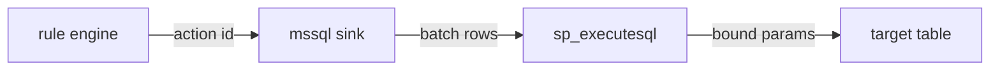

# SQL Server connector

The SQL Server connector runs a custom upsert per action. It speaks TDS with the maintained driver, including bound parameters. It batches rows before each call.

Use it when SQL Server must hold telemetry. You get one RPC per batch with your own statement.



## Before you start

- Run SQL Server. Note the host and database.
- Create the target table. Match its columns to the statement.
- This kind ships in the default build. No feature flag is necessary.

## Settings

Set connector `type` to `mssql` (`sqlserver` alias works too).

| Setting | Required | Meaning |
|---|---|---|
| `server` | yes | `Host[:Port]`. Default port is 1433. |
| `database` | yes | Database name. |
| `username` | no | Login name. Default is `sa`. |
| `password` | no | Login password. Accepts `file:` and `env:` references. |
| `pool_size` | no | Server sessions. Default is 8. Range is 1 to 1024. |
| `driver` | no | Only `ms-sql` is accepted. Another value is refused. |
| `ssl` | no | `{"enable": true}` verifies the server chain. Without it the transport trusts the chain. |

Set action `type` to `mssql` and `parameters.sql` to the statement.

| Marker | Value |
|---|---|
| `$1` | Event time in milliseconds. |
| `$2` | Topic. |
| `$3` | Client id from the JSON payload, else empty. |
| `$4` | QoS. |
| `$5` | Payload JSON. |

The statement must name at least one marker from `$1` to `$5`. Values bind out of band. A quote in a value never escapes into the text.

Example:

```json
{
  "name": "ms-sink-1",
  "type": "mssql",
  "connector": "ms-conn-1",
  "parameters": {
    "sql": "INSERT INTO t_mqtt_msg(topic, qos, payload) VALUES ($2, $4, $5)"
  }
}
```

> [!NOTE]
> The docs run creates this shape. Creation validates only; it touches no database. The send path needs a SQL Server instance.

## Check that it works

Create the connector and the action. The broker answers 201 for each.

```toml test
[node]
id = "docs-connector-mssql"

[listeners.tcp]
bind = "0.0.0.0:1883"

[listeners.api]
bind = "0.0.0.0:18083"

[logging]
level = "warn"

[auth]
allow_anonymous = true
```

```sh test
python3 - <<'PY'
import json, os, urllib.request
port = os.environ.get("API_PORT", "18083")
key = os.environ["API_KEY"]
def call(method, path, body=None):
    import urllib.error
    req = urllib.request.Request(
        f"http://127.0.0.1:{port}{path}",
        data=json.dumps(body).encode() if body is not None else None,
        method=method,
        headers={"Authorization": f"Bearer {key}", "Content-Type": "application/json"})
    try:
        with urllib.request.urlopen(req, timeout=5) as res:
            assert res.status in (200, 201, 204), res.status
            return json.load(res) if res.status != 204 else {}
    except urllib.error.HTTPError as e:
        assert e.code == 404, e.code
        return {}
call("DELETE", "/api/v5/actions/ms-sink-1")
call("DELETE", "/api/v5/connectors/ms-conn-1")
conn = call("POST", "/api/v5/connectors", {"name": "ms-conn-1", "type": "mssql",
    "server": "127.0.0.1:1433", "database": "db"})
assert conn["type"] == "mssql", conn
act = call("POST", "/api/v5/actions", {"name": "ms-sink-1", "type": "mssql",
    "connector": "ms-conn-1",
    "parameters": {"sql": "INSERT INTO t(topic) VALUES ($2)"}})
print(act["status"])
PY
```

```output
connected
```

## Limits

- A missing `server` or `database` is refused with 400 and names the field.
- A missing `parameters.sql` is refused with 400.
- A `driver` other than `ms-sql` is refused with 400.
- A dead server counts each fire as failed. The broker keeps serving.

## Next steps

- Feed the action from a rule in [Actions](../rules/actions.md).
- See every kind in [Connectors](./index.md).
