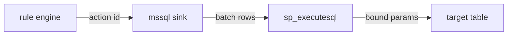
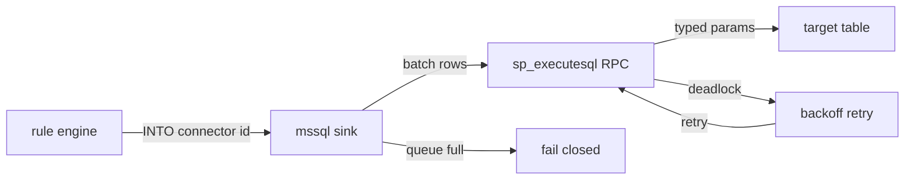

# SQL Server connector

The SQL Server connector runs a custom upsert per action. It speaks TDS with the maintained driver, including bound parameters. It batches rows before each call.

Use it when SQL Server must hold telemetry. You get one RPC per batch with your own statement.



## Before you start

- Run SQL Server. Note the host and database.
- Create the target table. Match its columns to the statement.
- This kind ships in the default build. No feature flag is necessary.

## Settings

Set connector `type` to `mssql` (`sqlserver` alias works too).

| Setting | Required | Meaning |
|---|---|---|
| `server` | yes | `Host[:Port]`. Default port is 1433. |
| `database` | yes | Database name. |
| `username` | no | Login name. Default is `sa`. |
| `password` | no | Login password. Accepts `file:` and `env:` references. |
| `pool_size` | no | Server sessions. Default is 8. Range is 1 to 1024. |
| `driver` | no | Only `ms-sql` is accepted. Another value is refused. |
| `ssl` | no | `{"enable": true}` verifies the server chain. Without it the transport trusts the chain. |

Set action `type` to `mssql` and `parameters.sql` to the statement.

| Marker | Value |
|---|---|
| `$1` | Event time in milliseconds. |
| `$2` | Topic. |
| `$3` | Client id from the JSON payload, else empty. |
| `$4` | QoS. |
| `$5` | Payload JSON. |

The statement must name at least one marker from `$1` to `$5`. Values bind out of band. A quote in a value never escapes into the text.

Example:

```json
{
  "name": "ms-sink-1",
  "type": "mssql",
  "connector": "ms-conn-1",
  "parameters": {
    "sql": "INSERT INTO t_mqtt_msg(topic, qos, payload) VALUES ($2, $4, $5)"
  }
}
```

> [!NOTE]
> The docs run creates this shape. Creation validates only; it touches no database. The send path needs a SQL Server instance.

## Check that it works

Create the connector and the action. The broker answers 201 for each.

```toml test
[node]
id = "docs-connector-mssql"

[listeners.tcp]
bind = "0.0.0.0:1883"

[listeners.api]
bind = "0.0.0.0:18083"

[logging]
level = "warn"

[auth]
allow_anonymous = true
```

```sh test
python3 - <<'PY'
import json, os, urllib.request
port = os.environ.get("API_PORT", "18083")
key = os.environ["API_KEY"]
def call(method, path, body=None):
    import urllib.error
    req = urllib.request.Request(
        f"http://127.0.0.1:{port}{path}",
        data=json.dumps(body).encode() if body is not None else None,
        method=method,
        headers={"Authorization": f"Bearer {key}", "Content-Type": "application/json"})
    try:
        with urllib.request.urlopen(req, timeout=5) as res:
            assert res.status in (200, 201, 204), res.status
            return json.load(res) if res.status != 204 else {}
    except urllib.error.HTTPError as e:
        assert e.code == 404, e.code
        return {}
call("DELETE", "/api/v5/actions/ms-sink-1")
call("DELETE", "/api/v5/connectors/ms-conn-1")
conn = call("POST", "/api/v5/connectors", {"name": "ms-conn-1", "type": "mssql",
    "server": "127.0.0.1:1433", "database": "db"})
assert conn["type"] == "mssql", conn
act = call("POST", "/api/v5/actions", {"name": "ms-sink-1", "type": "mssql",
    "connector": "ms-conn-1",
    "parameters": {"sql": "INSERT INTO t(topic) VALUES ($2)"}})
print(act["status"])
PY
```

```output
disconnected
```

## Limits

- A missing `server` or `database` is refused with 400 and names the field.
- A missing `parameters.sql` is refused with 400.
- A `driver` other than `ms-sql` is refused with 400.
- A dead server counts each fire as failed. The broker keeps serving.

## Next steps

- Feed the action from a rule in [Actions](../rules/actions.md).
- See every kind in [Connectors](./index.md).

## Reference form (v1 API)

The reference form uses the v1 connector API. The v5 form above uses connector and action documents. This section keeps the reference page.

The MSSQL connector writes each rule result as one table row. It sends typed rows through `sp_executesql` with the maintained driver. It groups rows by table before each write.

Use it when relational rows must hold telemetry in SQL Server. You get one RPC per row in each batch with your own table mapping.



### Before you start

- Run SQL Server. Note the host and the database.
- Create the target table with the five columns.
- This kind ships in the default build. No feature flag is necessary.

### Settings

Set `kind` to `mssql`. The broker also accepts the aliases `sqlserver` and `azuresql`.

| Setting | Required | Meaning |
|---|---|---|
| `host` | yes | Server hostname or IP. An empty value is refused. |
| `port` | no | TCP port. Default 1433. Port 0 is refused. |
| `database` | yes | Target database name. An empty name, `;`, or NUL is refused. |
| `table_template` | yes | Table name with `${topic}`, `${qos}`, `${timestamp}`. An unknown or unclosed variable is refused. |
| `auth` | no | Object with `type`, `username`, `password`. Default is `integrated`, which the driver refuses. Use `sql_password`. An empty username is refused. |
| `query_mode` | no | Row shape. Default is the fixed five-column insert. A custom shape needs `sql_template` with `$1..$5`. |
| `trust_server_certificate` | no | Trust a self-signed server certificate. Default true. It governs TLS deployments only. |
| `batch_size` | no | Rows per batch. Default 200. A value of 0 is refused. `null` means no count bound. |
| `batch_bytes` | no | Batch byte limit. Default 2097152. A value of 0 is refused. `null` means no byte bound. |
| `linger_ms` | no | Linger before a partial batch flushes. Default 20. `null` means no time bound. |
| `max_retries` | no | Retries on deadlocks and disconnects. Default 3. `null` means no bound. A value of 0 means no retry. |
| `initial_backoff_ms` | no | First retry delay in ms. Default 100. A value below 1 reads as 1. |
| `max_backoff_ms` | no | Retry delay ceiling in ms. Default 2500. A value below 1 reads as 1. |
| `timeout_ms` | no | Connect and query deadline in ms. Default 5000. A value below 1 reads as 1. |

Example:

```json
{
  "id": "mssql-1",
  "kind": "mssql",
  "config": {
    "host": "127.0.0.1",
    "database": "telemetry",
    "table_template": "dbo.SensorEvents",
    "auth": {"type": "sql_password", "username": "sa", "password": "secret"},
    "query_mode": {"mode": "insertjson"},
    "trust_server_certificate": true,
    "batch_size": 50,
    "batch_bytes": 65536,
    "linger_ms": 20,
    "max_retries": 2,
    "initial_backoff_ms": 10,
    "max_backoff_ms": 100,
    "timeout_ms": 5000
  }
}
```

> [!NOTE]
> The docs run creates this shape. Creation validates only; it opens no socket. The send path needs a SQL Server instance. See the failure record in [Verification failures](../_verification/failures.md).

### Check that it works

Create the connector. The broker answers 201 with the kind.

```toml test
# Reference form run.
[node]
id = "docs-connector-mssql"

[listeners.tcp]
bind = "0.0.0.0:1883"

[listeners.api]
bind = "0.0.0.0:18083"

[logging]
level = "warn"

[auth]
allow_anonymous = true
```

```sh test
python3 - <<'PY'
import json, os, urllib.request
port = os.environ.get("API_PORT", "18083")
key = os.environ["API_KEY"]
body = json.dumps({"id": "mssql-1", "kind": "mssql",
                   "config": {"host": "127.0.0.1",
                              "database": "telemetry",
                              "table_template": "dbo.SensorEvents",
                              "auth": {"type": "sql_password", "username": "sa", "password": "secret"},
                              "query_mode": {"mode": "insertjson"},
                              "trust_server_certificate": True,
                              "batch_size": 50, "batch_bytes": 65536,
                              "linger_ms": 20, "max_retries": 2,
                              "initial_backoff_ms": 10,
                              "max_backoff_ms": 100,
                              "timeout_ms": 5000}}).encode()
req = urllib.request.Request(
    f"http://127.0.0.1:{port}/api/v1/connectors", data=body, method="POST",
    headers={"Authorization": f"Bearer {key}", "Content-Type": "application/json"})
with urllib.request.urlopen(req, timeout=5) as res:
    assert res.status == 201
    print(json.load(res)["kind"])
PY
```

```output
mssql
```

### Limits

- An empty `host`, `database`, or `table_template` is refused with 400.
- A `database` with `;` is refused with 400.
- A table result that is empty, starts with `.`, holds `..`, or holds `;` is refused.
- Characters outside letters, digits, `.`, `_`, and `-` become `_`.
- A custom `sql_template` must name `$1..$5`. An empty set, `$0`, or above `$5` is refused.
- A payload that is not UTF-8 or not JSON is refused. An empty topic is refused.
- Each row carries event time, topic, client id, QoS, and payload. Types are `DATETIMEOFFSET`, `NVARCHAR`, `NVARCHAR`, `BIGINT`, `NVARCHAR`.
- The production path uses `DriverMssqlTransport` through tiberius. When `trust_server_certificate` is true the driver calls `trust_cert` and accepts the server certificate. When it is false the driver uses default validation.
- Integrated auth fails closed. Use `sql_password` credentials.
- Error 1205 retries with backoff. Other server errors fail fast and keep the row.
- A failed flush keeps rows and engages backoff. Flushes fail fast during backoff.
- The tier is enterprise. The kind ships in the default build.

### Next steps

- Feed the connector from a rule in [Actions](../rules/actions.md).
- See every kind in [Connectors](./index.md).

## Known limits in this release

The broker accepts the fields in this list. The broker does not apply them in this release.

- `batch_bytes` (the batch size in bytes)
- `batch_size` (the batch size)
- `initial_backoff_ms` (the first retry wait time)
- `linger_ms` (the batch wait time)
- `max_backoff_ms` (the longest retry wait time)
- `max_retries` (the retry count)

To set batching, use `resource_opts` in the action. The broker applies `resource_opts`.

A later release applies these fields.
