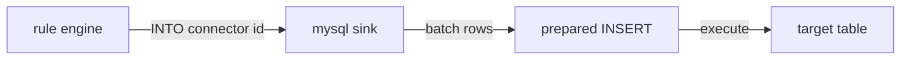

# MySQL connector

The MySQL connector inserts rule results with a SQL template. It speaks the native MySQL protocol with the maintained driver, including prepared statements. It batches rows before each insert.

Use it when a MySQL or MariaDB database must hold telemetry. You get one insert per batch with your own column mapping.



## Before you start

- Run MySQL or MariaDB. Note the connection URL.
- Create the target table. Match its columns to the template.
- This kind ships in the default build. No feature flag is necessary.

## Settings

Set `kind` to `mysql`.

| Setting | Required | Meaning |
|---|---|---|
| `connection_url` | yes | Database URL with credentials. |
| `sql_template` | yes | Insert statement with exactly three `?` placeholders. |
| `pool_size` | no | Pooled connections. |
| `batch_size` | no | Rows per insert. |
| `batch_timeout_ms` | no | Linger before a partial batch flushes. |

Example:

```json
{
  "id": "mysql-sink-1",
  "kind": "mysql",
  "config": {
    "connection_url": "mysql://u:p@127.0.0.1:3306/db",
    "sql_template": "INSERT INTO t (topic, qos, payload) VALUES (?, ?, ?)",
    "pool_size": 2,
    "batch_size": 50,
    "batch_timeout_ms": 25
  }
}
```

> [!NOTE]
> The docs run creates this shape. Creation validates only; it touches no database. The send path needs a MySQL server. See the failure record in [Verification failures](../_verification/failures.md).

## Check that it works

Create the connector. The broker answers 201 with the kind.

```toml test
[node]
id = "docs-connector-mysql"

[listeners.tcp]
bind = "0.0.0.0:1883"

[listeners.api]
bind = "0.0.0.0:18083"

[logging]
level = "warn"

[auth]
allow_anonymous = true
```

```sh test
python3 - <<'PY'
import json, os, urllib.request
port = os.environ.get("API_PORT", "18083")
key = os.environ["API_KEY"]
body = json.dumps({"id": "mysql-sink-1", "kind": "mysql",
                   "config": {"connection_url": "mysql://u:p@127.0.0.1:3306/db",
                              "sql_template": "INSERT INTO t (topic, qos, payload) VALUES (?, ?, ?)",
                              "pool_size": 2, "batch_size": 50,
                              "batch_timeout_ms": 25}}).encode()
req = urllib.request.Request(
    f"http://127.0.0.1:{port}/api/v1/connectors", data=body, method="POST",
    headers={"Authorization": f"Bearer {key}", "Content-Type": "application/json"})
with urllib.request.urlopen(req, timeout=5) as res:
    assert res.status == 201
    print(json.load(res)["kind"])
PY
```

```output
mysql
```

## Limits

- An empty `connection_url` or `sql_template` is refused with 400.
- The template uses `?` placeholders for topic, QoS, and payload.
- A dead database backs off and retries. The bounded queue sheds past its bound.

## Next steps

- Feed the connector from a rule in [Actions](../rules/actions.md).
- See every kind in [Connectors](./index.md).
