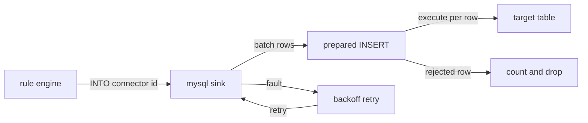

# MySQL connector

The MySQL connector writes each rule result as one table row. It sends bound parameters through the maintained driver with one explicit prepare per batch. It buffers rows and flushes full or stale batches.

Use it when relational rows must hold telemetry in MySQL or MariaDB. You get one RPC per row in each batch with your own table mapping.



## Before you start

- Run MySQL or MariaDB. Note the host and the database.
- Create the target table with three columns.
- This kind ships in the default build. No feature flag is necessary.

## Settings

Set `kind` to `mysql`. The broker also accepts the alias `mariadb`. It stores the kind as `mysql`.

| Setting | Required | Meaning |
|---|---|---|
| `connection_url` | yes | URL `mysql://[user[:password]@]host[:port][/db]`. Default user is `root`. Default port is 3306. Query options are accepted and ignored. A missing host is refused. |
| `sql_template` | yes | Insert statement with exactly three `?` markers for topic, QoS, and payload. Markers inside strings, quoted names, and comments do not count. |
| `pool_size` | no | Driver pool size. Default 10. A value of 0 is refused. |
| `batch_size` | no | Rows per batch. Default 100. A value of 0 is refused. |
| `batch_timeout_ms` | no | Linger before a stale batch flushes. Default 50. |

Example:

```json
{
  "id": "mysql-sink-1",
  "kind": "mysql",
  "config": {
    "connection_url": "mysql://u:p@127.0.0.1:3306/db",
    "sql_template": "INSERT INTO t (topic, qos, payload) VALUES (?, ?, ?)",
    "pool_size": 2,
    "batch_size": 50,
    "batch_timeout_ms": 25
  }
}
```

> [!NOTE]
> The docs run creates this shape. Creation validates only; it opens no socket. The send path needs a MySQL server. See the failure record in [Verification failures](../_verification/failures.md).

## Check that it works

Create the connector. The broker answers 201 with the kind.

```toml test
[node]
id = "docs-connector-mysql"

[listeners.tcp]
bind = "0.0.0.0:1883"

[listeners.api]
bind = "0.0.0.0:18083"

[logging]
level = "warn"

[auth]
allow_anonymous = true
```

```sh test
python3 - <<'PY'
import json, os, urllib.request
port = os.environ.get("API_PORT", "18083")
key = os.environ["API_KEY"]
body = json.dumps({"id": "mysql-sink-1", "kind": "mysql",
                   "config": {"connection_url": "mysql://u:p@127.0.0.1:3306/db",
                              "sql_template": "INSERT INTO t (topic, qos, payload) VALUES (?, ?, ?)",
                              "pool_size": 2, "batch_size": 50,
                              "batch_timeout_ms": 25}}).encode()
req = urllib.request.Request(
    f"http://127.0.0.1:{port}/api/v1/connectors", data=body, method="POST",
    headers={"Authorization": f"Bearer {key}", "Content-Type": "application/json"})
with urllib.request.urlopen(req, timeout=5) as res:
    assert res.status == 201
    print(json.load(res)["kind"])
PY
```

```output
mysql
```

## Limits

- An empty `connection_url` or `sql_template` is refused with 400.
- A template without exactly three `?` markers is refused with 400.
- A `pool_size` of 0 is refused. A `batch_size` of 0 is refused.
- A bad URL is refused. A wrong scheme or a bad port is refused.
- The production path uses `DriverMySqlTransport` through the maintained driver. The legacy handshake path serves offline unit tests only.
- The driver supports both password plugins. A wrong password fails closed with a connection error.
- A rejected row is counted and dropped. A CHECK violation surfaces errno 3819 on MySQL and 4025 on MariaDB.
- A failed flush restores unprocessed rows in order and backs off. Flushes fail fast during backoff.
- Delivery across a reconnect is at-least-once. A duplicate row is possible.
- The connect deadline is 5 seconds. The statement deadline is 10 seconds. A packet above 16 MB is refused.
- The tier is community. The kind ships in the default build.

## Next steps

- Feed the connector from a rule in [Actions](../rules/actions.md).
- See every kind in [Connectors](./index.md).
