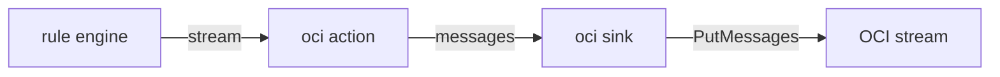

# OCI Streaming connector

The OCI Streaming connector writes rule results as messages in one stream.

Use it for event streaming in Oracle Cloud. The action names the stream.



## Status

This kind is pending. The reference 6.3.0 has no schema for it, and the CEO kept it out of the MVP on 2026-11-08.
The broker refuses connector and action create and update with `400 BAD_REQUEST`.
A stored record does not start and reports `disconnected`.
The driver code stays in the tree for a later decision.

## Before you start

- Create a stream pool and stream.
- Create OCI API keys with write access.

## Settings

| Connector setting | Required | Meaning |
|---|---|---|
| `endpoint` | yes | Streaming endpoint URL. |
| `stream_pool_id` | yes | Stream pool OCID. |
| `stream_id` | yes | Stream OCID. |
| `tenancy_ocid` | yes | Tenancy OCID. |
| `user_ocid` | yes | User OCID. |
| `fingerprint` | yes | Key fingerprint. |
| `private_key_pem` | yes | Private key. |

| Action setting | Required | Meaning |
|---|---|---|
| `stream_id` | yes | Target stream OCID. |

Example action:

```json
{
  "name": "oci-events",
  "type": "oci_streaming",
  "connector": "oci-local",
  "parameters": {
    "stream_id": "ocid1.stream.oc1.phx.aaa"
  }
}
```

## Limits

- A missing identity field or stream answers 400 and names the field.
- A failed batch counts one failed forward on the action.
- Not verified against the live service while the kind is pending.

## Next steps

- Feed the connector from a rule in [Actions](../rules/actions.md).
- See every kind in [Connectors](./index.md).

## Check that it works

Create the connector with test identity. The broker answers 400 and prints `ok`.

```toml test
[node]
id = "docs-connector-oci"

[listeners.tcp]
bind = "0.0.0.0:1883"

[listeners.api]
bind = "0.0.0.0:18083"

[logging]
level = "warn"

[auth]
allow_anonymous = true
```

```sh test
python3 - <<'PY'
import json, os, urllib.request
port = os.environ.get("API_PORT", "18083")
key = os.environ["API_KEY"]
body = json.dumps({"name": "docs-oci-1", "type": "oci_streaming",
                   "endpoint": "https://cell-1.streaming.us-east-1.oraclecloud.com",
                   "stream_pool_id": "ocid1.streampool.oc1.phx.aaa",
                   "stream_id": "ocid1.stream.oc1.phx.aaa",
                   "tenancy_ocid": "ocid1.tenancy.oc1..aaa",
                   "user_ocid": "ocid1.user.oc1..aaa",
                   "fingerprint": "aa:bb:cc:dd:ee:ff:00:11:22:33:44:55:66:77:88:99",
                   "private_key_pem": "key"}).encode()
req = urllib.request.Request(
    f"http://127.0.0.1:{port}/api/v5/connectors", data=body, method="POST",
    headers={"Authorization": f"Bearer {key}", "Content-Type": "application/json"})
try:
    with urllib.request.urlopen(req, timeout=5) as res:
        status, created = res.status, json.load(res)
except urllib.error.HTTPError as err:
    status, created = err.code, json.load(err)
assert status == 400, (status, created)
assert "oci" in created["message"], created
print("ok")
PY
```

```output
ok
```
