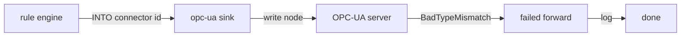

# OPC-UA connector

The OPC-UA connector writes rule results to OPC-UA nodes. The connector holds the server. Each action holds one node id. The runtime uses anonymous auth with no policy or mode.

Use it when a PLC or SCADA server must receive setpoints. You get one write per event to the named node.



## Before you start

- Run an OPC-UA server. Note its `endpoint_url`.
- Pick the node id to write, for example `ns=1;i=1001`.
- This kind ships in the default build. No feature flag is necessary.

## Settings

Set `kind` to `opc_ua`. The alias `opcua` selects the same runtime.

| Setting | Required | Meaning |
|---|---|---|
| `endpoint_url` | yes | Server URL. Must start with `opc.tcp://`. Aliases `server`, `url`, `endpoint` work. |
| `node_id` | yes, on the action | Target node, for example `ns=1;i=1001`. |
| `timeout_ms` | no | Dial timeout in ms. Default 5000. |

Example:

```json
{
  "type": "opc_ua",
  "name": "opc-1",
  "endpoint_url": "opc.tcp://127.0.0.1:4840"
}
```

> [!NOTE]
> The docs run creates this shape. Creation validates only; it opens no socket and writes no node. The send path needs an OPC-UA server. See the failure record in [Verification failures](../_verification/failures.md).

## Check that it works

Create the connector. The broker answers 201 with the kind. The answer prints `ok`.

```toml test
[node]
id = "docs-connector-opc-ua"

[listeners.tcp]
bind = "0.0.0.0:1883"

[listeners.api]
bind = "0.0.0.0:18083"

[logging]
level = "warn"

[auth]
allow_anonymous = true
```

```sh test
python3 - <<'PY'
import json, os, urllib.request
port = os.environ.get("API_PORT", "18083")
key = os.environ["API_KEY"]
body = json.dumps({"type": "opc_ua", "name": "opc-1",
                   "endpoint_url": "opc.tcp://127.0.0.1:4840"}).encode()
req = urllib.request.Request(
    f"http://127.0.0.1:{port}/api/v5/connectors", data=body, method="POST",
    headers={"Authorization": f"Bearer {key}", "Content-Type": "application/json"})
with urllib.request.urlopen(req, timeout=5) as res:
    status, created = res.status, json.load(res)
assert status == 201, (status, created)
assert created["type"] in ("opc_ua", "opcua"), created
print("ok")
PY
```

```output
ok
```

## Limits

- A missing `endpoint_url` is refused with 400 and names the field.
- A missing action `node_id` is refused with 400 and names the field.
- Only anonymous auth with no policy or mode is supported. Any other value is refused.
- A payload that is not JSON, or a value that does not fit the node type, counts one failed forward.

## Next steps

- Feed the connector from a rule in [Actions](../rules/actions.md).
- See every kind in [Connectors](./index.md).
