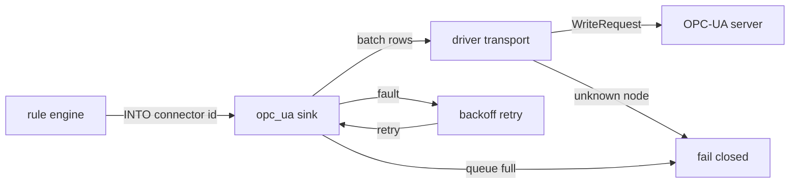

# OPC-UA connector

The OPC-UA connector writes each MQTT setpoint as one node write. It sends typed writes through the maintained driver. It buffers rows and flushes by count or by linger.

Use it when plant setpoints must reach an OPC-UA server. You get one write per row in each batch with your own node mapping.



## Before you start

- Run an OPC-UA server. Note the endpoint URL.
- Note one node id and one write topic.
- For a full build, enable the feature: `--features opc_ua`. The default build answers 400 and names the feature.

## Settings

Set `kind` to `opc_ua`. The broker also accepts the alias `opcua`. It stores the kind as `opc_ua`.

| Setting | Required | Meaning |
|---|---|---|
| `endpoint_url` | yes | Server URL. It must start with `opc.tcp://`. |
| `security_policy` | no | Policy name. Default `None`. Use `Basic256Sha256` or `Aes128Sha256RsaOaep` for signed paths. |
| `security_mode` | no | Mode name. Default `none`. `sign` and `signandencrypt` need a policy. |
| `auth` | no | Object with `type`. Default `anonymous`. Use `usernamepassword` with `username` and `password`. An empty username is refused. |
| `node_subscriptions` | yes | Non-empty list of node routes. Each route names one node and one write topic. |
| `node_id` | yes | Node address as `ns=<n>;<t>=<v>`. Type `i` is numeric, `s` is text, `g` is GUID, `b` is base64. Wildcards are refused. |
| `sampling_interval_ms` | yes | Poll interval in ms for the node. |
| `publish_topic_template` | yes | Topic template with `${node.sanitized_id}`. An empty value is refused. |
| `write_topic_pattern` | no | MQTT pattern with `+` and `#`. The first match wins. A topic with no match is refused. |
| `buffer_capacity` | no | Buffered rows. Default holds no bound. A full buffer fails closed. |
| `batch_size` | no | Rows per batch. Default 100. A value of 0 is refused. `null` means no count bound. |
| `linger_ms` | no | Linger before a partial batch flushes. Default 50. `null` means no time bound. |
| `timeout_ms` | no | Connect and request deadline in ms. Default 5000. A value below 1 reads as 1. |

Example:

```json
{
  "id": "opc-ua-1",
  "kind": "opc_ua",
  "config": {
    "endpoint_url": "opc.tcp://127.0.0.1:4840",
    "security_policy": "None",
    "security_mode": "none",
    "auth": {"type": "anonymous"},
    "node_subscriptions": [{"node_id": "ns=2;s=Line1.Temperature",
                            "sampling_interval_ms": 1000,
                            "publish_topic_template": "factory/line1/${node.sanitized_id}",
                            "write_topic_pattern": "factory/setpoint/+"}],
    "batch_size": 50,
    "linger_ms": 20,
    "timeout_ms": 5000
  }
}
```

> [!NOTE]
> The docs run creates this shape. Creation validates only; it opens no socket. The send path needs an OPC-UA server. See the failure record in [Verification failures](../_verification/failures.md).


### `endpoint_url`

Target OPC-UA server address.

- Name: `endpoint_url`
- Type: text
- Range: URI starting with `opc.tcp://`
- Default: none (required)
- Missing-value behaviour: returns HTTP status 400 with a message naming `endpoint_url`
- Code reference: `crates/broker-connectors-enterprise/src/opc_ua.rs:811, 851; crates/broker-api/src/v5/action_sinks.rs:3297-3308`

The setting specifies the server URL. It must start with `opc.tcp://`. An absent setting returns HTTP status 400 naming `endpoint_url`.

```sh test
python3 - <<'PY'
import json, os, urllib.request
port = os.environ.get("API_PORT", "18083")
key = os.environ["API_KEY"]
headers = {"Authorization": f"Bearer {key}", "Content-Type": "application/json"}
body = json.dumps({
    "name": "opc-endpoint-conn",
    "type": "opc_ua",
    "endpoint_url": "opc.tcp://127.0.0.1:4840",
}).encode()
req = urllib.request.Request(
    f"http://127.0.0.1:{port}/api/v5/connectors",
    data=body,
    method="POST",
    headers=headers,
)
with urllib.request.urlopen(req, timeout=5) as res:
    assert res.status == 201

req = urllib.request.Request(
    f"http://127.0.0.1:{port}/api/v5/connectors",
    headers={"Authorization": f"Bearer {key}"},
)
with urllib.request.urlopen(req, timeout=5) as res:
    connectors = json.load(res)
conn = next(c for c in connectors if c.get("name") == "opc-endpoint-conn")
print(conn["endpoint_url"])
PY
```

```output
opc.tcp://127.0.0.1:4840
```

### `node_id`

Target OPC-UA node identifier for action writes.

- Name: `node_id`
- Type: text
- Range: valid OPC-UA node identifier, for example `ns=1;i=1001`
- Default: none (required action parameter in `NodeSubscriptionConfig` group)
- Missing-value behaviour: returns HTTP status 400 with message `action "<id>" is missing required field: node_id (field parameters.node_id)`
- Code reference: `crates/broker-connectors-enterprise/src/opc_ua.rs:795-797, 887; crates/broker-api/src/v5/action_sinks.rs:3329-3333`

The setting specifies the target node. It must parse as a valid node identifier. A missing setting returns HTTP status 400 naming `node_id`.

```sh test
python3 - <<'PY'
import json, os, urllib.request
port = os.environ.get("API_PORT", "18083")
key = os.environ["API_KEY"]
headers = {"Authorization": f"Bearer {key}", "Content-Type": "application/json"}
conn_body = json.dumps({
    "name": "opc-node-conn",
    "type": "opc_ua",
    "endpoint_url": "opc.tcp://127.0.0.1:4840",
}).encode()
req = urllib.request.Request(
    f"http://127.0.0.1:{port}/api/v5/connectors",
    data=conn_body,
    method="POST",
    headers=headers,
)
with urllib.request.urlopen(req, timeout=5) as res:
    assert res.status == 201

act_body = json.dumps({
    "name": "opc-node-act",
    "type": "opc_ua",
    "connector": "opc-node-conn",
    "parameters": {"node_id": "ns=1;i=1001"},
}).encode()
req = urllib.request.Request(
    f"http://127.0.0.1:{port}/api/v5/actions",
    data=act_body,
    method="POST",
    headers=headers,
)
with urllib.request.urlopen(req, timeout=5) as res:
    assert res.status == 201

req = urllib.request.Request(
    f"http://127.0.0.1:{port}/api/v5/actions",
    headers={"Authorization": f"Bearer {key}"},
)
with urllib.request.urlopen(req, timeout=5) as res:
    actions = json.load(res)
act = next(a for a in actions if a.get("name") == "opc-node-act")
print(act["parameters"]["node_id"])
PY
```

```output
ns=1;i=1001
```

### `timeout_ms`

Network connect / request timeout in ms.

- Name: `timeout_ms`
- Type: whole number of milliseconds
- Range: 0 or greater (0 is raised to 1 millisecond)
- Default: 5000 milliseconds
- Missing-value behaviour: defaults to 5000 milliseconds
- Code reference: `crates/broker-connectors-enterprise/src/opc_ua.rs:832, 834, 846-848`

The setting specifies the network connect and request timeout. An absent value defaults to 5000 milliseconds. A value of 0 is raised to 1 millisecond.

```sh test
python3 - <<'PY'
import json, os, urllib.request
port = os.environ.get("API_PORT", "18083")
key = os.environ["API_KEY"]
headers = {"Authorization": f"Bearer {key}", "Content-Type": "application/json"}
body = json.dumps({
    "name": "opc-timeout-conn",
    "type": "opc_ua",
    "endpoint_url": "opc.tcp://127.0.0.1:4840",
    "timeout_ms": 2500,
}).encode()
req = urllib.request.Request(
    f"http://127.0.0.1:{port}/api/v5/connectors",
    data=body,
    method="POST",
    headers=headers,
)
with urllib.request.urlopen(req, timeout=5) as res:
    assert res.status == 201

req = urllib.request.Request(
    f"http://127.0.0.1:{port}/api/v5/connectors",
    headers={"Authorization": f"Bearer {key}"},
)
with urllib.request.urlopen(req, timeout=5) as res:
    connectors = json.load(res)
conn = next(c for c in connectors if c.get("name") == "opc-timeout-conn")
print(conn["timeout_ms"])
PY
```

```output
2500
```

## Check that it works

Create the connector. The broker answers 201 with the kind when the build holds OPC-UA, else 400 naming the feature. Both answers print `ok`.

```toml test
[node]
id = "docs-connector-opc_ua"

[listeners.tcp]
bind = "0.0.0.0:1883"

[listeners.api]
bind = "0.0.0.0:18083"

[logging]
level = "warn"

[auth]
allow_anonymous = true
```

```sh test
python3 - <<'PY'
import json, os, urllib.request, urllib.error
port = os.environ.get("API_PORT", "18083")
key = os.environ["API_KEY"]
body = json.dumps({"id": "opc-ua-1", "kind": "opc_ua",
                   "config": {"endpoint_url": "opc.tcp://127.0.0.1:4840",
                              "security_policy": "None",
                              "security_mode": "none",
                              "auth": {"type": "anonymous"},
                              "node_subscriptions": [{"node_id": "ns=2;s=Line1.Temperature",
                                                      "sampling_interval_ms": 1000,
                                                      "publish_topic_template": "factory/line1/${node.sanitized_id}",
                                                      "write_topic_pattern": "factory/setpoint/+"}],
                              "batch_size": 50,
                              "linger_ms": 20,
                              "timeout_ms": 5000}}).encode()
req = urllib.request.Request(
    f"http://127.0.0.1:{port}/api/v1/connectors", data=body, method="POST",
    headers={"Authorization": f"Bearer {key}", "Content-Type": "application/json"})
try:
    with urllib.request.urlopen(req, timeout=5) as res:
        status, created = res.status, json.load(res)
except urllib.error.HTTPError as err:
    status, created = err.code, json.load(err)
assert status in (201, 400), (status, created)
if status == 201:
    assert created["kind"] == "opc_ua", created
else:
    assert "opc_ua" in created["error"], created
print("ok")
PY
```

```output
ok
```

## Limits

- An `endpoint_url` without the `opc.tcp://` prefix is refused with 400.
- `sign` and `signandencrypt` without a policy are refused with 400.
- Certificate auth passes validation but the driver transport refuses it. It fails closed. Use anonymous or username with password.
- An empty `node_subscriptions` list is refused with 400.
- A `node_id` outside `ns=<n>;<t>=<v>` is refused. Type must be `i`, `s`, `g`, or `b`. A wildcard is refused.
- An empty `publish_topic_template` is refused with 400.
- A `batch_size` of 0 is refused with 400.
- A payload that is not UTF-8 or not JSON is refused. An array is refused as `BadTypeMismatch`. An object without a `value` key is refused as `BadTypeMismatch`, unless it holds one key. Then the sink uses the sole value.
- A whole number rides as `Int64`. A fraction rides as `Double`. Text rides as `Text`. A bool rides as `Boolean`.
- A topic with no matching `write_topic_pattern` is refused. The first match wins.
- The production path uses `DriverOpcUaTransport` through the maintained driver. The raw TCP path serves offline unit tests only.
- An unknown node fails as `BadNodeIdUnknown`. A bad value fails as `BadTypeMismatch`. Both are terminal. A lost session or channel is transient and reconnects.
- A failed flush keeps rows and engages backoff. Flushes fail fast during backoff.
- The tier is enterprise. The kind needs the `opc_ua` feature build.

## Other names

This connector is also known as `opc-ua` and `opcua`. The alias `opc-ua` redirects to this page.

Both names select the OPC-UA industrial connector runtime.

## Next steps

- Feed the connector from a rule in [Actions](../rules/actions.md).
- See every kind in [Connectors](./index.md).

## Known limits in this release

The broker accepts the fields in this list. The broker does not apply them in this release.

- `batch_size` (the batch size)
- `buffer_capacity` (the buffer size)
- `linger_ms` (the batch wait time)

To set batching, use `resource_opts` in the action. The broker applies `resource_opts`.

A later release applies these fields.
