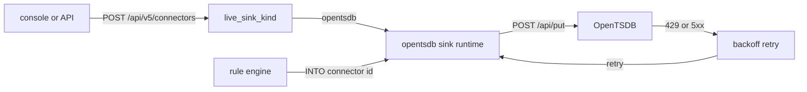

# OpenTSDB (opents) connector

The `opents` name is the v5 name for the OpenTSDB sink. The v5 connector route accepts the name and maps it to the `opentsdb` runtime. The v1 connector route does not accept the name.

Use it when a tool sends the v5 name `opents`. You get a stored connector row that writes each rule result as an OpenTSDB point.



## Before you start

- Run OpenTSDB or a compatible store. Note the HTTP address.
- Pick the metric name and the value field. Match them to the payload.
- Use the v5 route. The v1 route refuses `opents`; it accepts `opentsdb`.

## Settings

Create the connector with `POST /api/v5/connectors`.

| Setting | Required | Meaning |
|---|---|---|
| `id` or `name` | yes | Connector id. Its length is capped at 256 bytes. |
| `type` | yes | Connector type. Use `opents`. |
| `enable` | no | Enable flag. Default `true`. |
| `endpoint` | no | Target address. Default `http://127.0.0.1:4242`. The v5 route also reads `server`, `servers`, and `url`. A value without a scheme gets `http://`. The protocol is always HTTP. |
| `metric_template` | no | Metric name template. Default `factory.telemetry`. The v5 route also reads `metric`. An empty value is refused. |
| `value_field` | no | Field for the numeric value. Default `temperature`. The v5 route also reads `value`. An empty value is refused. |
| `summary` | no | Add `?summary` to the HTTP path. Default `true`. |
| `tag_mappings` | no | Object of tag key to template. The v5 route also reads `tags`. Default `{"sensor": "${payload.sensor}"}`. |
| `timeout_ms` | no | Request deadline in ms. Default 5000. A value below 1 reads as 1. The v5 route also reads `timeout` and `request_timeout_ms`. |

The v5 route fixes `protocol` to `http`, `compression` to `none`, and `batch_size` to 1. It uses the finite default buffer of 10000 rows. It registers the name and the alias `opentsdb:name`. The stored row keeps the type `opents`.

The `opentsdb` page documents the full sink settings, including the telnet protocol, gzip compression, and the batch size. The v1 route accepts only `opentsdb`, `open_tsdb`, and `tsdb`.

Example:

```json
{
  "id": "opents-1",
  "name": "opents-1",
  "type": "opents",
  "enable": true,
  "endpoint": "http://127.0.0.1:4242",
  "metric": "factory.telemetry",
  "value": "temperature",
  "summary": true,
  "tag_mappings": {"site": "${payload.site}"},
  "timeout_ms": 5000
}
```

> [!NOTE]
> The docs run creates the connector and sends one message to a local loopback receiver. The real OpenTSDB server is not verified. See the record in [Verification failures](../_verification/failures.md).

## Check that it works

The test starts a local receiver. It refuses `opents` on the v1 route. It creates the connector on the v5 route. It creates a forwarding rule and publishes one message. It reads the point back. The receiver prints `delivered` when the point arrives.

```toml test
[node]
id = "docs-connector-opents"

[listeners.tcp]
bind = "0.0.0.0:1883"

[listeners.api]
bind = "0.0.0.0:18083"

[logging]
level = "warn"

[auth]
allow_anonymous = true
```

```sh test
python3 - <<'PY'
import json, os, socket, struct, threading, time, urllib.request, urllib.error
from http.server import BaseHTTPRequestHandler, HTTPServer

received = []

class Handler(BaseHTTPRequestHandler):
    def do_POST(self):
        length = int(self.headers.get("Content-Length", 0))
        received.append((self.path, self.rfile.read(length)))
        self.send_response(200)
        self.send_header("Content-Type", "application/json")
        self.end_headers()
        self.wfile.write(b'{"success": 1, "failed": 0}')
    def log_message(self, *args):
        pass

server = HTTPServer(("127.0.0.1", 0), Handler)
tsdb_port = server.server_address[1]
threading.Thread(target=server.serve_forever, daemon=True).start()

mqtt_port = int(os.environ.get("MQTT_PORT", "1883"))
api_port = os.environ.get("API_PORT", "18083")
key = os.environ["API_KEY"]

def call(method, path, body=None):
    data = None if body is None else json.dumps(body).encode()
    req = urllib.request.Request(
        f"http://127.0.0.1:{api_port}{path}", data=data, method=method,
        headers={"Authorization": f"Bearer {key}",
                 "Content-Type": "application/json"})
    try:
        with urllib.request.urlopen(req, timeout=10) as res:
            raw = res.read().decode()
            return res.status, (json.loads(raw) if raw else None)
    except urllib.error.HTTPError as err:
        raw = err.read().decode()
        try:
            return err.code, json.loads(raw)
        except ValueError:
            return err.code, raw

s1, b1 = call("POST", "/api/v1/connectors",
              {"id": "opents-v1", "kind": "opents",
               "config": {"endpoint": f"http://127.0.0.1:{tsdb_port}"}})
assert s1 == 400, (s1, b1)
assert "unknown connector kind" in json.dumps(b1).lower(), b1

s2, b2 = call("POST", "/api/v5/connectors",
              {"name": "opents-v5", "type": "opents",
               "endpoint": f"http://127.0.0.1:{tsdb_port}",
               "metric": "docs.metric", "value": "temperature",
               "summary": True,
               "tag_mappings": {"site": "${payload.site}"},
               "timeout_ms": 5000})
assert s2 == 201 and b2["type"] == "opents", (s2, b2)

s3, b3 = call("POST", "/api/v5/connectors",
              {"name": "opents-empty", "type": "opents",
               "endpoint": f"http://127.0.0.1:{tsdb_port}", "metric": ""})
assert s3 == 400, (s3, b3)
assert "metric" in json.dumps(b3).lower(), b3

s4, b4 = call("POST", "/api/v1/rules",
              {"name": "opents-rule", "topic_filter": "docs/opents/in",
               "actions": [{"type": "forwardconnector",
                            "connector_id": "opents-v5"}]})
assert s4 == 201, (s4, b4)

def packet(kind, body):
    return bytes([kind, len(body)]) + body

def field(data):
    return struct.pack(">H", len(data)) + data

pub = socket.create_connection(("127.0.0.1", mqtt_port), timeout=5)
pub.sendall(packet(0x10, b"\x00\x04MQTT\x04\x02\x00\x3c" + field(b"opents-pub")))
assert pub.recv(4) == b"\x20\x02\x00\x00"
pub.sendall(packet(0x30, field(b"docs/opents/in") +
                   b'{"temperature": 42.5, "site": "north"}'))
deadline = time.time() + 12
while not received and time.time() < deadline:
    time.sleep(0.1)
assert received, "no point arrived"
path, body = received[0]
assert path == "/api/put?summary", path
points = json.loads(body)
assert len(points) == 1, points
point = points[0]
assert point["metric"] == "docs.metric", point
assert point["value"] == 42.5, point
assert point["tags"] == {"site": "north"}, point
print("delivered")
PY
```

```output
delivered
```

## Limits

- The v1 route refuses `opents` with 400. Use `opentsdb` on v1 or `opents` on v5.
- The v5 route reads the endpoint, metric, value, summary, tags, and timeout. It fixes the protocol, the compression, and the batch size.
- An empty `metric_template` or `value_field` is refused with 400.
- A `batch_size` or `buffer_capacity` of 0 is refused.
- An HTTP endpoint must use `http://` or `https://`.
- A payload that is not JSON is refused. A missing value reads as `0.0`.
- Metric and tag text allows letters, digits, `_`, `.`, `-`, and `/`. Other chars become `_`.
- A full buffer fails closed with a connection error.
- A failed flush restores the point and engages backoff. A 429 or 5xx retries. Other 4xx statuses fail fast.
- The tier is community. The kind ships in the default build.

## Next steps

- Read the full sink settings in [OpenTSDB](./opentsdb.md).
- Feed the connector from a rule in [Actions](../rules/actions.md).
- See every kind in [Connectors](./index.md).
