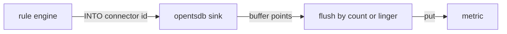
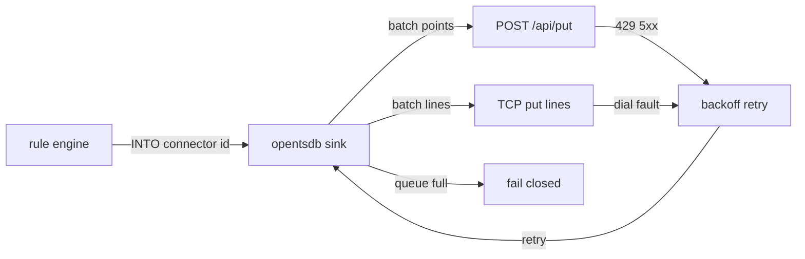

# OpenTSDB connector

The OpenTSDB connector writes rule results as data points. It posts points over HTTP or over telnet. It buffers points and flushes by count or by linger.

Use it when metrics must land in OpenTSDB. You get one put per flush.



## Before you start

- Run OpenTSDB. Note the endpoint and the metric name.

## Settings

Set `kind` to `opentsdb`. The alias `opents` selects the same runtime.

| Setting | Required | Meaning |
|---|---|---|
| `server` | yes | Endpoint URL. A `telnet://` scheme selects the telnet wire. |
| `metric` | yes | Metric name template. |
| `value` | yes | Value field, for example `${payload.temp}`. |
| `tags` | no | Tag templates. Every point carries the `topic` tag. |
| `summary` | no | Ask for summary counters. Default `true`. |

The action may override `metric`, `value`, `tags` and `summary` per target.

### `server`

Endpoint URL. Type: string. Required: yes. A `telnet://` scheme selects the telnet wire. Absent: 400 naming `server`.

```sh test
python3 - <<'PY'
import json, os, urllib.request
port = os.environ.get("API_PORT", "18083")
key = os.environ["API_KEY"]
def post(body):
    req = urllib.request.Request(
        f"http://127.0.0.1:{port}/api/v5/connectors", data=json.dumps(body).encode(), method="POST",
        headers={"Authorization": f"Bearer {key}", "Content-Type": "application/json"})
    try:
        with urllib.request.urlopen(req, timeout=5) as res:
            return res.status, json.load(res)
    except urllib.error.HTTPError as err:
        return err.code, json.load(err)
status, body = post({"name": "opents-server-bad", "type": "opentsdb",
                     "metric": "m", "value": "v"})
assert status == 400 and "server" in body["message"], body
print("ok")
PY
```

```output
ok
```

### `metric`

Metric name template. Type: string. Required: yes. Absent: 400 naming `metric`.

```sh test
python3 - <<'PY'
import json, os, urllib.request
port = os.environ.get("API_PORT", "18083")
key = os.environ["API_KEY"]
def post(body):
    req = urllib.request.Request(
        f"http://127.0.0.1:{port}/api/v5/connectors", data=json.dumps(body).encode(), method="POST",
        headers={"Authorization": f"Bearer {key}", "Content-Type": "application/json"})
    try:
        with urllib.request.urlopen(req, timeout=5) as res:
            return res.status, json.load(res)
    except urllib.error.HTTPError as err:
        return err.code, json.load(err)
status, body = post({"name": "opents-metric-bad", "type": "opentsdb",
                     "server": "http://127.0.0.1:4242", "value": "v"})
assert status == 400 and "metric" in body["message"], body
print("ok")
PY
```

```output
ok
```

### `value`

Value field template. Type: string. Required: yes. Absent: 400 naming `value`.

```sh test
python3 - <<'PY'
import json, os, urllib.request
port = os.environ.get("API_PORT", "18083")
key = os.environ["API_KEY"]
def post(body):
    req = urllib.request.Request(
        f"http://127.0.0.1:{port}/api/v5/connectors", data=json.dumps(body).encode(), method="POST",
        headers={"Authorization": f"Bearer {key}", "Content-Type": "application/json"})
    try:
        with urllib.request.urlopen(req, timeout=5) as res:
            return res.status, json.load(res)
    except urllib.error.HTTPError as err:
        return err.code, json.load(err)
status, body = post({"name": "opents-value-bad", "type": "opentsdb",
                     "server": "http://127.0.0.1:4242", "metric": "m"})
assert status == 400 and "value" in body["message"], body
print("ok")
PY
```

```output
ok
```

### `tags`

Tag templates. Type: object. Required: no. Default empty. Every point still carries the `topic` tag.

```sh test
python3 - <<'PY'
import json, os, urllib.request
port = os.environ.get("API_PORT", "18083")
key = os.environ["API_KEY"]
def post(body):
    req = urllib.request.Request(
        f"http://127.0.0.1:{port}/api/v5/connectors", data=json.dumps(body).encode(), method="POST",
        headers={"Authorization": f"Bearer {key}", "Content-Type": "application/json"})
    try:
        with urllib.request.urlopen(req, timeout=5) as res:
            return res.status, json.load(res)
    except urllib.error.HTTPError as err:
        return err.code, json.load(err)
status, created = post({"name": "opents-tags-ok", "type": "opentsdb",
                        "server": "http://127.0.0.1:4242", "metric": "m", "value": "v",
                        "tags": {"room": "r1"}})
assert status == 201, (status, created)
print("ok")
PY
```

```output
ok
```

### `summary`

Ask for summary counters. Type: boolean. Required: no. Default `true`. `false` drops the `?summary` query.

```sh test
python3 - <<'PY'
import json, os, urllib.request
port = os.environ.get("API_PORT", "18083")
key = os.environ["API_KEY"]
def post(body):
    req = urllib.request.Request(
        f"http://127.0.0.1:{port}/api/v5/connectors", data=json.dumps(body).encode(), method="POST",
        headers={"Authorization": f"Bearer {key}", "Content-Type": "application/json"})
    try:
        with urllib.request.urlopen(req, timeout=5) as res:
            return res.status, json.load(res)
    except urllib.error.HTTPError as err:
        return err.code, json.load(err)
status, created = post({"name": "opents-summary-ok", "type": "opentsdb",
                        "server": "http://127.0.0.1:4242", "metric": "m", "value": "v",
                        "summary": False})
assert status == 201, (status, created)
print("ok")
PY
```

```output
ok
```

Example:

```json
{
  "name": "opents-sink-1",
  "type": "opentsdb",
  "server": "http://127.0.0.1:4242",
  "metric": "factory.telemetry",
  "value": "${payload.temp}"
}
```

> [!NOTE]
> The docs run creates this shape. Creation validates only; it writes nothing. The send path needs an OpenTSDB server. See the failure record in [Verification failures](../_verification/failures.md).

## Check that it works

Create the connector. The broker answers 201 with the kind. It prints `ok`.

```toml test
[node]
id = "docs-connector-opentsdb"

[listeners.tcp]
bind = "0.0.0.0:1883"

[listeners.api]
bind = "0.0.0.0:18083"

[logging]
level = "warn"

[auth]
allow_anonymous = true
```

```sh test
python3 - <<'PY'
import json, os, urllib.request
port = os.environ.get("API_PORT", "18083")
key = os.environ["API_KEY"]
body = json.dumps({"name": "opents-sink-1", "type": "opentsdb",
                   "server": "http://127.0.0.1:4242",
                   "metric": "factory.telemetry",
                   "value": "${payload.temp}"}).encode()
req = urllib.request.Request(
    f"http://127.0.0.1:{port}/api/v5/connectors", data=body, method="POST",
    headers={"Authorization": f"Bearer {key}", "Content-Type": "application/json"})
try:
    with urllib.request.urlopen(req, timeout=5) as res:
        status, created = res.status, json.load(res)
except urllib.error.HTTPError as err:
    status, created = err.code, json.load(err)
assert status == 201, (status, created)
assert created["type"] == "opentsdb", created
print("ok")
PY
```

```output
ok
```

## Limits

- A point needs a numeric value. A missing field reads as zero.
- A failed summary count stops the batch with a failure.
- A dead server backs off and retries. The bounded queue sheds past its bound.

## Next steps

- Feed the connector from a rule in [Actions](../rules/actions.md).
- See every kind in [Connectors](./index.md).

## Reference form (v1 API)

The reference form uses the v1 connector API. The v5 form above uses connector and action documents. This section keeps the reference page.

The OpenTSDB connector writes each rule result as one time-series point. It sends points over HTTP `POST /api/put` or over telnet `put` lines. It buffers points and flushes full or stale batches.

Use it when metrics must land in OpenTSDB or a compatible store. You get one HTTP post or one TCP write per flush with your own metric mapping.



### Before you start

- Run OpenTSDB or a compatible store. Note the HTTP endpoint and the telnet address.
- Pick the metric template and the value field. Match them to the payload.
- This kind ships in the default build. No feature flag is necessary.

### Settings

Set `kind` to `opentsdb`. The broker also accepts `open_tsdb` and `tsdb`. It stores the kind as `opentsdb`.

| Setting | Required | Meaning |
|---|---|---|
| `endpoint` | yes | Target endpoint. HTTP mode needs `http://` or `https://`. Telnet mode takes `telnet://host:port`, `tcp://host:port`, or bare `host:port`. A bare host uses port 4242. |
| `protocol` | no | `http` default, or `telnet`. |
| `metric_template` | yes | Metric name with `${topic}`, `${topic_segment_N}`, `${payload.<field>}`, or `${client_id}`. An empty value is refused. Unknown names read as `unknown`. |
| `tag_mappings` | no | Object of tag key to template. Default is empty. An empty map sends one `topic` tag. |
| `value_field` | yes | Field for the numeric value, for example `${payload.temp}`. An empty value is refused. A missing value reads as `0.0`. |
| `summary` | no | Add `?summary` to the HTTP path. Default `true`. Telnet ignores it. |
| `compression` | no | `none` default, or `gzip`. It sets `Content-Encoding: gzip` on the HTTP post. Telnet ignores it. |
| `batch_size` | no | Rows per flush. Default 1000. A value of 0 is refused. A full batch flushes at once. |
| `buffer_capacity` | no | Max buffered rows. Default 10000. A value of 0 is refused. A full buffer fails closed. |
| `timeout_ms` | no | Request deadline in ms. Default 5000. A value below 1 reads as 1. It bounds HTTP and telnet dial, write, and flush. |

Example:

```json
{
  "id": "opentsdb-1",
  "kind": "opentsdb",
  "config": {
    "endpoint": "http://127.0.0.1:4243",
    "protocol": "http",
    "metric_template": "sensor.temp",
    "tag_mappings": {"host": "${payload.host}"},
    "value_field": "${payload.temperature}",
    "summary": false,
    "compression": "none",
    "batch_size": 100,
    "buffer_capacity": 10000,
    "timeout_ms": 5000
  }
}
```

> [!NOTE]
> The docs run creates this shape. Creation validates only; it writes no point. The send path needs an OpenTSDB server. See the failure record in [Verification failures](../_verification/failures.md).

### Check that it works

Create the connector. The broker answers 201 with the kind.

```toml test
# Reference form run.
[node]
id = "docs-connector-opentsdb"

[listeners.tcp]
bind = "0.0.0.0:1883"

[listeners.api]
bind = "0.0.0.0:18083"

[logging]
level = "warn"

[auth]
allow_anonymous = true
```

```sh test
python3 - <<'PY'
import json, os, urllib.request
port = os.environ.get("API_PORT", "18083")
key = os.environ["API_KEY"]
body = json.dumps({"id": "opentsdb-1", "kind": "opentsdb",
                   "config": {"endpoint": "http://127.0.0.1:4243",
                              "protocol": "http",
                              "metric_template": "sensor.temp",
                              "tag_mappings": {"host": "${payload.host}"},
                              "value_field": "${payload.temperature}",
                              "summary": False,
                              "compression": "none",
                              "batch_size": 100,
                              "buffer_capacity": 10000,
                              "timeout_ms": 5000}}).encode()
req = urllib.request.Request(
    f"http://127.0.0.1:{port}/api/v1/connectors", data=body, method="POST",
    headers={"Authorization": f"Bearer {key}", "Content-Type": "application/json"})
with urllib.request.urlopen(req, timeout=5) as res:
    assert res.status == 201
    print(json.load(res)["kind"])
PY
```

```output
opentsdb
```

### Limits

- An empty `endpoint`, `metric_template`, or `value_field` is refused with 400.
- An HTTP endpoint without `http://` or `https://` is refused with 400.
- A telnet endpoint with no host or with a bad port is refused with 400.
- A `batch_size` or `buffer_capacity` of 0 is refused with 400.
- A payload that is not JSON is refused. A non-UTF-8 payload is refused.
- Metric and tag text allows letters, digits, `_`, `.`, `-`, and `/`. Other chars become `_`. Empty text reads as `default`.
- A telnet line holds `put <metric> <ts> <value> <k=v>`. Tags sort by key. Time is seconds since epoch.
- A missing numeric value reads as `0.0`. A numeric string parses. Other types read as `0.0`.
- HTTP success with a summary `failed` count fails the flush and keeps rows. A 429 or 5xx status retries. Other 4xx statuses fail fast.
- A failed flush restores rows in order and engages backoff. Backoff waits 2s, then doubles to 30s. Flushes fail fast during backoff.
- A full buffer fails closed with a connection error. Buffered rows stay queued.
- A partial batch flushes after 50 ms. A full batch flushes at once.
- Telnet opens one TCP connection per flush. A dial, write, or flush timeout fails closed as a connection error.
- The production HTTP path uses the maintained client with pooling and TLS. The production telnet path uses plain TCP writes. One TCP write per flush keeps the code fail-closed without a pool to bound.
- The tier is community. The kind ships in the default build.

### Next steps

- Feed the connector from a rule in [Actions](../rules/actions.md).
- See every kind in [Connectors](./index.md).
