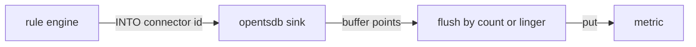

# OpenTSDB connector

The OpenTSDB connector writes rule results as data points. It posts points over HTTP or over telnet. It buffers points and flushes by count or by linger.

Use it when metrics must land in OpenTSDB. You get one put per flush.



## Before you start

- Run OpenTSDB. Note the endpoint and the metric name.

## Settings

Set `kind` to `opentsdb`. The alias `opents` selects the same runtime.

| Setting | Required | Meaning |
|---|---|---|
| `server` | yes | Endpoint URL. A `telnet://` scheme selects the telnet wire. |
| `metric` | yes | Metric name template. |
| `value` | yes | Value field, for example `${payload.temp}`. |
| `tags` | no | Tag templates. Every point carries the `topic` tag. |
| `summary` | no | Ask for summary counters. Default `true`. |

The action may override `metric`, `value`, `tags` and `summary` per target.

### `server`

Endpoint URL. Type: string. Required: yes. A `telnet://` scheme selects the telnet wire. Absent: 400 naming `server`.

```sh test
python3 - <<'PY'
import json, os, urllib.request
port = os.environ.get("API_PORT", "18083")
key = os.environ["API_KEY"]
def post(body):
    req = urllib.request.Request(
        f"http://127.0.0.1:{port}/api/v5/connectors", data=json.dumps(body).encode(), method="POST",
        headers={"Authorization": f"Bearer {key}", "Content-Type": "application/json"})
    try:
        with urllib.request.urlopen(req, timeout=5) as res:
            return res.status, json.load(res)
    except urllib.error.HTTPError as err:
        return err.code, json.load(err)
status, body = post({"name": "opents-server-bad", "type": "opentsdb",
                     "metric": "m", "value": "v"})
assert status == 400 and "server" in body["message"], body
print("ok")
PY
```

```output
ok
```

### `metric`

Metric name template. Type: string. Required: yes. Absent: 400 naming `metric`.

```sh test
python3 - <<'PY'
import json, os, urllib.request
port = os.environ.get("API_PORT", "18083")
key = os.environ["API_KEY"]
def post(body):
    req = urllib.request.Request(
        f"http://127.0.0.1:{port}/api/v5/connectors", data=json.dumps(body).encode(), method="POST",
        headers={"Authorization": f"Bearer {key}", "Content-Type": "application/json"})
    try:
        with urllib.request.urlopen(req, timeout=5) as res:
            return res.status, json.load(res)
    except urllib.error.HTTPError as err:
        return err.code, json.load(err)
status, body = post({"name": "opents-metric-bad", "type": "opentsdb",
                     "server": "http://127.0.0.1:4242", "value": "v"})
assert status == 400 and "metric" in body["message"], body
print("ok")
PY
```

```output
ok
```

### `value`

Value field template. Type: string. Required: yes. Absent: 400 naming `value`.

```sh test
python3 - <<'PY'
import json, os, urllib.request
port = os.environ.get("API_PORT", "18083")
key = os.environ["API_KEY"]
def post(body):
    req = urllib.request.Request(
        f"http://127.0.0.1:{port}/api/v5/connectors", data=json.dumps(body).encode(), method="POST",
        headers={"Authorization": f"Bearer {key}", "Content-Type": "application/json"})
    try:
        with urllib.request.urlopen(req, timeout=5) as res:
            return res.status, json.load(res)
    except urllib.error.HTTPError as err:
        return err.code, json.load(err)
status, body = post({"name": "opents-value-bad", "type": "opentsdb",
                     "server": "http://127.0.0.1:4242", "metric": "m"})
assert status == 400 and "value" in body["message"], body
print("ok")
PY
```

```output
ok
```

### `tags`

Tag templates. Type: object. Required: no. Default empty. Every point still carries the `topic` tag.

```sh test
python3 - <<'PY'
import json, os, urllib.request
port = os.environ.get("API_PORT", "18083")
key = os.environ["API_KEY"]
def post(body):
    req = urllib.request.Request(
        f"http://127.0.0.1:{port}/api/v5/connectors", data=json.dumps(body).encode(), method="POST",
        headers={"Authorization": f"Bearer {key}", "Content-Type": "application/json"})
    try:
        with urllib.request.urlopen(req, timeout=5) as res:
            return res.status, json.load(res)
    except urllib.error.HTTPError as err:
        return err.code, json.load(err)
status, created = post({"name": "opents-tags-ok", "type": "opentsdb",
                        "server": "http://127.0.0.1:4242", "metric": "m", "value": "v",
                        "tags": {"room": "r1"}})
assert status == 201, (status, created)
print("ok")
PY
```

```output
ok
```

### `summary`

Ask for summary counters. Type: boolean. Required: no. Default `true`. `false` drops the `?summary` query.

```sh test
python3 - <<'PY'
import json, os, urllib.request
port = os.environ.get("API_PORT", "18083")
key = os.environ["API_KEY"]
def post(body):
    req = urllib.request.Request(
        f"http://127.0.0.1:{port}/api/v5/connectors", data=json.dumps(body).encode(), method="POST",
        headers={"Authorization": f"Bearer {key}", "Content-Type": "application/json"})
    try:
        with urllib.request.urlopen(req, timeout=5) as res:
            return res.status, json.load(res)
    except urllib.error.HTTPError as err:
        return err.code, json.load(err)
status, created = post({"name": "opents-summary-ok", "type": "opentsdb",
                        "server": "http://127.0.0.1:4242", "metric": "m", "value": "v",
                        "summary": False})
assert status == 201, (status, created)
print("ok")
PY
```

```output
ok
```

Example:

```json
{
  "name": "opents-sink-1",
  "type": "opentsdb",
  "server": "http://127.0.0.1:4242",
  "metric": "factory.telemetry",
  "value": "${payload.temp}"
}
```

> [!NOTE]
> The docs run creates this shape. Creation validates only; it writes nothing. The send path needs an OpenTSDB server. See the failure record in [Verification failures](../_verification/failures.md).

## Check that it works

Create the connector. The broker answers 201 with the kind. It prints `ok`.

```toml test
[node]
id = "docs-connector-opentsdb"

[listeners.tcp]
bind = "0.0.0.0:1883"

[listeners.api]
bind = "0.0.0.0:18083"

[logging]
level = "warn"

[auth]
allow_anonymous = true
```

```sh test
python3 - <<'PY'
import json, os, urllib.request
port = os.environ.get("API_PORT", "18083")
key = os.environ["API_KEY"]
body = json.dumps({"name": "opents-sink-1", "type": "opentsdb",
                   "server": "http://127.0.0.1:4242",
                   "metric": "factory.telemetry",
                   "value": "${payload.temp}"}).encode()
req = urllib.request.Request(
    f"http://127.0.0.1:{port}/api/v5/connectors", data=body, method="POST",
    headers={"Authorization": f"Bearer {key}", "Content-Type": "application/json"})
try:
    with urllib.request.urlopen(req, timeout=5) as res:
        status, created = res.status, json.load(res)
except urllib.error.HTTPError as err:
    status, created = err.code, json.load(err)
assert status == 201, (status, created)
assert created["type"] == "opentsdb", created
print("ok")
PY
```

```output
ok
```

## Limits

- A point needs a numeric value. A missing field reads as zero.
- A failed summary count stops the batch with a failure.
- A dead server backs off and retries. The bounded queue sheds past its bound.

## Next steps

- Feed the connector from a rule in [Actions](../rules/actions.md).
- See every kind in [Connectors](./index.md).
