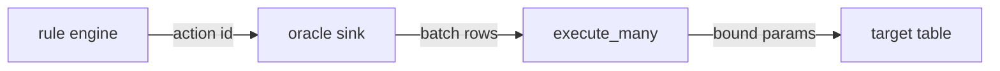

# Oracle connector

The Oracle connector runs one statement per batch. It speaks TNS with the maintained driver, including bound parameters. It pools one session per `pool_size` entry.

Use it when Oracle Database must hold telemetry. You get one parse per batch with your own statement.



## Before you start

- Run Oracle Database. Note the host, port, and service name or SID.
- Create the target table. Match its columns to the statement.
- This kind ships in the default build. No feature flag is necessary.

## Settings

Set connector `type` to `oracle`.

| Setting | Required | Meaning |
|---|---|---|
| `server` | yes | `Host[:Port]`. Default port is 1521. |
| `username` | yes | Database user. |
| `password` | no | Database password. Accepts `file:` and `env:` references. |
| `service_name` | no | Service name. One of `service_name` or `sid` is required. |
| `sid` | no | System identifier. One of `service_name` or `sid` is required. |
| `role` | no | Only `normal` is accepted. Another value is refused. |
| `pool_size` | no | Server sessions. Default is 8. Range is 1 to 1024. |

Set action `type` to `oracle` and `parameters.sql` to the statement.

| Marker | Value |
|---|---|
| `:1` | Topic. |
| `:2` | QoS. |
| `:3` | Payload. |

The statement must name at least one marker from `:1` to `:3`. Values bind out of band. A quote in a value never escapes into the text.

Example:

```json
{
  "name": "ora-sink-1",
  "type": "oracle",
  "connector": "ora-conn-1",
  "parameters": {
    "sql": "INSERT INTO t_mqtt_msg(topic, qos, payload) VALUES (:1, :2, :3)"
  }
}
```

> [!NOTE]
> The docs run creates this shape. Creation validates only; it touches no database. The send path needs an Oracle Database server. Full delivery is proved by the release qualification run, not by the docs run.

## Check that it works

Create the connector and the action. The broker answers 201 for each.

```toml test
[node]
id = "docs-connector-oracle"

[listeners.tcp]
bind = "0.0.0.0:1883"

[listeners.api]
bind = "0.0.0.0:18083"

[logging]
level = "warn"

[auth]
allow_anonymous = true
```

```sh test
python3 - <<'PY'
import json, os, urllib.request
port = os.environ.get("API_PORT", "18083")
key = os.environ["API_KEY"]
def call(method, path, body=None):
    import urllib.error
    req = urllib.request.Request(
        f"http://127.0.0.1:{port}{path}",
        data=json.dumps(body).encode() if body is not None else None,
        method=method,
        headers={"Authorization": f"Bearer {key}", "Content-Type": "application/json"})
    try:
        with urllib.request.urlopen(req, timeout=5) as res:
            assert res.status in (200, 201, 204), res.status
            return json.load(res) if res.status != 204 else {}
    except urllib.error.HTTPError as e:
        assert e.code == 404, e.code
        return {}
call("DELETE", "/api/v5/actions/ora-sink-1")
call("DELETE", "/api/v5/connectors/ora-conn-1")
conn = call("POST", "/api/v5/connectors", {"name": "ora-conn-1", "type": "oracle",
    "server": "127.0.0.1:1521", "username": "u", "service_name": "XE"})
assert conn["type"] == "oracle", conn
act = call("POST", "/api/v5/actions", {"name": "ora-sink-1", "type": "oracle",
    "connector": "ora-conn-1",
    "parameters": {"sql": "INSERT INTO t(topic) VALUES (:1)"}})
print(act["status"])
PY
```

```output
connected
```

## Limits

- A missing `server`, `username`, or service is refused with 400 and names the field.
- A missing `parameters.sql` is refused with 400.
- A `role` other than `normal` is refused with 400.
- A dead server counts each fire as failed. The broker keeps serving.

## Next steps

- Feed the action from a rule in [Actions](../rules/actions.md).
- See every kind in [Connectors](./index.md).
