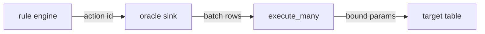
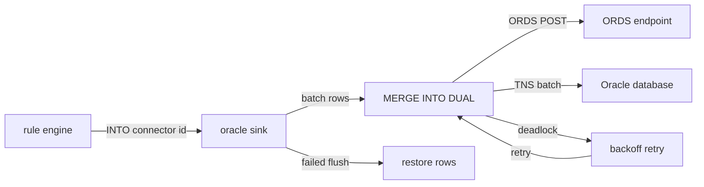

# Oracle connector

The Oracle connector runs one statement per batch. It speaks TNS with the maintained driver, including bound parameters. It pools one session per `pool_size` entry.

Use it when Oracle Database must hold telemetry. You get one parse per batch with your own statement.



## Before you start

- Run Oracle Database. Note the host, port, and service name or SID.
- Create the target table. Match its columns to the statement.
- This kind ships in the default build. No feature flag is necessary.

## Settings

Set connector `type` to `oracle`.

| Setting | Required | Meaning |
|---|---|---|
| `server` | yes | `Host[:Port]`. Default port is 1521. |
| `username` | yes | Database user. |
| `password` | no | Database password. Accepts `file:` and `env:` references. |
| `service_name` | no | Service name. One of `service_name` or `sid` is required. |
| `sid` | no | System identifier. One of `service_name` or `sid` is required. |
| `role` | no | Only `normal` is accepted. Another value is refused. |
| `pool_size` | no | Server sessions. Default is 8. Range is 1 to 1024. |

Set action `type` to `oracle` and `parameters.sql` to the statement.

| Marker | Value |
|---|---|
| `:1` | Topic. |
| `:2` | QoS. |
| `:3` | Payload. |

The statement must name at least one marker from `:1` to `:3`. Values bind out of band. A quote in a value never escapes into the text.

Example:

```json
{
  "name": "ora-sink-1",
  "type": "oracle",
  "connector": "ora-conn-1",
  "parameters": {
    "sql": "INSERT INTO t_mqtt_msg(topic, qos, payload) VALUES (:1, :2, :3)"
  }
}
```

> [!NOTE]
> The docs run creates this shape. Creation validates only; it touches no database. The send path needs an Oracle Database server. Full delivery is proved by the release qualification run, not by the docs run.

## Check that it works

Create the connector and the action. The broker answers 201 for each.

```toml test
[node]
id = "docs-connector-oracle"

[listeners.tcp]
bind = "0.0.0.0:1883"

[listeners.api]
bind = "0.0.0.0:18083"

[logging]
level = "warn"

[auth]
allow_anonymous = true
```

```sh test
python3 - <<'PY'
import json, os, urllib.request
port = os.environ.get("API_PORT", "18083")
key = os.environ["API_KEY"]
def call(method, path, body=None):
    import urllib.error
    req = urllib.request.Request(
        f"http://127.0.0.1:{port}{path}",
        data=json.dumps(body).encode() if body is not None else None,
        method=method,
        headers={"Authorization": f"Bearer {key}", "Content-Type": "application/json"})
    try:
        with urllib.request.urlopen(req, timeout=5) as res:
            assert res.status in (200, 201, 204), res.status
            return json.load(res) if res.status != 204 else {}
    except urllib.error.HTTPError as e:
        assert e.code == 404, e.code
        return {}
call("DELETE", "/api/v5/actions/ora-sink-1")
call("DELETE", "/api/v5/connectors/ora-conn-1")
conn = call("POST", "/api/v5/connectors", {"name": "ora-conn-1", "type": "oracle",
    "server": "127.0.0.1:1521", "username": "u", "service_name": "XE"})
assert conn["type"] == "oracle", conn
act = call("POST", "/api/v5/actions", {"name": "ora-sink-1", "type": "oracle",
    "connector": "ora-conn-1",
    "parameters": {"sql": "INSERT INTO t(topic) VALUES (:1)"}})
print(act["status"])
PY
```

```output
disconnected
```

## Limits

- A missing `server`, `username`, or service is refused with 400 and names the field.
- A missing `parameters.sql` is refused with 400.
- A `role` other than `normal` is refused with 400.
- A dead server counts each fire as failed. The broker keeps serving.

## Next steps

- Feed the action from a rule in [Actions](../rules/actions.md).
- See every kind in [Connectors](./index.md).

## Reference form (v1 API)

The reference form uses the v1 connector API. The v5 form above uses connector and action documents. This section keeps the reference page.

The Oracle connector writes each rule result as one table row. It sends typed rows as an atomic `MERGE INTO ... USING DUAL` statement with positional binds. It groups rows by shape before each write.

Use it when relational rows must hold telemetry in Oracle Database. You get one batched write per group with your own key mapping.



### Before you start

- Run Oracle Database or an ORDS endpoint. Note the host and the service.
- Create the target table with a primary key.
- This kind ships in the default build. No feature flag is necessary.

### Settings

Set `kind` to `oracle`. The broker also accepts the aliases `oracle_db` and `ords`. It stores the kind as `oracle`.

| Setting | Required | Meaning |
|---|---|---|
| `url` | yes | ORDS endpoint or connection string. An empty value is refused. |
| `schema` | yes | Oracle schema name. An empty value is refused. |
| `table` | yes | Target table name. An empty value is refused. |
| `username` | yes | Database username. An empty value is refused. |
| `password` | yes | Database password. The key must exist. An empty value passes validation and fails at connect. |
| `custom_upsert` | no | Custom `MERGE INTO` statement override. Default is empty, so the sink builds the statement. |
| `key_columns` | no | Match keys for the merge. Default is empty. An empty list without `custom_upsert` is refused. |
| `batch_size` | no | Rows per batch. Default 500. A value of 0 reads as 1. |
| `buffer_capacity` | no | Accepted and stored. Default `None`. The sink flushes by `batch_size`. |
| `timeout_ms` | no | Connect and request deadline in ms. Default 5000. A value below 1 reads as 1. |

Example:

```json
{
  "id": "oracle-1",
  "kind": "oracle",
  "config": {
    "url": "https://oracle-host:8080/ords/admin/_/sql",
    "schema": "ADMIN",
    "table": "telemetry",
    "username": "admin",
    "password": "secret",
    "key_columns": ["device_id"],
    "batch_size": 100,
    "timeout_ms": 5000
  }
}
```

> [!NOTE]
> The docs run creates this shape. Creation validates only; it opens no socket. The send path needs an Oracle server. See the failure record in [Verification failures](../_verification/failures.md).

### Check that it works

Create the connector. The broker answers 201 with the kind.

```toml test
# Reference form run.
[node]
id = "docs-connector-oracle"

[listeners.tcp]
bind = "0.0.0.0:1883"

[listeners.api]
bind = "0.0.0.0:18083"

[logging]
level = "warn"

[auth]
allow_anonymous = true
```

```sh test
python3 - <<'PY'
import json, os, urllib.request
port = os.environ.get("API_PORT", "18083")
key = os.environ["API_KEY"]
body = json.dumps({"id": "oracle-1", "kind": "oracle",
                   "config": {"url": "https://oracle-host:8080/ords/admin/_/sql",
                              "schema": "ADMIN",
                              "table": "telemetry",
                              "username": "admin",
                              "password": "secret",
                              "key_columns": ["device_id"],
                              "batch_size": 100,
                              "timeout_ms": 5000}}).encode()
req = urllib.request.Request(
    f"http://127.0.0.1:{port}/api/v1/connectors", data=body, method="POST",
    headers={"Authorization": f"Bearer {key}", "Content-Type": "application/json"})
with urllib.request.urlopen(req, timeout=5) as res:
    assert res.status == 201
    print(json.load(res)["kind"])
PY
```

```output
oracle
```

### Limits

- An empty `url`, `schema`, `table`, or `username` is refused with 400.
- Empty `key_columns` without `custom_upsert` is refused with 400.
- A payload that is not JSON is refused. A payload that is not UTF-8 is refused.
- An object payload maps each key to one column. Other JSON rides in one `payload` column.
- Rows with one shape share one parse. Mixed shapes fall back to one call per row.
- Deadlocks and lost connections retry with backoff. Missing tables and bad logins fail fast.
- A wrong table fails with the server text, including `ORA-00942`.
- A failed flush restores rows in order and engages backoff. Backoff waits 2s, then doubles to 30s. Flushes fail fast during backoff.
- A partial batch flushes after 50 ms. A full batch flushes at once.
- The API path posts `statementText` with binds to ORDS through `HttpOracleTransport` with Basic auth.
- The direct path runs `MERGE` batches over TNS through `DriverOracleTransport`. It holds one cached connection and commits once per batch.
- The tier is enterprise. The kind ships in the default build.

### Next steps

- Feed the connector from a rule in [Actions](../rules/actions.md).
- See every kind in [Connectors](./index.md).

## Known limits in this release

The broker accepts the fields in this list. The broker does not apply them in this release.

- `batch_size` (the batch size)

To set batching, use `resource_opts` in the action. The broker applies `resource_opts`.

A later release applies these fields.
