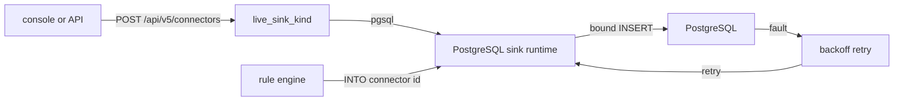

# PostgreSQL (pgsql) connector

The `pgsql` name is the v5 name for the PostgreSQL sink. The v5 connector route accepts the name and builds a connection URL from four fields. The v1 connector route does not accept the name.

Use it when a tool sends the v5 name `pgsql`. You get a stored connector row that inserts each rule result into `test_telemetry`.



## Before you start

- Run PostgreSQL. Note the host, the port, and the database.
- Create the target table `test_telemetry` with the columns `clientid`, `topic`, `payload`, and `timestamp`.
- Use the v5 route. The v1 route refuses `pgsql`; it accepts `postgres` and `postgresql`.

## Settings

Create the connector with `POST /api/v5/connectors`.

| Setting | Required | Meaning |
|---|---|---|
| `id` or `name` | yes | Connector id. Its length is capped at 256 bytes. |
| `type` | yes | Connector type. Use `pgsql`. The v5 route also maps `postgres` to this runtime. |
| `enable` | no | Enable flag. Default `true`. |
| `server` | no | Host and optional port. Default `127.0.0.1:5432`. An empty host is refused. |
| `database` | no | Database name. Default `postgres`. |
| `username` | no | Login user. Default `postgres`. |
| `password` | no | Login password. Default empty. |

The v5 route builds the URL `postgres://{username}:{password}@{server}/{database}`. The URL has no query, so this route uses plaintext. It fixes `pool_size` to 1, `batch_size` to 1, and `batch_timeout_ms` to 10.

The fixed statement is:

```sql
INSERT INTO test_telemetry (clientid, topic, payload, timestamp)
VALUES ('rule-engine', $1, $3, 0)
```

`$1` is the topic and `$3` is the raw payload. The statement sets the client id and the timestamp. It does not use `$2`.

The `postgres` page documents the full sink settings, including `connection_url`, `sql_template`, `pool_size`, `batch_size`, and `batch_timeout_ms`. The v1 route accepts `postgres` and `postgresql`.

Example:

```json
{
  "id": "pgsql-1",
  "name": "pgsql-1",
  "type": "pgsql",
  "enable": true,
  "server": "127.0.0.1:5432",
  "database": "telemetry",
  "username": "indra_loader",
  "password": "secret"
}
```

> [!NOTE]
> The docs run creates the connector and sends one message to a local listener. The listener reads the PostgreSQL startup message. No real server completes the insert. See the record in [Verification failures](../_verification/failures.md).

## Check that it works

The test starts a local listener. It refuses `pgsql` on the v1 route. It creates the connector on the v5 route. It creates a forwarding rule and publishes one message. It reads the startup message back. The listener prints `connected` when the message arrives.

```toml test
[node]
id = "docs-connector-pgsql"

[listeners.tcp]
bind = "0.0.0.0:1883"

[listeners.api]
bind = "0.0.0.0:18083"

[logging]
level = "warn"

[auth]
allow_anonymous = true
```

```sh test
python3 - <<'PY'
import json, os, socket, struct, threading, time, urllib.request, urllib.error

captured = []

def listen_once(port):
    server = socket.socket()
    server.setsockopt(socket.SOL_SOCKET, socket.SO_REUSEADDR, 1)
    server.bind(("127.0.0.1", port))
    server.listen(1)

    def run():
        try:
            server.settimeout(15)
            client, _ = server.accept()
            client.settimeout(5)
            captured.append(client.recv(4096))
            client.close()
        except OSError:
            pass
        finally:
            server.close()

    threading.Thread(target=run, daemon=True).start()

probe = socket.socket()
probe.bind(("127.0.0.1", 0))
pg_port = probe.getsockname()[1]
probe.close()
listen_once(pg_port)

mqtt_port = int(os.environ.get("MQTT_PORT", "1883"))
api_port = os.environ.get("API_PORT", "18083")
key = os.environ["API_KEY"]

def call(method, path, body=None):
    data = None if body is None else json.dumps(body).encode()
    req = urllib.request.Request(
        f"http://127.0.0.1:{api_port}{path}", data=data, method=method,
        headers={"Authorization": f"Bearer {key}",
                 "Content-Type": "application/json"})
    try:
        with urllib.request.urlopen(req, timeout=10) as res:
            raw = res.read().decode()
            return res.status, (json.loads(raw) if raw else None)
    except urllib.error.HTTPError as err:
        raw = err.read().decode()
        try:
            return err.code, json.loads(raw)
        except ValueError:
            return err.code, raw

s1, b1 = call("POST", "/api/v1/connectors",
              {"id": "pgsql-v1", "kind": "pgsql",
               "config": {"server": "127.0.0.1:5432"}})
assert s1 == 400, (s1, b1)
assert "unknown connector kind" in json.dumps(b1).lower(), b1

s2, b2 = call("POST", "/api/v5/connectors",
              {"name": "pgsql-v5", "type": "pgsql",
               "server": f"127.0.0.1:{pg_port}", "database": "docsdb",
               "username": "docsuser", "password": "secret"})
assert s2 == 201 and b2["type"] == "pgsql", (s2, b2)

s3, b3 = call("POST", "/api/v5/connectors",
              {"name": "pgsql-empty", "type": "pgsql", "server": ""})
assert s3 == 400, (s3, b3)
assert "host" in json.dumps(b3).lower() or "server" in json.dumps(b3).lower(), b3

s4, b4 = call("POST", "/api/v1/rules",
              {"name": "pgsql-rule", "topic_filter": "docs/pg/in",
               "actions": [{"type": "forwardconnector",
                            "connector_id": "pgsql-v5"}]})
assert s4 == 201, (s4, b4)

def packet(kind, body):
    return bytes([kind, len(body)]) + body

def field(data):
    return struct.pack(">H", len(data)) + data

pub = socket.create_connection(("127.0.0.1", mqtt_port), timeout=5)
pub.sendall(packet(0x10, b"\x00\x04MQTT\x04\x02\x00\x3c" + field(b"pgsql-pub")))
assert pub.recv(4) == b"\x20\x02\x00\x00"
pub.sendall(packet(0x30, field(b"docs/pg/in") + b'{"value": 8}'))
deadline = time.time() + 12
while not captured and time.time() < deadline:
    time.sleep(0.1)
assert captured, "no startup message arrived"
startup = captured[0]
assert b"user\x00docsuser\x00" in startup, startup
assert b"database\x00docsdb\x00" in startup, startup
print("connected")
PY
```

```output
connected
```

## Limits

- The v1 route refuses `pgsql` with 400. Use `postgres` on v1 or `pgsql` on v5.
- An empty `server` or a server with a bad port is refused with 400.
- The v5 route builds a plaintext URL. It has no `sslmode` option.
- The fixed statement inserts into `test_telemetry`. Create that table first.
- The fixed statement sets `clientid` to `rule-engine` and `timestamp` to 0.
- A payload that is not valid UTF-8 is refused.
- A rejected row is counted and dropped. A failed flush restores the row and backs off.
- The connect deadline is 5 seconds. The statement deadline is 10 seconds.
- The production path uses the maintained PostgreSQL driver with bound parameters.
- The tier is community. The kind ships in the default build.

## Next steps

- Read the full sink settings in [PostgreSQL](./postgres.md).
- Feed the connector from a rule in [Actions](../rules/actions.md).
- See every kind in [Connectors](./index.md).
