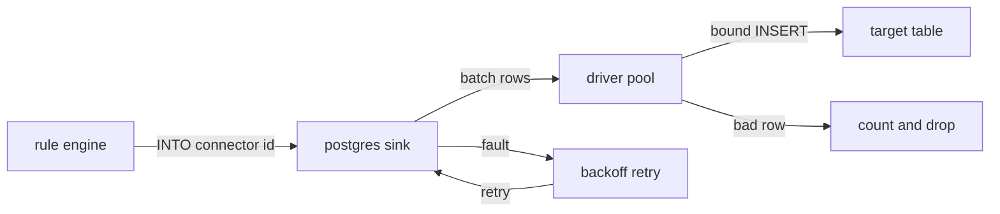

# PostgreSQL connector

The PostgreSQL connector writes each rule result as one table row. It sends bound parameters through the maintained driver with one round trip per row. It buffers rows and flushes full or stale batches.

Use it when relational rows must hold telemetry in PostgreSQL. You get one insert per row in each batch with your own column mapping.



## Before you start

- Run PostgreSQL. Note the connection URL.
- Create the target table with topic, QoS, and payload columns.
- This kind ships in the default build. No feature flag is necessary.

## Settings

Set `kind` to `postgres`. The broker also accepts the alias `postgresql`. It stores the kind as `postgres`.

| Setting | Required | Meaning |
|---|---|---|
| `connection_url` | yes | URL `postgresql://[user[:password]@]host[:port][/dbname][?params]`. The driver also accepts the `postgres://` spelling. Default user is `postgres`. Default port is 5432. Default database is the user name. A missing host is refused. |
| `sql_template` | yes | Insert statement with `$1` (topic), `$2` (QoS), and `$3` (payload). Markers inside strings, quoted names, and comments do not count. `$0` and markers above `$3` are refused. |
| `pool_size` | no | Driver pool size. Default 10. A value of 0 is refused. |
| `batch_size` | no | Rows per batch. Default 100. A value of 0 is refused. |
| `batch_timeout_ms` | no | Linger before a stale batch flushes. Default 50. |

Example:

```json
{
  "id": "pg-sink-1",
  "kind": "postgres",
  "config": {
    "connection_url": "postgresql://u:p@127.0.0.1:5432/db",
    "sql_template": "INSERT INTO t (topic, qos, payload) VALUES ($1, $2, $3)",
    "pool_size": 2,
    "batch_size": 50,
    "batch_timeout_ms": 25
  }
}
```

> [!NOTE]
> The docs run creates this shape. Creation validates only; it opens no socket. The send path needs a PostgreSQL server. See the failure record in [Verification failures](../_verification/failures.md).

## Check that it works

Create the connector. The broker answers 201 with the kind.

```toml test
[node]
id = "docs-connector-postgres"

[listeners.tcp]
bind = "0.0.0.0:1883"

[listeners.api]
bind = "0.0.0.0:18083"

[logging]
level = "warn"

[auth]
allow_anonymous = true
```

```sh test
python3 - <<'PY'
import json, os, urllib.request
port = os.environ.get("API_PORT", "18083")
key = os.environ["API_KEY"]
body = json.dumps({"id": "pg-sink-1", "kind": "postgres",
                   "config": {"connection_url": "postgresql://u:p@127.0.0.1:5432/db",
                              "sql_template": "INSERT INTO t (topic, qos, payload) VALUES ($1, $2, $3)",
                              "pool_size": 2, "batch_size": 50,
                              "batch_timeout_ms": 25}}).encode()
req = urllib.request.Request(
    f"http://127.0.0.1:{port}/api/v1/connectors", data=body, method="POST",
    headers={"Authorization": f"Bearer {key}", "Content-Type": "application/json"})
with urllib.request.urlopen(req, timeout=5) as res:
    assert res.status == 201
    print(json.load(res)["kind"])
PY
```

```output
postgres
```

## Limits

- An empty `connection_url` or `sql_template` is refused with 400.
- A template with `$0` or a marker above `$3` is refused with 400.
- A URL without the `postgresql://` or `postgres://` prefix is refused. A missing host is refused. A bad port is refused.
- A `pool_size` of 0 is refused. A `batch_size` of 0 is refused.
- The production path uses `DriverPgTransport` through the maintained driver. The hand-written framing path serves offline unit tests only.
- An explicit `sslmode=require`, `verify-ca`, or `verify-full` opts into TLS through the system trust store. Other URLs stay plaintext. An empty trust store denies the connection.
- The driver runs MD5 and SCRAM-SHA-256 logins. A wrong password fails closed with a connection error.
- Values travel bound (`$1` topic, `$2` QoS, `$3` payload). One extended-protocol round trip runs per row.
- `$2` accepts integer and text columns. `$3` accepts JSON, JSONB, text, BYTEA, and citext columns.
- A payload that is not valid UTF-8 is refused with SQLSTATE 22021.
- A rejected row is counted and dropped. Class `22` and `23` errors, `42703`, and `42804` mark a rejected row.
- A failed flush restores rows in order and backs off. Backoff waits 2s, then doubles to 30s. Flushes fail fast during backoff.
- The connect deadline is 5 seconds. The statement deadline is 10 seconds.
- The tier is community. The kind ships in the default build.

## Next steps

- Feed the connector from a rule in [Actions](../rules/actions.md).
- See every kind in [Connectors](./index.md).
