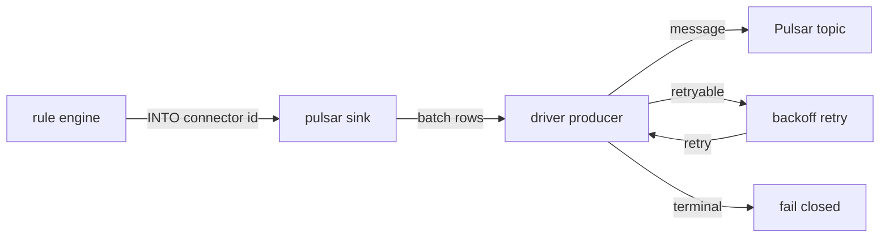

# Pulsar connector

The Pulsar connector writes each rule result as one Pulsar message. It groups rows by destination topic and produces them through the maintained driver.

Use it when streaming telemetry must reach Apache Pulsar with keyed routing. You get one message per result row on a persistent topic.



## Before you start

- Run Apache Pulsar standalone. Note the service URL.
- Plan the tenant, the namespace, and the topic name.
- This kind ships in the default build. No feature flag is necessary.

## Settings

Set `kind` to `pulsar`.

| Setting | Required | Meaning |
|---|---|---|
| `service_url` | yes | Service address as `pulsar://host:port`, `http://host:port`, or bare `host:port`. Default port is 6650, or 8080 for `http(s)://`. An empty value is refused. An unknown scheme is refused. A value with `/` is refused. An empty host is refused. A bad port or port 0 is refused. |
| `tenant` | no | Pulsar tenant. Default is `public`. It must match `[A-Za-z0-9._-]`. |
| `namespace` | no | Pulsar namespace. Default is `default`. It must match `[A-Za-z0-9._-]`. |
| `topic` | yes | Topic name or template with `${topic}`, `${qos}`, `${timestamp}`. An empty value is refused. A resolved name with `/` or a space is refused. The destination is `persistent://{tenant}/{namespace}/{name}`. |
| `auth` | no | Auth object. Default is `{"type": "none"}`. `{"type": "token", "token": "..."}` needs a non-empty token. The driver refuses a token and fails closed. Use no auth against standalone. |
| `partition_key_template` | no | Partition key template with `${topic}`, `${client_id}`, `${qos}`, `${timestamp}`. Default is none. A missing `${client_id}` reads as empty. |
| `properties` | no | Custom property map. Default is empty. Each name must be non-empty. Each value is a template with the same variables as the partition key. Every message also carries `mqtt_topic` and `mqtt_qos`. |
| `batch_size` | no | Messages per produce call. Default is 200. A value of 0 is refused. `null` means no count bound. |
| `batch_bytes` | no | Batch byte limit. Default is 2097152. A value of 0 is refused. `null` means no byte bound. |
| `linger_ms` | no | Linger before a partial batch flushes in ms. Default is 10. `null` means no time bound. |
| `max_retries` | no | Retries on transport faults. Default is 3. A value of 0 means no retry. `null` means no bound. |
| `initial_backoff_ms` | no | First retry delay in ms. Default is 100. A value below 1 reads as 1. |
| `max_backoff_ms` | no | Retry delay ceiling in ms. Default is 2000. A value below 1 reads as 1. |
| `timeout_ms` | no | Network and send deadline in ms. Default is 5000. A value below 1 reads as 1. |

Example:

```json
{
  "id": "pulsar-1",
  "kind": "pulsar",
  "config": {
    "service_url": "pulsar://127.0.0.1:6650",
    "tenant": "public",
    "namespace": "default",
    "topic": "iot-telemetry",
    "auth": {"type": "none"},
    "batch_size": 50,
    "batch_bytes": 65536,
    "linger_ms": 10,
    "max_retries": 2,
    "initial_backoff_ms": 10,
    "max_backoff_ms": 100,
    "timeout_ms": 5000
  }
}
```

> [!NOTE]
> The docs run creates this shape. Creation validates only; it opens no socket. The send path needs a Pulsar server. See the failure record in [Verification failures](../_verification/failures.md).

## Check that it works

Create the connector. The broker answers 201 with the kind.

```toml test
[node]
id = "docs-connector-pulsar"

[listeners.tcp]
bind = "0.0.0.0:1883"

[listeners.api]
bind = "0.0.0.0:18083"

[logging]
level = "warn"

[auth]
allow_anonymous = true
```

```sh test
python3 - <<'PY'
import json, os, urllib.request
port = os.environ.get("API_PORT", "18083")
key = os.environ["API_KEY"]
body = json.dumps({"id": "pulsar-1", "kind": "pulsar",
                   "config": {"service_url": "pulsar://127.0.0.1:6650",
                              "tenant": "public",
                              "namespace": "default",
                              "topic": "iot-telemetry",
                              "auth": {"type": "none"},
                              "batch_size": 50, "batch_bytes": 65536,
                              "linger_ms": 10, "max_retries": 2,
                              "initial_backoff_ms": 10,
                              "max_backoff_ms": 100,
                              "timeout_ms": 5000}}).encode()
req = urllib.request.Request(
    f"http://127.0.0.1:{port}/api/v1/connectors", data=body, method="POST",
    headers={"Authorization": f"Bearer {key}", "Content-Type": "application/json"})
with urllib.request.urlopen(req, timeout=5) as res:
    assert res.status == 201
    print(json.load(res)["kind"])
PY
```

```output
pulsar
```

## Limits

- An empty `service_url` or `topic` is refused with 400.
- A scheme outside `pulsar://`, `http://`, and `https://` is refused.
- An empty host, a bad port, or port 0 is refused.
- A `tenant` or `namespace` outside `[A-Za-z0-9._-]` is refused.
- A resolved topic with `/` or a space is refused.
- An empty token is refused at validation. A non-empty token fails closed at produce time; the driver is not qualified for tokens.
- An `http(s)://` address names the admin entry, not the binary entry. The driver fails it closed; it needs a `pulsar://` address.
- A `batch_size` of 0 is refused. A `batch_bytes` of 0 is refused.
- A `/` in the MQTT topic becomes `.` in the resolved name. A char outside `[A-Za-z0-9._-+]` becomes `-`. `+` stays verbatim.
- Mixed MQTT topics group by destination path in first-seen order.
- Each message carries a monotonic sequence id and an event time from the ingest clock.
- A failed flush restores rows in order and engages backoff. Flushes fail fast during backoff.
- The production path uses `DriverPulsarTransport` through the maintained driver. The hand-written framing path serves offline unit tests only.
- The connector runs behind the rule engine bounded queue. A slow cluster sheds load; it never stalls publishers.
- The tier is enterprise. The kind ships in the default build.

## Next steps

- Feed the connector from a rule in [Actions](../rules/actions.md).
- See every kind in [Connectors](./index.md).
