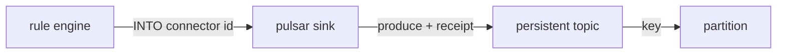

# Pulsar connector

The Pulsar connector produces rule results as Pulsar messages. The action names the topic and the key. The driver waits for the send receipt.

Use it when a Pulsar consumer reads broker data. You get each event on the topic path you set.



## Before you start

- Run a Pulsar broker. Note its `pulsar://host:6650` service URL.
- Create the namespace, or use `public/default`.
- Authentication holds `none` only. A token or basic value is refused.

## Settings

Set `type` to `pulsar`.

Connector settings:

| Setting | Required | Meaning |
|---|---|---|
| `servers` | yes | Service URL, `pulsar://host:6650`. Alias `service_url`. |
| `tenant` | no | Tenant, default `public`. |
| `namespace` | no | Namespace, default `default`. |
| `authentication` | no | Only `none` is supported. |

Action settings:

| Setting | Required | Meaning |
|---|---|---|
| `pulsar_topic` | yes | Topic template, `${topic}` supported. |
| `message.key` | no | Partition key template. Absent means no key. |
| `message.value` | no | Only `${.}` is supported (the whole message). |
| `strategy` | no | `random` (default), `roundrobin`, or `key_dispatch`. |

Example:

```json
{
  "type": "pulsar",
  "name": "pulsar-out",
  "servers": "pulsar://127.0.0.1:6650"
}
```

```json
{
  "type": "pulsar",
  "name": "pulsar-act",
  "connector": "pulsar-out",
  "parameters": {
    "pulsar_topic": "events",
    "message": {"key": "${client_id}"},
    "strategy": "key_dispatch"
  }
}
```

> [!NOTE]
> The docs run creates this shape. Creation validates only; it opens no socket and sends no message. The send path needs a Pulsar broker.

## Check that it works

Create the connector. The broker answers 201. A body without a service URL answers 400 naming the field. Both answers print `ok`.

```toml test
[node]
id = "docs-connector-pulsar"

[listeners.tcp]
bind = "0.0.0.0:1883"

[listeners.api]
bind = "0.0.0.0:18083"

[logging]
level = "warn"

[auth]
allow_anonymous = true
```

```sh test
python3 - <<'PY'
import json, os, urllib.request
port = os.environ.get("API_PORT", "18083")
key = os.environ["API_KEY"]
def post(body):
    req = urllib.request.Request(
        f"http://127.0.0.1:{port}/api/v5/connectors", data=json.dumps(body).encode(), method="POST",
        headers={"Authorization": f"Bearer {key}", "Content-Type": "application/json"})
    try:
        with urllib.request.urlopen(req, timeout=5) as res:
            return res.status, json.load(res)
    except urllib.error.HTTPError as err:
        return err.code, json.load(err)
status, created = post({"name": "pulsar-run-ok", "type": "pulsar",
                        "servers": "pulsar://127.0.0.1:6650"})
assert status == 201, (status, created)
assert created.get("type") == "pulsar", created
status, body = post({"name": "pulsar-run-bad", "type": "pulsar"})
assert status == 400 and "servers" in body["message"], body
print("ok")
PY
```

```output
ok
```

## Limits

- No authentication yet. A token or basic value is refused with a clear error.
- Producer tuning (`batch_size`, `compression`, timeouts) belongs to `resource_opts`. A present value is refused.
- `message.value` supports only the whole message. A custom value is refused.

## Next steps

- Feed the action from a rule in [Actions](../rules/actions.md).
- See every kind in [Connectors](./index.md).
