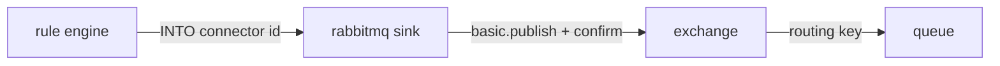

# RabbitMQ connector

The RabbitMQ connector publishes rule results as AMQP messages. The action names the exchange and the routing key. The driver waits for the broker confirm.

Use it when a queue worker reads broker data. You get each event on the exchange and routing key you set.



## Before you start

- Run a RabbitMQ broker. Note its host, port, user, and password.
- Create the target exchange, or publish to the default exchange with a queue name.
- For a full build, enable the feature: `--features rabbitmq`. The default build answers 400 and names the feature.

## Settings

Set `type` to `rabbitmq`.

Connector settings:

| Setting | Required | Meaning |
|---|---|---|
| `servers` | yes | Host and port, `host:port`. Alias `server`. |
| `username` | yes | Login name. |
| `password` | yes | Login secret. |
| `virtual_host` | no | Virtual host, default `/`. |

Action settings:

| Setting | Required | Meaning |
|---|---|---|
| `routing_key` | yes | Routing template, `${topic}` supported. Slashes become dots. |
| `exchange` | no | Exchange template, default `""` (the default exchange). |
| `delivery_mode` | no | `non_persistent` (default) or `persistent`. |
| `headers_template` | no | Array of `{key, value}` templates. Values support `${topic}` and `${payload}`. |
| `properties_template` | no | Only the empty list is supported. |
| `payload_template` | no | Body template, `${topic}` and `${payload}` supported. Absent forwards raw bytes. |

Example:

```json
{
  "type": "rabbitmq",
  "name": "rabbit-out",
  "servers": "127.0.0.1:5672",
  "username": "app",
  "password": "secret"
}
```

```json
{
  "type": "rabbitmq",
  "name": "rabbit-act",
  "connector": "rabbit-out",
  "parameters": {
    "exchange": "events",
    "routing_key": "sensor.${topic}",
    "delivery_mode": "persistent"
  }
}
```

> [!NOTE]
> The docs run creates this shape. Creation validates only; it opens no socket and sends no message. The send path needs a RabbitMQ broker.

## Check that it works

Create the connector. The broker answers 201 with the kind when the build holds RabbitMQ, else 400 naming the feature. Both answers print `ok`. A body without a password answers 400 naming the field.

```toml test
[node]
id = "docs-connector-rabbitmq"

[listeners.tcp]
bind = "0.0.0.0:1883"

[listeners.api]
bind = "0.0.0.0:18083"

[logging]
level = "warn"

[auth]
allow_anonymous = true
```

```sh test
python3 - <<'PY'
import json, os, urllib.request
port = os.environ.get("API_PORT", "18083")
key = os.environ["API_KEY"]
def post(body):
    req = urllib.request.Request(
        f"http://127.0.0.1:{port}/api/v5/connectors", data=json.dumps(body).encode(), method="POST",
        headers={"Authorization": f"Bearer {key}", "Content-Type": "application/json"})
    try:
        with urllib.request.urlopen(req, timeout=5) as res:
            return res.status, json.load(res)
    except urllib.error.HTTPError as err:
        return err.code, json.load(err)
status, created = post({"name": "rabbit-run-ok", "type": "rabbitmq",
                        "servers": "127.0.0.1:5672", "username": "u", "password": "p"})
assert status in (201, 400), (status, created)
if status == 201:
    assert created.get("type") == "rabbitmq", created
else:
    assert "feature" in str(created).lower(), created
status, body = post({"name": "rabbit-run-bad", "type": "rabbitmq",
                     "servers": "127.0.0.1:5672", "username": "u"})
assert status == 400 and "password" in body["message"], body
print("ok")
PY
```

```output
ok
```

## Limits

- The broker checks the publisher confirm for each message. A refused message counts a failed forward.
- `properties_template` accepts only `[]`. The broker sets content type, delivery mode, and timestamp.
- Tune `publish_confirmation_timeout` is not supported. Delivery always awaits the broker ack.

## Next steps

- Feed the action from a rule in [Actions](../rules/actions.md).
- See every kind in [Connectors](./index.md).
