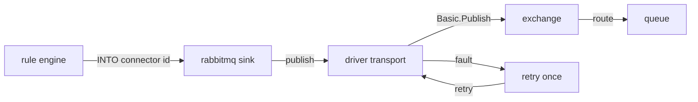

# RabbitMQ connector

The RabbitMQ connector sends each rule result as one AMQP message. It publishes through the maintained driver to one exchange with a rendered routing key.

Use it when downstream services consume AMQP messages from RabbitMQ. You get one message per result row on the named exchange.



## Before you start

- Run RabbitMQ. Note the AMQP endpoint.
- Create the exchange. Plan the routing key.
- For a full build, enable the feature: `--features rabbitmq`. The default build answers 400 and names the feature.

## Settings

Set `kind` to `rabbitmq`. The broker also accepts the aliases `rabbit` and `amqp`. It stores the kind as `rabbitmq`.

| Setting | Required | Meaning |
|---|---|---|
| `endpoint` | yes | AMQP URL `amqp://[user[:pass]@]host[:port][/vhost]`. Default user is `guest`. Default password is `guest`. Default port is 5672. Default vhost is `/`. `%2f` decodes to `/` in the vhost. A value without the `amqp://` prefix is refused. An empty host is refused. A bad port is refused. An empty username is refused. |
| `exchange` | yes | Exchange name with 1..255 bytes. An empty value is refused. A value above 255 bytes is refused. |
| `routing_key_template` | yes | Routing key with `${topic}`. Slashes in the topic become dots. An empty value is refused. A rendered key above 255 bytes is refused. |
| `delivery_mode` | yes | `1` or `2`. Other values are refused. |

Example:

```json
{
  "id": "rabbit-1",
  "kind": "rabbitmq",
  "config": {
    "endpoint": "amqp://127.0.0.1:5672/%2f",
    "exchange": "telemetry",
    "routing_key_template": "sensor.${topic}",
    "delivery_mode": 2
  }
}
```

> [!NOTE]
> The docs run creates this shape. Creation validates only; it opens no socket. The send path needs a RabbitMQ server. See the failure record in [Verification failures](../_verification/failures.md).

## Check that it works

Create the connector. The broker answers 201 with the kind when the build holds RabbitMQ, else 400 naming the feature. Both answers print `ok`.

```toml test
[node]
id = "docs-connector-rabbitmq"

[listeners.tcp]
bind = "0.0.0.0:1883"

[listeners.api]
bind = "0.0.0.0:18083"

[logging]
level = "warn"

[auth]
allow_anonymous = true
```

```sh test
python3 - <<'PY'
import json, os, urllib.request, urllib.error
port = os.environ.get("API_PORT", "18083")
key = os.environ["API_KEY"]
body = json.dumps({"id": "rabbit-1", "kind": "rabbitmq",
                   "config": {"endpoint": "amqp://127.0.0.1:5672/%2f",
                              "exchange": "telemetry",
                              "routing_key_template": "sensor.${topic}",
                              "delivery_mode": 2}}).encode()
req = urllib.request.Request(
    f"http://127.0.0.1:{port}/api/v1/connectors", data=body, method="POST",
    headers={"Authorization": f"Bearer {key}", "Content-Type": "application/json"})
try:
    with urllib.request.urlopen(req, timeout=5) as res:
        status, created = res.status, json.load(res)
except urllib.error.HTTPError as err:
    status, created = err.code, json.load(err)
assert status in (201, 400), (status, created)
if status == 201:
    assert created["kind"] == "rabbitmq", created
else:
    assert "rabbitmq" in created["error"], created
print("ok")
PY
```

```output
ok
```

## Limits

- An empty `endpoint`, `exchange`, or `routing_key_template` is refused with 400.
- An endpoint without the `amqp://` prefix is refused. An empty host is refused. A bad port is refused. An empty username is refused.
- An `exchange` outside 1..255 bytes is refused.
- A `routing_key_template` without `${topic}` still validates. Slashes in the topic become dots. A rendered key above 255 bytes fails the send.
- A `delivery_mode` outside `1` and `2` is refused.
- Each message carries `mqtt.topic`, `mqtt.qos`, and `mqtt.timestamp` in the header table. The content type is `application/json`. The body holds the payload verbatim.
- The production path uses `LapinRabbitTransport` through the maintained driver. The hand-written TCP framing serves offline unit tests only.
- The connect timeout is 5 seconds. It matches the legacy dial timeout. The confirm wait is 10 seconds. It matches the legacy read timeout.
- A fault drops the connection and the channel. The next publish retries once with a fresh handshake.
- The connector runs behind the rule engine bounded queue. A slow server sheds load; it never stalls publishers.
- The tier is community. The kind needs the `rabbitmq` feature build.

## Next steps

- Feed the connector from a rule in [Actions](../rules/actions.md).
- See every kind in [Connectors](./index.md).
