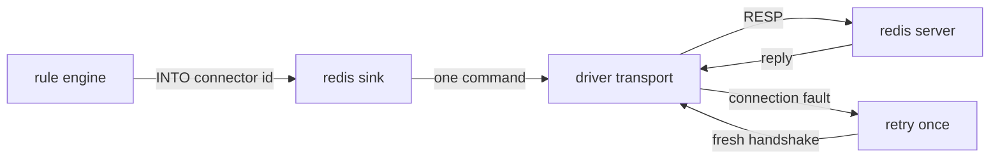

# Redis connector

The Redis connector runs one command per row: stream append, set, hash set, or publish. It multiplexes one driver connection with pipelining.

Use it when a cache, a stream, or a pub/sub channel must receive broker data. You get one Redis command per result row.



## Before you start

- Run Redis. Note the endpoint URL.
- Pick one command and its key template.
- This kind ships in the default build. No feature flag is necessary.

## Settings

Set `kind` to `redis`.

| Setting | Required | Meaning |
|---|---|---|
| `endpoint` | yes | URL `redis://[:password@]host[:port][/db]`. Default port is 6379. Default db is 0. The password form holds no username, only `:pass@`. A value without the `redis://` prefix is refused. An empty host is refused. A bad port is refused. A bad db index is refused. |
| `command` | yes | One of `set`, `hset`, `publish`, `xadd` (flat field). |
| `key_template` | for `set`/`hset` | Key name with `${topic}`. An empty value is refused. |
| `ttl_seconds` | for `set` | Expiry in seconds. The send appends `EX <ttl>`. Default is none. |
| `field_template` | for `hset` | Hash field name with `${topic}`. An empty value is refused. |
| `channel_template` | for `publish` | Channel name with `${topic}`. An empty value is refused. |
| `stream_template` | for `xadd` | Stream name with `${topic}`. An empty value is refused. |
| `maxlen` | for `xadd` | Stream trim length. The send uses `MAXLEN ~ <maxlen>`. Default is none. |

Templates render `${topic}` against the MQTT topic. Other text stays verbatim.

Example (stream append):

```json
{
  "id": "redis-sink-1",
  "kind": "redis",
  "config": {
    "endpoint": "redis://127.0.0.1:6379",
    "command": "xadd",
    "stream_template": "events",
    "maxlen": 1000
  }
}
```

> [!NOTE]
> The docs run creates this shape. Creation validates only; it opens no socket. The send path needs a Redis server. See the failure record in [Verification failures](../_verification/failures.md).

## Check that it works

Create the connector. The broker answers 201 with the kind.

```toml test
[node]
id = "docs-connector-redis"

[listeners.tcp]
bind = "0.0.0.0:1883"

[listeners.api]
bind = "0.0.0.0:18083"

[logging]
level = "warn"

[auth]
allow_anonymous = true
```

```sh test
python3 - <<'PY'
import json, os, urllib.request
port = os.environ.get("API_PORT", "18083")
key = os.environ["API_KEY"]
body = json.dumps({"id": "redis-sink-1", "kind": "redis",
                   "config": {"endpoint": "redis://127.0.0.1:6379",
                              "command": "xadd",
                              "stream_template": "events",
                              "maxlen": 1000}}).encode()
req = urllib.request.Request(
    f"http://127.0.0.1:{port}/api/v1/connectors", data=body, method="POST",
    headers={"Authorization": f"Bearer {key}", "Content-Type": "application/json"})
with urllib.request.urlopen(req, timeout=5) as res:
    assert res.status == 201
    print(json.load(res)["kind"])
PY
```

```output
redis
```

## Limits

- An empty `endpoint` or key template is refused with 400.
- The endpoint must start with `redis://`. The host must not be empty. The port defaults to 6379. The db defaults to 0 and must fit in one byte.
- The auth part holds only a password as `:pass@`. There is no username field.
- `SET` sends `SET <key> <payload> [EX <ttl>]`. `HSET` sends `HSET <key> <field> <payload>`. `PUBLISH` sends `PUBLISH <channel> <payload>`. `XADD` sends `XADD <stream> [MAXLEN ~ <n>] * payload <payload>`.
- The production path uses `DriverRedisTransport` through the maintained driver. The hand-written TCP framing serves offline unit tests only. The memory transport serves tests only.
- The connect timeout is 5 seconds. It bounds the handshake. The command timeout is 10 seconds. It matches the legacy read timeout.
- A connection fault drops the connection and retries once with a fresh handshake. A server error fails the send without a retry.
- Pipelined sends write back-to-back and read replies in order.
- A wrong password fails closed as a connection error. No row leaves the broker on a failed handshake.
- The connector holds one shared multiplexed connection and no background queue. It runs behind the rule engine bounded queue. A slow server sheds load; it never stalls publishers.
- The tier is community. The kind ships in the default build.

## Next steps

- Feed the connector from a rule in [Actions](../rules/actions.md).
- See every kind in [Connectors](./index.md).
