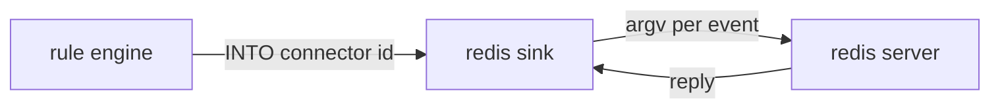

# Redis connector

The Redis connector runs one command per row. The connector names the server. The action names the command template. Each template entry renders to one RESP argument. The driver waits for the server reply.

Use it when a cache, a stream, or a pub/sub channel must receive broker data. You get one Redis command per row.



## Before you start

- Run Redis. Note the host and port.
- Pick one command and its arguments.
- This kind ships in the default build. No feature flag is necessary.

## Settings

Set `type` to `redis`.

Connector settings:

| Setting | Required | Meaning |
|---|---|---|
| `servers` | yes | Host and port, `host:port`. Port 6379 is the default. |
| `username` | no | ACL name, default empty. |
| `password` | no | Secret, default empty. |
| `database` | no | Index, default 0. |

Action settings:

| Setting | Required | Meaning |
|---|---|---|
| `command_template` | yes | Array of templates, one per RESP argument. `${topic}` and `${payload}` supported. |

Example:

```json
{
  "type": "redis",
  "name": "redis-out",
  "servers": "127.0.0.1:6379"
}
```

```json
{
  "type": "redis",
  "name": "redis-act",
  "connector": "redis-out",
  "parameters": {
    "command_template": ["HSET", "sensors:${topic}", "payload", "${payload}"]
  }
}
```

> [!NOTE]
> The docs run creates this shape. Creation validates only; it sends no command. The send path needs a Redis server.

## Check that it works

Create the connector. The broker answers 201. A body without a server answers 400 naming the field. Both answers print `ok`.

```toml test
[node]
id = "docs-connector-redis"

[listeners.tcp]
bind = "0.0.0.0:1883"

[listeners.api]
bind = "0.0.0.0:18083"

[logging]
level = "warn"

[auth]
allow_anonymous = true
```

```sh test
python3 - <<'PY'
import json, os, urllib.request
port = os.environ.get("API_PORT", "18083")
key = os.environ["API_KEY"]
def post(body):
    req = urllib.request.Request(
        f"http://127.0.0.1:{port}/api/v5/connectors", data=json.dumps(body).encode(), method="POST",
        headers={"Authorization": f"Bearer {key}", "Content-Type": "application/json"})
    try:
        with urllib.request.urlopen(req, timeout=5) as res:
            return res.status, json.load(res)
    except urllib.error.HTTPError as err:
        return err.code, json.load(err)
status, created = post({"name": "redis-run-ok", "type": "redis",
                        "servers": "127.0.0.1:6379"})
assert status == 201, (status, created)
assert created.get("type") == "redis", created
status, body = post({"name": "redis-run-bad", "type": "redis"})
assert status == 400 and "servers" in body["message"], body
print("ok")
PY
```

```output
ok
```

## Limits

- A value with spaces stays one argument. It never becomes a second command.
- A blank command entry is refused with 400.
- The action owns the command. A connector alone sends nothing.

## Next steps

- Feed the action from a rule in [Actions](../rules/actions.md).
- See every kind in [Connectors](./index.md).
