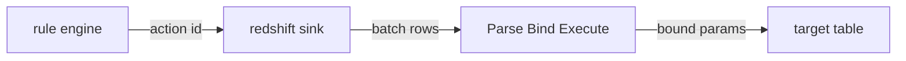
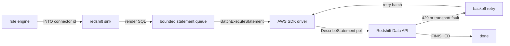

# Redshift connector

The Redshift connector runs one statement per batch. It speaks the PostgreSQL wire protocol with the maintained driver, including bound parameters. It pools one session per `pool_size` entry.

Use it when Redshift must hold telemetry. You get one parse per batch with your own statement.



## Before you start

- Run Redshift. Note the host, database, and user.
- Create the target table. Match its columns to the statement.
- This kind ships in the default build. No feature flag is necessary.

## Settings

Set connector `type` to `redshift`.

| Setting | Required | Meaning |
|---|---|---|
| `server` | yes | `Host[:Port]`. Default port is 5439. |
| `database` | yes | Database name. |
| `username` | yes | Database user. |
| `password` | no | Database password. Accepts `file:` and `env:` references. |
| `pool_size` | no | Server sessions. Default is 8. Range is 1 to 1024. |
| `ssl` | no | `{"enable": true}` uses TLS with the system roots. `verify_none` is refused. |
| `disable_prepared_statements` | no | Only `false` is accepted. Every send prepares. |
| `application_name` | no | Must be absent. The runtime never stamps it. |

Set action `type` to `redshift` and `parameters.sql` to the statement.

| Marker | Value |
|---|---|
| `$1` | Topic. |
| `$2` | QoS. |
| `$3` | Payload. |

The statement must name at least one marker from `$1` to `$3`. Values bind out of band. A quote in a value never escapes into the text.

Example:

```json
{
  "name": "rs-sink-1",
  "type": "redshift",
  "connector": "rs-conn-1",
  "parameters": {
    "sql": "INSERT INTO t_mqtt_msg(topic, qos, payload) VALUES ($1, $2, $3)"
  }
}
```

> [!NOTE]
> The docs run creates this shape. Creation validates only; it touches no database. The send path needs a Redshift cluster.

## Check that it works

Create the connector and the action. The broker answers 201 for each.

```toml test
[node]
id = "docs-connector-redshift"

[listeners.tcp]
bind = "0.0.0.0:1883"

[listeners.api]
bind = "0.0.0.0:18083"

[logging]
level = "warn"

[auth]
allow_anonymous = true
```

```sh test
python3 - <<'PY'
import json, os, urllib.request
port = os.environ.get("API_PORT", "18083")
key = os.environ["API_KEY"]
def call(method, path, body=None):
    import urllib.error
    req = urllib.request.Request(
        f"http://127.0.0.1:{port}{path}",
        data=json.dumps(body).encode() if body is not None else None,
        method=method,
        headers={"Authorization": f"Bearer {key}", "Content-Type": "application/json"})
    try:
        with urllib.request.urlopen(req, timeout=5) as res:
            assert res.status in (200, 201, 204), res.status
            return json.load(res) if res.status != 204 else {}
    except urllib.error.HTTPError as e:
        assert e.code == 404, e.code
        return {}
call("DELETE", "/api/v5/actions/rs-sink-1")
call("DELETE", "/api/v5/connectors/rs-conn-1")
conn = call("POST", "/api/v5/connectors", {"name": "rs-conn-1", "type": "redshift",
    "server": "127.0.0.1:5439", "database": "db", "username": "u"})
assert conn["type"] == "redshift", conn
act = call("POST", "/api/v5/actions", {"name": "rs-sink-1", "type": "redshift",
    "connector": "rs-conn-1",
    "parameters": {"sql": "INSERT INTO t(topic) VALUES ($1)"}})
print(act["status"])
PY
```

```output
disconnected
```

## Limits

- A missing `server`, `database`, or `username` is refused with 400 and names the field.
- A missing `parameters.sql` is refused with 400.
- `ssl.verify_none` and custom TLS files are refused with 400.
- A dead server counts each fire as failed. The broker keeps serving.

## Next steps

- Feed the action from a rule in [Actions](../rules/actions.md).
- See every kind in [Connectors](./index.md).

## Reference form (v1 API)

The reference form uses the v1 connector API. The v5 form above uses connector and action documents. This section keeps the reference page.

The `redshift` connector writes each rule result to an Amazon Redshift database. It renders a SQL statement per row and sends the statements in a `BatchExecuteStatement` call to the Redshift Data API. It signs each request with AWS Signature Version 4 for the `redshift-data` service.

Use it when Redshift must hold broker telemetry. You get batched inserts, a table template, and retry on throttles and transport faults.



### Before you start

- Run a Redshift provisioned cluster or a Redshift Serverless workgroup. Note the database name and the table.
- Keep an access key pair. Add a session token when the credentials are temporary.
- Create the target table with the columns that the SQL writes.
- This kind ships in the default build. No feature flag is necessary.

### Settings

Set `kind` to `redshift` on the v1 route. The v1 route also accepts `rs` and `aws_redshift`. Set `type` to `redshift` on the v5 route. Both routes store the runtime as `redshift`.

| Setting | Required | Meaning |
|---|---|---|
| `database` | yes | Redshift database name. An empty value is refused. The v5 route defaults to `dev`. |
| `table_template` | yes | Target table with `${topic}`, `${client_id}`, `${qos}`, and `${timestamp}`. An empty value is refused. The v5 route also reads `table` and defaults to `sensor_events`. |
| `cluster_identifier` | one of cluster or workgroup | Provisioned cluster id. The v1 route refuses both set or both absent. The v5 route fixes it to none. |
| `workgroup_name` | one of cluster or workgroup | Serverless workgroup name. The v1 route refuses both set or both absent. The v5 route also reads `workgroup` and defaults to `default`. |
| `region` | yes | AWS region. An empty value is refused. The v5 route defaults to `us-east-1`. |
| `endpoint` | no | Custom endpoint with `http://` or `https://`. Default `https://redshift-data.{region}.amazonaws.com`. The v5 route also reads `url`. |
| `access_key_id` | yes | AWS access key id. An empty value is refused. The v5 route defaults to `test`. |
| `secret_access_key` | yes | AWS secret access key. An empty value is refused. The v5 route defaults to `test`. |
| `session_token` | no | STS session token for temporary credentials. Default none. The v5 route fixes it to none. |
| `db_user` | no | Database user, sent as `DbUser` when set. Default none. The v5 route fixes it to none. |
| `sql_template` | no | Custom SQL with `$1` to `$5` and optional `$table`. A reference outside `$1..$5` is refused. Default is the 5-column INSERT. The v5 route fixes it to none. |
| `batch_size` | no | Statements per sink batch. Default 100. A value of 0 is refused. `null` means no item limit. The v5 route fixes 1. |
| `batch_bytes` | no | Sink batch byte limit. Default 1048576 (1 MiB). A value of 0 is refused. `null` means no byte limit. The v5 route fixes 1048576. |
| `linger_ms` | no | Linger flush window in ms. Default 20. `null` means no time bound. The v5 route fixes 10. |
| `max_retries` | no | Retries on throttles and transport faults. Default 4. `null` means no limit. A value of 0 means no retry. The v5 route fixes 3. |
| `initial_backoff_ms` | no | Base retry delay in ms. Default 100. The sink grows the delay from this base. The first retry uses two times this base. The v5 route fixes 100. |
| `max_backoff_ms` | no | Retry delay ceiling before jitter, in ms. Default 2500. The v5 route fixes 2000. |
| `timeout_ms` | no | Request deadline in ms. Default 5000. A value below 1 reads as 1. The v5 route also reads `timeout` and `request_timeout_ms`. |

The v1 route reads the full settings above. The v5 route reads the database, the table, the workgroup, the region, the endpoint, the credentials, and the timeout. It fixes the other values.

The default statement is:

```sql
INSERT INTO sensor_events (time_ms, topic, client_id, qos, payload)
VALUES ($1, $2, $3, $4, $5)
```

`$1` is the event time in ms. `$2` is the topic. `$3` is the `client_id` field of the JSON payload. `$4` is the QoS. `$5` is the payload JSON. The sink escapes each text literal with doubled single quotes. The table name keeps `[A-Za-z0-9_.-]`; every other character becomes `_`.

Example:

```json
{
  "id": "redshift-1",
  "kind": "redshift",
  "config": {
    "database": "analytics",
    "table_template": "sensor_events",
    "workgroup_name": "iot-workgroup",
    "region": "us-east-1",
    "access_key_id": "AKID",
    "secret_access_key": "secret",
    "batch_size": 100,
    "batch_bytes": 1048576,
    "linger_ms": 20,
    "max_retries": 4,
    "initial_backoff_ms": 100,
    "max_backoff_ms": 2500,
    "timeout_ms": 5000
  }
}
```

> [!NOTE]
> The docs run creates the connector on both routes. It sends one message to a local Data API receiver. The receiver checks the batch body and returns a `FINISHED` statement. The real Redshift service, its SQL execution, and its signature check are not verified. See the record in [Verification failures](../_verification/failures.md).

### Check that it works

The test starts a local Data API receiver. It creates the connector on the v1 and v5 routes. It creates a forwarding rule and publishes one message. It reads the `BatchExecuteStatement` body back. The receiver prints `delivered` when the batch and its status poll arrive.

```toml test
# Reference form run.
[node]
id = "docs-connector-redshift"

[listeners.tcp]
bind = "0.0.0.0:1883"

[listeners.api]
bind = "0.0.0.0:18083"

[logging]
level = "warn"

[auth]
allow_anonymous = true
```

```sh test
python3 - <<'PY'
import json, os, socket, struct, threading, time, urllib.request, urllib.error
from http.server import BaseHTTPRequestHandler, HTTPServer

received = []

class Handler(BaseHTTPRequestHandler):
    def do_POST(self):
        length = int(self.headers.get("Content-Length", 0))
        body = self.rfile.read(length)
        target = self.headers.get("X-Amz-Target", "")
        received.append((target, body))
        if target.endswith("DescribeStatement"):
            out = b'{"Id":"stmt-docs","Status":"FINISHED"}'
        else:
            out = b'{"Id":"stmt-docs"}'
        self.send_response(200)
        self.send_header("Content-Type", "application/x-amz-json-1.1")
        self.send_header("Content-Length", str(len(out)))
        self.end_headers()
        self.wfile.write(out)
    def log_message(self, *args):
        pass

server = HTTPServer(("127.0.0.1", 0), Handler)
redshift_port = server.server_address[1]
threading.Thread(target=server.serve_forever, daemon=True).start()

mqtt_port = int(os.environ.get("MQTT_PORT", "1883"))
api_port = int(os.environ.get("API_PORT", "18083"))
key = os.environ["API_KEY"]

def call(method, path, body=None):
    data = None if body is None else json.dumps(body).encode()
    req = urllib.request.Request(
        f"http://127.0.0.1:{api_port}{path}", data=data, method=method,
        headers={"Authorization": f"Bearer {key}",
                 "Content-Type": "application/json"})
    try:
        with urllib.request.urlopen(req, timeout=10) as res:
            raw = res.read().decode()
            return res.status, (json.loads(raw) if raw else None)
    except urllib.error.HTTPError as err:
        raw = err.read().decode()
        try:
            return err.code, json.loads(raw)
        except ValueError:
            return err.code, raw

common = {
    "database": "analytics",
    "table_template": "sensor_events",
    "workgroup_name": "iot-workgroup",
    "region": "us-east-1",
    "endpoint": f"http://127.0.0.1:{redshift_port}",
    "access_key_id": "AKID",
    "secret_access_key": "secret",
    "timeout_ms": 10000,
}

s1, b1 = call("POST", "/api/v1/connectors",
              {"id": "redshift-v1", "kind": "redshift",
               "config": {**common, "batch_size": 1}})
assert s1 == 201 and b1["kind"] == "redshift", (s1, b1)

s2, b2 = call("POST", "/api/v5/connectors",
              {"name": "redshift-v5", "type": "redshift", **common})
assert s2 == 201 and b2["type"] == "redshift", (s2, b2)

s3, b3 = call("POST", "/api/v5/connectors",
              {"name": "redshift-empty", "type": "redshift", "database": "",
               "access_key_id": "AKID", "secret_access_key": "secret"})
assert s3 == 400, (s3, b3)

s4, b4 = call("POST", "/api/v1/rules",
              {"name": "redshift-rule", "topic_filter": "docs/rs/in",
               "actions": [{"type": "forwardconnector",
                            "connector_id": "redshift-v5"}]})
assert s4 == 201, (s4, b4)

def packet(kind, body):
    return bytes([kind, len(body)]) + body

def field(data):
    return struct.pack(">H", len(data)) + data

pub = socket.create_connection(("127.0.0.1", mqtt_port), timeout=5)
pub.sendall(packet(0x10, b"\x00\x04MQTT\x04\x02\x00\x3c" + field(b"redshift-pub")))
assert pub.recv(4) == b"\x20\x02\x00\x00"
pub.sendall(packet(0x30, field(b"docs/rs/in")
                   + b'{"value": 7, "client_id": "sensor-1"}'))

deadline = time.time() + 15
while time.time() < deadline:
    if any(t.endswith("BatchExecuteStatement") for t, _ in received) \
            and any(t.endswith("DescribeStatement") for t, _ in received):
        break
    time.sleep(0.1)
batch = [body for target, body in received
         if target.endswith("BatchExecuteStatement")]
assert batch, "no BatchExecuteStatement arrived"
doc = json.loads(batch[0])
assert doc["Database"] == "analytics", doc
assert doc["WorkgroupName"] == "iot-workgroup", doc
statements = doc["Sqls"]
assert len(statements) == 1, statements
sql = statements[0]
assert sql.startswith("INSERT INTO sensor_events "), sql
assert "'docs/rs/in'" in sql, sql
assert "'sensor-1'" in sql, sql
assert '"value": 7' in sql, sql
print("delivered")
PY
```

```output
delivered
```

### Limits

- On the v1 route, a missing database, table, region, access key id, or secret access key is refused with 400.
- The v1 route refuses a config with both `cluster_identifier` and `workgroup_name`, and a config with neither.
- An endpoint without `http://` or `https://` is refused. A `sql_template` that references a marker outside `$1..$5` is refused.
- A payload that is not UTF-8 or not JSON fails the row.
- The table template renders with a dummy payload at creation. A table that renders empty fails the row.
- The sink sends at most 40 statements per `BatchExecuteStatement` call. It splits a larger sink batch into serial calls.
- The sink polls `DescribeStatement` every 1000 ms for at most 180 polls. A batch that is still pending after the bound returns a retryable error. The sink retry loop then applies `max_retries`. A duplicate statement is possible on retry.
- Throttles (429), 5xx, and transport faults retry with backoff. The first retry waits at least 200 ms. The delay doubles to the ceiling and adds jitter. A query failure is terminal and names the failed statement.
- A failed flush restores the statements in order and engages backoff. The connector runs behind the rule engine bounded queue. A slow workgroup never stalls publishers.
- The production path uses the maintained AWS SDK driver. The tier is enterprise. The kind ships in the default build.

### Next steps

- Feed the connector from a rule in [Actions](../rules/actions.md).
- See every kind in [Connectors](./index.md).

## Known limits in this release

The broker accepts the fields in this list. The broker does not apply them in this release.

- `batch_bytes` (the batch size in bytes)
- `batch_size` (the batch size)
- `batch_timeout_ms` (the batch wait time)
- `initial_backoff_ms` (the first retry wait time)
- `linger_ms` (the batch wait time)
- `max_backoff_ms` (the longest retry wait time)
- `max_retries` (the retry count)

To set batching, use `resource_opts` in the action. The broker applies `resource_opts`.

A later release applies these fields.
