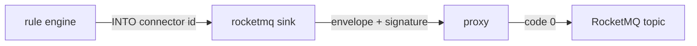

# RocketMQ connector

The RocketMQ connector sends rule results as envelopes to a RocketMQ proxy. The action names the topic, the tag, and the keys. The proxy answers each envelope with a status code.

Use it when a RocketMQ consumer reads broker data. You get each event on the topic you set.



## Before you start

- Run a RocketMQ proxy. Note its host and port.
- Create the target topic, or use `TopicTest`.
- Signing needs both `access_key` and `secret_key`, or neither.

## Settings

Set `type` to `rocketmq`.

Connector settings:

| Setting | Required | Meaning |
|---|---|---|
| `servers` | yes | Proxy endpoints, `host:port` pairs. |
| `access_key` | no | ACL key. Needs `secret_key` too. |
| `secret_key` | no | ACL secret. Needs `access_key` too. |

Action settings:

| Setting | Required | Meaning |
|---|---|---|
| `topic` | no | Topic, default `TopicTest`. |
| `tag` | no | Tag template. |
| `key` | no | Keys template, `${client_id}` and `${message_id}` supported. |
| `strategy` | no | `roundrobin` (default) or `key_dispatch`. |
| `template` | no | Only the empty template is supported. |

Example:

```json
{
  "type": "rocketmq",
  "name": "rmq-out",
  "servers": "127.0.0.1:9876"
}
```

```json
{
  "type": "rocketmq",
  "name": "rmq-act",
  "connector": "rmq-out",
  "parameters": {
    "topic": "events",
    "tag": "t1",
    "key": "${client_id}-${message_id}"
  }
}
```

> [!NOTE]
> The docs run creates this shape. Creation validates only; it opens no socket and sends no message. The send path needs a RocketMQ proxy.

## Check that it works

Create the connector. The broker answers 201. A body without a server answers 400 naming the field. Both answers print `ok`.

```toml test
[node]
id = "docs-connector-rocketmq"

[listeners.tcp]
bind = "0.0.0.0:1883"

[listeners.api]
bind = "0.0.0.0:18083"

[logging]
level = "warn"

[auth]
allow_anonymous = true
```

```sh test
python3 - <<'PY'
import json, os, urllib.request
port = os.environ.get("API_PORT", "18083")
key = os.environ["API_KEY"]
def post(body):
    req = urllib.request.Request(
        f"http://127.0.0.1:{port}/api/v5/connectors", data=json.dumps(body).encode(), method="POST",
        headers={"Authorization": f"Bearer {key}", "Content-Type": "application/json"})
    try:
        with urllib.request.urlopen(req, timeout=5) as res:
            return res.status, json.load(res)
    except urllib.error.HTTPError as err:
        return err.code, json.load(err)
status, created = post({"name": "rmq-run-ok", "type": "rocketmq",
                        "servers": "127.0.0.1:9876"})
assert status == 201, (status, created)
assert created.get("type") == "rocketmq", created
status, body = post({"name": "rmq-run-bad", "type": "rocketmq"})
assert status == 400 and "servers" in body["message"], body
print("ok")
PY
```

```output
ok
```

## Limits

- A custom `template` is refused. The driver stores the whole message.
- Socket tuning (`refresh_interval`, `send_buffer`, `sync_timeout`) is refused. Batching belongs to `resource_opts`.
- `ssl` is refused when present. The proxy dial is plaintext.

## Next steps

- Feed the action from a rule in [Actions](../rules/actions.md).
- See every kind in [Connectors](./index.md).
