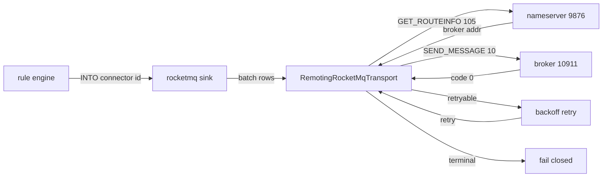

# RocketMQ connector

The RocketMQ connector writes each rule result as one vendor message. It fetches the route from the nameserver, then sends each row to the broker through the vendor remoting protocol.

Use it when telemetry must reach Apache RocketMQ. You get one broker message per result row.



## Before you start

- Run Apache RocketMQ 5.3.0. Note the nameserver address.
- Plan the destination `topic`.
- This kind ships in the default build. No feature flag is necessary.

## Settings

Set `kind` to `rocketmq`.

| Setting | Required | Meaning |
|---|---|---|
| `endpoints` | yes | Nameserver addresses as `["host:9876"]`. An empty list is refused. An empty entry is refused. |
| `topic` | yes | Destination topic. An empty value is refused. A value with a space is refused. |
| `tag_template` | no | Tag template with `${topic}`, `${topic_segment_N}`, `${client_id}`, `${message_id}`. Default is none. An unknown variable is refused. |
| `keys_template` | no | Keys template with the same variables as the tag. Default is none. An unknown variable is refused. |
| `message_group_template` | no | Group template for ordered delivery with the same variables. Default is none. A set group hashes the queue. |
| `access_key` | with `secret_key` | ACL access key. Both keys must appear together. A blank key is refused. Keyed sends sign each request with the vendor ACL. |
| `secret_key` | with `access_key` | ACL secret key. Both keys must appear together. An empty value is refused. The value never renders in a read. |
| `security_token` | no | ACL session token. It rides each signed request only when set. An empty value is refused. The value never renders in a read. |
| `batch_size` | no | Rows per flush. Default is 128. A value of 0 is refused. |
| `buffer_capacity` | no | Buffered rows. Default is 10000. `null` means no bound. |
| `linger_ms` | no | Linger before a partial batch flushes in ms. Default is 100. A value below 1 reads as 1. |
| `timeout_ms` | no | Connect and exchange deadline in ms. Default is 5000. A value below 1 reads as 1. |

Example:

```json
{
  "id": "rocketmq-1",
  "kind": "rocketmq",
  "config": {
    "endpoints": ["127.0.0.1:9876"],
    "topic": "rocket-telemetry",
    "batch_size": 128,
    "buffer_capacity": 10000,
    "linger_ms": 100,
    "timeout_ms": 5000
  }
}
```

> [!NOTE]
> The docs run creates this shape. Creation validates only; it opens no socket. The send path needs a vendor server.

## Check that it works

Create the connector. The broker answers 201 with the kind.

```toml test
[node]
id = "docs-connector-rocketmq"

[listeners.tcp]
bind = "0.0.0.0:1883"

[listeners.api]
bind = "0.0.0.0:18083"

[logging]
level = "warn"

[auth]
allow_anonymous = true
```

```sh test
python3 - <<'PY'
import json, os, urllib.request
port = os.environ.get("API_PORT", "18083")
key = os.environ["API_KEY"]
body = json.dumps({"id": "rocketmq-1", "kind": "rocketmq",
                   "config": {"endpoints": ["127.0.0.1:9876"],
                              "topic": "rocket-telemetry",
                              "timeout_ms": 5000}}).encode()
req = urllib.request.Request(
    f"http://127.0.0.1:{port}/api/v1/connectors", data=body, method="POST",
    headers={"Authorization": f"Bearer {key}", "Content-Type": "application/json"})
with urllib.request.urlopen(req, timeout=5) as res:
    assert res.status == 201
    print(json.load(res)["kind"])
PY
```

```output
rocketmq
```

## Limits

- An empty `endpoints` or `topic` is refused with 400. A topic with a space is refused.
- One key without the other is refused. A blank `access_key` is refused. An empty `secret_key` is refused. A `security_token` without both keys is refused.
- Keyed sends add `AccessKey` and `Signature` to each request. The signature is Base64 HMAC-SHA1 over the sorted field values plus the body. `SecurityToken` rides only when set.
- A template with an unknown `${name}` is refused. An unclosed `${name` is refused. An empty `${}` is refused.
- A `batch_size` of 0 is refused. Default `batch_size` is 128. Each `send` buffers rows and flushes when full or stale.
- Without `buffer_capacity` the buffer holds 10000 rows. `null` opts into no bound explicitly.
- All production uses `RemotingRocketMqTransport` on the vendor protocol, also for keyed configs. The custom envelope path serves offline unit tests only.
- The route lookup uses code 105. The send uses code 10. Code 0 commits. Each error code restores rows and retries after backoff.
- A failed flush restores rows in order and engages backoff. Flushes fail fast during backoff.
- The connector runs behind the rule engine bounded queue. A slow broker sheds load; it never stalls publishers.
- The tier is enterprise. The kind ships in the default build.

## Next steps

- Feed the connector from a rule in [Actions](../rules/actions.md).
- See every kind in [Connectors](./index.md).
