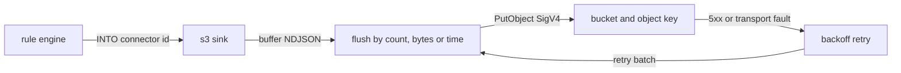

# Amazon S3 connector

The `s3` connector buffers rule results as NDJSON and uploads one object per rendered key group. It signs requests with AWS Signature Version 4. It works with Amazon S3 and with S3-compatible stores such as MinIO.

Use it when cold storage must keep telemetry files. You get one object per rendered key group under a partitioned key.



## Before you start

- Run Amazon S3 or MinIO. Note the endpoint, the bucket, and the region.
- Create credentials with write access to the bucket.
- For a full build, enable the feature: `--features s3`, `--features full`, or `--all-features`. The default build answers 400 and names the feature.

## Settings

Set `kind` to `s3` on the v1 route. The v1 route also accepts `minio`. Set `type` to `s3` on the v5 route. Both routes store the runtime as `s3`.

| Setting | Required | Meaning |
|---|---|---|
| `endpoint` | yes | Base endpoint with `http://` or `https://`. The v5 route also reads `url` and `server`, and defaults to `http://127.0.0.1:9000`. |
| `bucket` | yes | Target bucket. It must be 3 to 63 characters of `[a-z0-9.-]`, and it must start and end with a letter or digit. The v5 route defaults to `telemetry`. |
| `region` | no | AWS region for the SigV4 scope. Default `us-east-1`. An empty value is refused. |
| `access_key_id` | no | Access key id. Empty means anonymous access. The v5 route defaults to empty. |
| `secret_access_key` | no | Secret access key. Empty means anonymous access. The v5 route defaults to empty. |
| `key_template` | yes | Object key with `${topic}`, `${YYYY}`, `${MM}`, `${DD}`, `${seq}`, and `${uuid}`. An empty or bad template is refused. The v5 route defaults to `telemetry/${topic}_${seq}.ndjson`. |
| `compression` | no | Body compression: `none` or `gzip`. Default `none`. The v5 route fixes `none`. |
| `batch_size` | no | Flush trigger record count. Default 1000. A value of 0 is refused. The v5 route fixes 1. |
| `batch_bytes` | no | Flush trigger byte limit over the buffered NDJSON. Default 5242880 (5 MiB). A value of 0 is refused. The v5 route fixes 5242880. |
| `batch_timeout_ms` | no | Linger flush window in ms. Default 60000. The v5 route fixes 10. |
| `timeout_ms` | no | Request deadline in ms. Default 5000. A value below 1 reads as 1. The v5 route also reads `timeout` and `request_timeout_ms`. |

The v1 route reads the full settings above. The v5 route reads the endpoint, the bucket, the region, the credentials, the key template, and the timeout. It fixes the compression and the batch policy.

`${topic}` keeps `[A-Za-z0-9._-/]`; every other character becomes `_`. `${YYYY}`, `${MM}`, and `${DD}` come from the flush time in UTC. `${seq}` is the flush sequence number. `${uuid}` is a fresh identifier. At creation, a key that resolves empty or starts with `/` is refused.

Example:

```json
{
  "id": "s3-sink-1",
  "kind": "s3",
  "config": {
    "endpoint": "http://127.0.0.1:9000",
    "bucket": "telemetry-cold-store",
    "region": "us-east-1",
    "access_key_id": "AKID",
    "secret_access_key": "secret",
    "key_template": "telemetry/year=${YYYY}/month=${MM}/day=${DD}/${topic}_${seq}.ndjson",
    "compression": "gzip",
    "batch_size": 100,
    "batch_bytes": 65536,
    "batch_timeout_ms": 1000,
    "timeout_ms": 5000
  }
}
```

> [!NOTE]
> The docs run creates this shape on the v1 and v5 routes. A full build returns 201. The default build refuses the kind with 400 and names the `s3` feature. The send path needs an object store. See the record in [Verification failures](../_verification/failures.md).

## Check that it works

Create the connector on both routes. A build with the feature answers 201. The default build answers 400 and names the feature. A bucket with an uppercase name answers 400. All answers print `ok`.

```toml test
[node]
id = "docs-connector-s3"

[listeners.tcp]
bind = "0.0.0.0:1883"

[listeners.api]
bind = "0.0.0.0:18083"

[logging]
level = "warn"

[auth]
allow_anonymous = true
```

```sh test
python3 - <<'PY'
import json, os, urllib.request, urllib.error
port = os.environ.get("API_PORT", "18083")
key = os.environ["API_KEY"]

def call(method, path, body=None):
    data = None if body is None else json.dumps(body).encode()
    req = urllib.request.Request(
        f"http://127.0.0.1:{port}{path}", data=data, method=method,
        headers={"Authorization": f"Bearer {key}",
                 "Content-Type": "application/json"})
    try:
        with urllib.request.urlopen(req, timeout=5) as res:
            return res.status, json.load(res)
    except urllib.error.HTTPError as err:
        return err.code, json.load(err)

config = {
    "endpoint": "http://127.0.0.1:9000",
    "bucket": "telemetry-cold-store",
    "region": "us-east-1",
    "access_key_id": "AKID",
    "secret_access_key": "secret",
    "key_template": "telemetry/year=${YYYY}/month=${MM}/day=${DD}/${topic}_${seq}.ndjson",
    "compression": "gzip",
    "batch_size": 100,
    "batch_bytes": 65536,
    "batch_timeout_ms": 1000,
    "timeout_ms": 5000,
}

s1, b1 = call("POST", "/api/v1/connectors",
              {"id": "s3-sink-1", "kind": "s3", "config": config})
assert s1 in (201, 400), (s1, b1)
if s1 == 201:
    assert b1["kind"] == "s3", b1
else:
    assert "s3" in json.dumps(b1).lower(), b1

s2, b2 = call("POST", "/api/v5/connectors",
              {"name": "s3-sink-2", "type": "s3", **config})
assert s2 in (201, 400), (s2, b2)
if s2 == 201:
    assert b2["type"] == "s3", b2
else:
    assert "s3" in json.dumps(b2).lower(), b2

s3, b3 = call("POST", "/api/v1/connectors",
              {"id": "s3-bad-bucket", "kind": "s3",
               "config": {**config, "bucket": "UPPER"}})
assert s3 == 400, (s3, b3)
assert "s3" in json.dumps(b3).lower(), b3
print("ok")
PY
```

```output
ok
```

## Limits

- On the v1 route, a missing endpoint, bucket, or key template is refused with 400. A bucket that is not DNS-compatible is refused. An endpoint without `http://` or `https://` is refused.
- A key template with an unknown or unclosed variable is refused at creation. A template that resolves empty or starts with `/` is refused at creation.
- A key that fails to resolve at flush time uses the fallback key `unkeyed/{seq}.ndjson`, so no row overwrites another. The broker logs a warning with the count.
- A payload that is not UTF-8 fails the row. A non-JSON payload is stored as a JSON string. Each line holds `topic`, `qos`, `payload`, and `timestamp`.
- Objects above 5 MiB upload with a multipart request. The 5 MiB value is the vendor minimum for a non-final part.
- A failed flush restores the unsent rows in order and engages backoff. A timeout is retryable. An authentication fault or a missing bucket is terminal.
- The production path uses the maintained AWS SDK driver with path-style addressing. It uses static credentials when `access_key_id` is not empty. Empty credentials use the driver credential chain.
- The connector runs behind the rule engine bounded queue. A slow store never stalls publishers.
- The tier is community. The kind needs the `s3` feature build.

## Next steps

- Feed the connector from a rule in [Actions](../rules/actions.md).
- See every kind in [Connectors](./index.md).

## Known limits in this release

The broker accepts the fields in this list. The broker does not apply them in this release.

- `batch_bytes` (the batch size in bytes)
- `batch_size` (the batch size)
- `batch_timeout_ms` (the batch wait time)

To set batching, use `resource_opts` in the action. The broker applies `resource_opts`.

A later release applies these fields.
