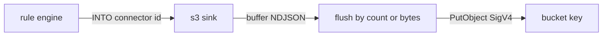

# S3 connector

The S3 connector buffers rule results as NDJSON and uploads one object per batch. It signs requests with SigV4. It works with S3 and with S3-compatible stores such as MinIO.

Use it when cold storage must keep telemetry files. You get one object per batch under a partitioned key.



## Before you start

- Run S3 or MinIO. Note the endpoint, bucket, and region.
- Create credentials with write access to the bucket.
- For a full build, enable the feature: `--features s3`. The default build answers 400 and names the feature.

## Settings

Set `kind` to `s3`.

| Setting | Required | Meaning |
|---|---|---|
| `endpoint` | yes | Base endpoint, `https://` or `http://` for local servers. |
| `bucket` | yes | Target bucket, DNS-compatible lowercase name. |
| `region` | no | AWS region for SigV4 scope; default `us-east-1`. |
| `access_key_id` | no | Access key; empty means anonymous access. |
| `secret_access_key` | no | Secret key; empty means anonymous access. |
| `key_template` | yes | Partitioned key, for example `telemetry/year=${YYYY}/month=${MM}/day=${DD}/${topic}_${seq}.ndjson`. |
| `compression` | no | Body compression; default none. |
| `batch_size` | no | Flush trigger record count; default 1000. |
| `batch_bytes` | no | Flush trigger byte limit; default 5 MiB. |
| `batch_timeout_ms` | no | Linger flush window; default 60000 ms. |
| `timeout_ms` | no | Request timeout in ms; default 5000. |

Example:

```json
{
  "id": "s3-sink-1",
  "kind": "s3",
  "config": {
    "endpoint": "http://127.0.0.1:9000",
    "bucket": "telemetry-cold-store",
    "region": "us-east-1",
    "key_template": "telemetry/year=${YYYY}/month=${MM}/day=${DD}/${topic}_${seq}.ndjson",
    "compression": "none",
    "batch_size": 100,
    "batch_bytes": 65536,
    "batch_timeout_ms": 1000
  }
}
```

> [!NOTE]
> The docs run creates this shape. Creation validates only; it uploads nothing. The send path needs an object store. See the failure record in [Verification failures](../_verification/failures.md).

## Check that it works

Create the connector. The broker answers 201 with the kind when the build holds S3, else 400 naming the feature. Both answers print `ok`.

```toml test
[node]
id = "docs-connector-s3"

[listeners.tcp]
bind = "0.0.0.0:1883"

[listeners.api]
bind = "0.0.0.0:18083"

[logging]
level = "warn"

[auth]
allow_anonymous = true
```

```sh test
python3 - <<'PY'
import json, os, urllib.request
port = os.environ.get("API_PORT", "18083")
key = os.environ["API_KEY"]
body = json.dumps({"id": "s3-sink-1", "kind": "s3",
                   "config": {"endpoint": "http://127.0.0.1:9000",
                              "bucket": "telemetry-cold-store",
                              "region": "us-east-1",
                              "key_template": "telemetry/year=${YYYY}/month=${MM}/day=${DD}/${topic}_${seq}.ndjson",
                              "compression": "none", "batch_size": 100,
                              "batch_bytes": 65536,
                              "batch_timeout_ms": 1000}}).encode()
req = urllib.request.Request(
    f"http://127.0.0.1:{port}/api/v1/connectors", data=body, method="POST",
    headers={"Authorization": f"Bearer {key}", "Content-Type": "application/json"})
try:
    with urllib.request.urlopen(req, timeout=5) as res:
        status, created = res.status, json.load(res)
except urllib.error.HTTPError as err:
    status, created = err.code, json.load(err)
assert status in (201, 400), (status, created)
if status == 201:
    assert created["kind"] == "s3", created
else:
    assert "s3" in created["error"], created
print("ok")
PY
```

```output
ok
```

## Limits

- An uppercase bucket is refused with 400. Use DNS-compatible lowercase names.
- A non-HTTP endpoint is refused with 400.
- Objects above the 5 MiB vendor part minimum upload as multipart.
- The bounded queue sheds past its bound. A slow store never stalls publishers.

## Next steps

- Feed the connector from a rule in [Actions](../rules/actions.md).
- See every kind in [Connectors](./index.md).
