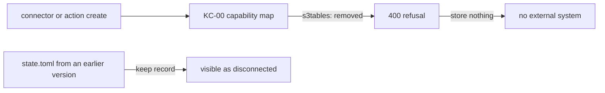

# Amazon S3 Tables alias connector

The `s3tables` alias is removed from this build. The connector and action routes answer 400 with the message `connector type s3_tables is not available in this broker`. Nothing is stored and no rows leave the broker through it.

The alias `s3_tables` has the same result. A state file from an earlier version still starts. It reports the stored record as `disconnected`. See [Removed connectors](../reference/removed-connectors.md) for the stored-state behaviour and the delete order.



## Before you start

- Do not create this alias. Use a supported object-store connector.
- To replace an old record, delete the stored connector, action and rule in that order.

## Settings

This name takes no settings. The broker refuses the create and stores nothing.

| Setting | Required | Meaning |
|---|---|---|
| `type` | yes | It must be `s3tables`. |
| `name` | yes | Connector id. It must not be empty. |

Example:

```json
{
  "type": "s3tables",
  "name": "s3-tables-alias-1"
}
```

> [!NOTE]
> The docs run sends this shape to both routes. Both routes refuse it and store nothing. See the record in [Verification failures](../_verification/failures.md).

## Check that it works

Create the connector on the v1 route with the alias `s3tables`. Create the connector on the v5 route with `s3tables`. Both routes refuse the alias. Both answers print `refused`.

```toml test
[node]
id = "docs-connector-s3tables"

[listeners.tcp]
bind = "0.0.0.0:1883"

[listeners.api]
bind = "0.0.0.0:18083"

[logging]
level = "warn"

[auth]
allow_anonymous = true
```

```sh test
python3 - <<'PY'
import json, os, urllib.request, urllib.error
port = os.environ.get("API_PORT", "18083")
key = os.environ["API_KEY"]
def call(method, path, body):
    data = json.dumps(body).encode() if body is not None else None
    req = urllib.request.Request(
        f"http://127.0.0.1:{port}{path}", data=data, method=method,
        headers={"Authorization": f"Bearer {key}", "Content-Type": "application/json"})
    try:
        with urllib.request.urlopen(req, timeout=5) as res:
            return res.status, json.load(res)
    except urllib.error.HTTPError as err:
        return err.code, json.load(err)
body = {
    "table_bucket_arn": "arn:aws:s3tables:us-east-1:123456789012:bucket/telemetry-bucket",
    "namespace": "production_iot",
    "table_name": "device_events",
    "region": "us-east-1",
    "access_key_id": "AKID",
    "secret_access_key": "secret",
}
s1, b1 = call("POST", "/api/v1/connectors",
              {"id": "s3t-v1", "kind": "s3tables", "config": body})
assert s1 == 400, (s1, b1)
assert "s3_tables" in json.dumps(b1), (s1, b1)
s2, b2 = call("POST", "/api/v5/connectors",
              {"name": "s3t-v5", "type": "s3tables", **body})
assert s2 == 400, (s2, b2)
assert "s3_tables" in json.dumps(b2), (s2, b2)
print("refused")
PY
```

```output
refused
```

## Limits

- `POST /api/v1/connectors` with `s3tables`, `s3_tables` or `iceberg` answers 400. The message names `s3_tables`.
- `POST /api/v5/connectors` with `s3tables` or `s3_tables` answers 400. The message names `s3_tables`.
- Nothing is stored. No rows leave the broker through this alias.
- A stored record from an earlier version is kept and reads `disconnected`.
- No feature build enables this path.

## Next steps

- Send rows with [Amazon S3](./s3.md).
- See every kind in [Connectors](./index.md).
