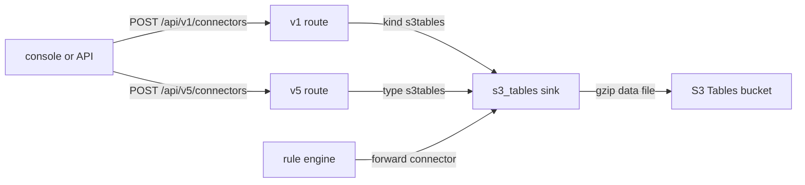

# Amazon S3 Tables alias connector

The `s3tables` name is an accepted name for the `s3_tables` sink. The v1 connectors route accepts it and stores the runtime as `s3_tables`. The v5 connectors route accepts it and keeps the posted type.

Use it when a console or a tool sends the documented `s3tables` name. You get the partitioned Iceberg data-file path of the `s3_tables` sink.



## Before you start

- Create an S3 Tables table bucket, an Iceberg namespace, and a table.
- Keep an access key pair. Add a session token when the credentials are temporary.
- Note the table bucket ARN, the namespace, the table name, and the region.
- This kind ships in the default build. No feature flag is necessary.

## Settings

Set `kind` to `s3tables` on the v1 route. The v1 route also accepts `iceberg` and stores the runtime as `s3_tables`. Set `type` to `s3tables` on the v5 route. The v5 route keeps the posted type.

| Setting | Required | Meaning |
|---|---|---|
| `table_bucket_arn` | yes | Table bucket ARN. The form is `arn:aws:s3tables:{region}:{12-digit account}:bucket/{name}`. A bad shape is refused. The v5 route also reads `bucket_arn` and `arn`, and defaults to a sample ARN. |
| `namespace` | yes | Iceberg namespace. An empty value is refused. The v5 route defaults to `production_iot`. |
| `table_name` | yes | Target table. An empty value is refused. The v5 route also reads `table` and defaults to `device_events`. |
| `region` | yes | AWS region. An empty value is refused. The v5 route defaults to `us-east-1`. |
| `access_key_id` | yes | AWS access key id. An empty value is refused. The v5 route defaults to `test`. |
| `secret_access_key` | yes | AWS secret access key. An empty value is refused. The v5 route defaults to `test`. |
| `session_token` | no | STS session token for temporary credentials. Default none. The v5 route fixes it to none. |
| `endpoint` | no | Custom endpoint with a scheme. Default is the S3 Tables service for the region. The v5 route also reads `url`. |
| `partition_spec` | no | Ordered partition fields. Each field has `source_name` and `transform`. A field with an empty source is refused. Default empty. The v5 route fixes it to empty. |
| `target_format` | no | `ndjsoncompressed` for gzip NDJSON, or `parquetplaceholder`. Default `ndjsoncompressed`. The v5 route fixes `ndjsoncompressed`. |
| `batch_size` | no | Rows per sink batch. Default 1000. A value of 0 is refused. `null` means no item limit. The v5 route fixes 1. |
| `buffer_capacity` | no | Buffered row limit. Default none, so no explicit row cap. A set capacity fails closed when full. The v5 route fixes it to none. |
| `linger_ms` | no | Linger flush window in ms. Default 1000. `null` uses the 1000 ms default. The v5 route fixes 10. |
| `timeout_ms` | no | Request deadline in ms. Default 5000. A value below 1 reads as 1. The v5 route also reads `timeout` and `request_timeout_ms`. |

The v1 route reads the full settings above. The v5 route reads the table bucket ARN, the namespace, the table, the region, the endpoint, the credentials, and the timeout. It fixes the codec, the partition spec, and the batch policy.

The v5 route registers the name and the aliases `s3_tables:name` and `s3tables:name`. The sink writes one gzip data file per partition group under `data/`. The `s3_tables` page documents the shared sink limits.

Example:

```json
{
  "id": "s3tables-1",
  "kind": "s3tables",
  "config": {
    "table_bucket_arn": "arn:aws:s3tables:us-east-1:123456789012:bucket/telemetry-bucket",
    "namespace": "production_iot",
    "table_name": "device_events",
    "region": "us-east-1",
    "access_key_id": "AKID",
    "secret_access_key": "secret",
    "partition_spec": [
      { "source_name": "date", "transform": "day" },
      { "source_name": "device_id", "transform": "identity" }
    ],
    "target_format": "ndjsoncompressed",
    "batch_size": 1,
    "linger_ms": 10,
    "timeout_ms": 5000
  }
}
```

> [!NOTE]
> The docs run creates this name on both routes. It sends one message through a forwarding rule to a local S3 receiver. The real S3 Tables service and its table commit are not verified. See the record in [Verification failures](../_verification/failures.md).

## Check that it works

The test creates the name on the v1 and v5 routes. It creates a forwarding rule and publishes one message. The local receiver checks the partition path, the gzip body, the content type, and the signature header.

```toml test
[node]
id = "docs-connector-s3tables"

[listeners.tcp]
bind = "0.0.0.0:1883"

[listeners.api]
bind = "0.0.0.0:18083"

[logging]
level = "warn"

[auth]
allow_anonymous = true
```

```sh test
python3 - <<'PY'
import gzip, json, os, socket, struct, threading, time, urllib.request, urllib.error
from http.server import BaseHTTPRequestHandler, HTTPServer

received = []

class Handler(BaseHTTPRequestHandler):
    def do_PUT(self):
        length = int(self.headers.get("Content-Length", 0))
        body = self.rfile.read(length)
        received.append((self.path, {k.lower(): v for k, v in self.headers.items()}, body))
        out = b"{}"
        self.send_response(200)
        self.send_header("Content-Type", "application/json")
        self.send_header("Content-Length", str(len(out)))
        self.end_headers()
        self.wfile.write(out)
    def log_message(self, *args):
        pass

server = HTTPServer(("127.0.0.1", 0), Handler)
store_port = server.server_address[1]
threading.Thread(target=server.serve_forever, daemon=True).start()

mqtt_port = int(os.environ.get("MQTT_PORT", "1883"))
api_port = int(os.environ.get("API_PORT", "18083"))
key = os.environ["API_KEY"]

def call(method, path, body=None):
    data = None if body is None else json.dumps(body).encode()
    req = urllib.request.Request(
        f"http://127.0.0.1:{api_port}{path}", data=data, method=method,
        headers={"Authorization": f"Bearer {key}",
                 "Content-Type": "application/json"})
    try:
        with urllib.request.urlopen(req, timeout=10) as res:
            raw = res.read().decode()
            return res.status, (json.loads(raw) if raw else None)
    except urllib.error.HTTPError as err:
        raw = err.read().decode()
        try:
            return err.code, json.loads(raw)
        except ValueError:
            return err.code, raw

common = {
    "table_bucket_arn": "arn:aws:s3tables:us-east-1:123456789012:bucket/telemetry-bucket",
    "namespace": "production_iot",
    "table_name": "device_events",
    "region": "us-east-1",
    "endpoint": f"http://127.0.0.1:{store_port}",
    "access_key_id": "AKID",
    "secret_access_key": "secret",
    "timeout_ms": 10000,
}

v1_config = {
    **common,
    "partition_spec": [
        {"source_name": "date", "transform": "day"},
        {"source_name": "device_id", "transform": "identity"},
    ],
    "target_format": "ndjsoncompressed",
    "batch_size": 1,
    "linger_ms": 10,
}

s1, b1 = call("POST", "/api/v1/connectors",
              {"id": "s3t-v1", "kind": "s3tables", "config": v1_config})
assert s1 == 201 and b1["kind"] == "s3_tables", (s1, b1)

s2, b2 = call("POST", "/api/v5/connectors",
              {"name": "s3t-v5", "type": "s3tables", **common})
assert s2 == 201 and b2["type"] == "s3tables", (s2, b2)

s3, b3 = call("POST", "/api/v5/connectors",
              {"name": "s3t-bad", "type": "s3tables",
               **{**common, "table_bucket_arn": "not-an-arn"}})
assert s3 == 400, (s3, b3)

s4, b4 = call("POST", "/api/v1/rules",
              {"name": "s3t-rule", "topic_filter": "docs/st/in",
               "actions": [{"type": "forwardconnector",
                            "connector_id": "s3t-v1"}]})
assert s4 == 201, (s4, b4)

def packet(kind, body):
    return bytes([kind, len(body)]) + body

def field(data):
    return struct.pack(">H", len(data)) + data

pub = socket.create_connection(("127.0.0.1", mqtt_port), timeout=5)
pub.sendall(packet(0x10, b"\x00\x04MQTT\x04\x02\x00\x3c" + field(b"s3t-pub")))
assert pub.recv(4) == b"\x20\x02\x00\x00"
payload = b'{"value": 9, "device_id": "sensor-42"}'
pub.sendall(packet(0x30, field(b"docs/st/in") + payload))

deadline = time.time() + 15
while not received and time.time() < deadline:
    time.sleep(0.1)
assert received, "no data file arrived"
path, headers, body = received[0]
parts = path.strip("/").split("/")
assert parts[0] == "data", path
assert len(parts) == 4, path
assert parts[1].startswith("date_day="), path
assert parts[2] == "device_id=sensor-42", path
assert parts[3].endswith(".data.gz"), path
assert headers.get("content-encoding") == "gzip", headers
assert headers.get("content-type") == "application/x-ndjson", headers
assert headers.get("authorization", "").startswith("AWS4-HMAC-SHA256"), headers
line = gzip.decompress(body).decode().strip()
row = json.loads(line)
assert row["topic"] == "docs/st/in", row
assert row["qos"] == 0, row
assert row["payload"]["value"] == 9, row
print("delivered")
PY
```

```output
delivered
```

## Limits

- The v1 route stores the runtime as `s3_tables`. The v5 route keeps the posted type `s3tables`.
- The v5 route registers the aliases `s3_tables:name` and `s3tables:name`.
- A bad table bucket ARN, an empty namespace, an empty table, an empty region, or an empty key is refused with 400.
- A partition field with an empty `source_name` is refused. A `batch_size` of 0 is refused.
- The shared sink limits are on the [`s3_tables` page](./s3_tables.md).
- The tier of the runtime is enterprise. The kind ships in the default build.

## Next steps

- Read the shared sink on the [Amazon S3 Tables connector](./s3_tables.md) page.
- Feed the connector from a rule in [Actions](../rules/actions.md).
- See every kind in [Connectors](./index.md).
