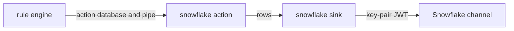

# Snowflake connector

The Snowflake connector streams rule results through the Snowflake streaming rows API with key-pair authentication.

Use it for warehouse rows in Snowflake. The action names the database, schema and pipe.



## Before you start

- Create a Snowflake account, user and RSA key pair.
- Create the database, schema and pipe.
- This kind is not verified against the live service in the MVP.

## Settings

| Connector setting | Required | Meaning |
|---|---|---|
| `account` | yes | Snowflake account identifier. |
| `pipe_user` | yes | User for the pipe. |
| `private_key` | yes | PKCS#8 RSA private key PEM. |
| `server` | yes | Snowflake server endpoint. |

| Action setting | Required | Meaning |
|---|---|---|
| `database` | yes | Target database. |
| `schema` | yes | Target schema. |
| `pipe` | yes | Target pipe. |

Example action:

```json
{
  "name": "sf-events",
  "type": "snowflake_streaming",
  "connector": "sf-account",
  "parameters": {"database": "TELEMETRY", "schema": "PUBLIC", "pipe": "EVENTS_PIPE"}
}
```

## Limits

- A missing account, user, key, server, database, schema or pipe answers 400 and names the field.
- The reference `pipe` becomes the streaming channel name. This mapping is marked for a later parity check.
- A failed row batch counts one failed forward on the action.

## Next steps

- Feed the connector from a rule in [Actions](../rules/actions.md).
- See every kind in [Connectors](./index.md).

## Check that it works

Create the connector. The broker answers 201 with the kind, else 400 names the missing field. Both answers print `ok`.

```toml test
[node]
id = "docs-connector-snowflake"

[listeners.tcp]
bind = "0.0.0.0:1883"

[listeners.api]
bind = "0.0.0.0:18083"

[logging]
level = "warn"

[auth]
allow_anonymous = true
```

```sh test
python3 - <<'PY'
import json, os, urllib.request
port = os.environ.get("API_PORT", "18083")
key = os.environ["API_KEY"]
body = json.dumps({"name": "docs-sf-1", "type": "snowflake",
                   "account": "acct", "pipe_user": "user",
                   "private_key": "not-a-key",
                   "server": "http://127.0.0.1:9"}).encode()
req = urllib.request.Request(
    f"http://127.0.0.1:{port}/api/v5/connectors", data=body, method="POST",
    headers={"Authorization": f"Bearer {key}", "Content-Type": "application/json"})
try:
    with urllib.request.urlopen(req, timeout=5) as res:
        status, created = res.status, json.load(res)
except urllib.error.HTTPError as err:
    status, created = err.code, json.load(err)
assert status in (201, 400), (status, created)
if status == 201:
    assert created["type"] == "snowflake", created
else:
    assert "snowflake" in created["message"], created
print("ok")
PY
```

```output
ok
```
