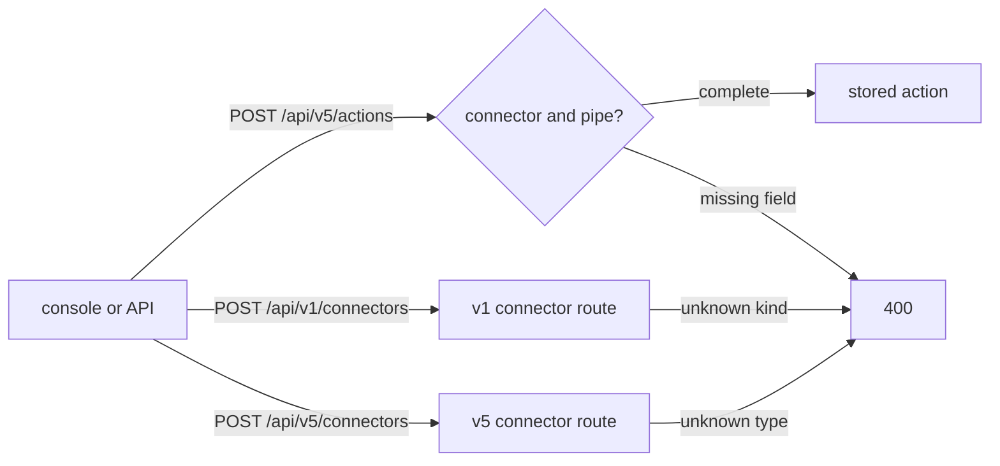

# Snowflake streaming name

The `snowflake_streaming` name is a documented Snowflake action type. It is not a connector type. The v1 and v5 connectors routes reject it. The v5 actions route validates the connector and the required action fields before it stores.

Use it when a console sends the documented streaming name to the actions route. You get a stored action row only when the connector and the pipe fields are complete.



## Before you start

- Read the [Snowflake connector](./snowflake.md) page for the Snowflake fields.
- Use the v5 actions route. Both connector routes reject this name.
- Create the connector first, then set `database`, `schema`, and `pipe` in the action parameters.
- This name is not a connector type. No connector row is created by the action.

## Settings

Create the action with `POST /api/v5/actions`.

| Setting | Required | Meaning |
|---|---|---|
| `type` | yes | Action type. Use `snowflake_streaming`. |
| `name` or `id` | yes | Action id. Its length is capped at 256 bytes. |
| `enable` | no | Enable flag. Default `true`. The status reads `connected` when enabled. |
| `parameters` | no | Object stored with the action. Default `{}`. The Snowflake fields are `account`, `user`, `database`, `schema`, `table`, `private_key_pem`, `endpoint`, and `timeout_ms`. |
| `resource_opts` | no | Object stored with the action. Default `{}`. |

The action stores its parameters without validation. The v5 connector route rejects the name with `unknown connector type`. The v1 connector route rejects the name with `unknown connector kind`.

The type catalogue lists `snowflake_streaming`. The stored row keeps the type `snowflake_streaming`.

Example:

```json
{
  "type": "snowflake_streaming",
  "name": "snowflake-streaming-1",
  "enable": true,
  "parameters": {
    "account": "xy12345.us-east-1",
    "user": "indra_loader",
    "database": "IOT",
    "schema": "PUBLIC",
    "table": "TELEMETRY",
    "private_key_pem": "docs-key-placeholder",
                 "server": "127.0.0.1:1"})
assert s2c == 201, (s2c, b2c)

s3, b3 = call("POST", "/api/v5/actions",
              {"type": "snowflake_streaming", "name": "ss-action",
               "connector": "ss-account",
               "parameters": {"database": "IOT", "schema": "PUBLIC"}})
assert s3 == 400, (s3, b3)
assert "pipe" in json.dumps(b3).lower(), b3

s4, b4 = call("GET", "/api/v5/actions/ss-action")
assert s4 == 404, (s4, b4)
assert b4["code"] == "NOT_FOUND", (s4, b4)

s5, b5 = call("GET", "/api/v5/action_types")
assert s5 == 200 and "snowflake_streaming" in b5, (s5, b5)
print("snowflake_streaming")
PY
```

```output
snowflake_streaming
```

## Limits

- The v1 connectors route rejects this name with 400.
- The v5 connectors route rejects this name with 400.
- The v5 actions route names this type in the action-type list. Create refuses an action that misses its connector, its pipe, or its database and schema fields.
- The action build reads `account`, `pipe_user`, and `private_key_pem` from the connector and `database`, `schema`, and `pipe` from the action.
- An incomplete action stores nothing, so the read answers 404.
- The action name is not a connector type. A rule forward uses the action, not a connector row of this name.
- The tier of the Snowflake runtime is enterprise.

## Next steps

- Read the Snowflake fields on the [Snowflake connector](./snowflake.md) page.
- Create a forwarding target with a [Connectors](./index.md) row.
- Feed the runtime from a rule in [Actions](../rules/actions.md).
