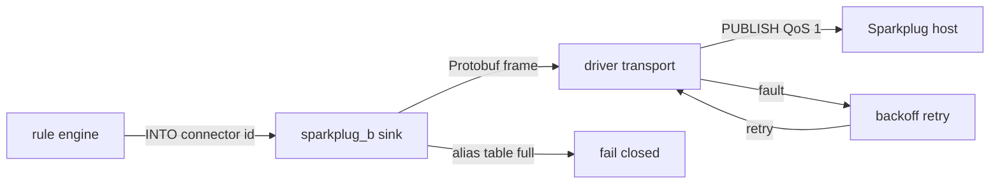

# Sparkplug B connector

The Sparkplug B connector encodes each rule result as one Tahu Protobuf frame. It publishes the frame to a Sparkplug namespace topic through the maintained driver.

Use it when a Sparkplug host must receive broker data. You get one Protobuf frame per result row on `spBv1.0` topics.



## Before you start

- Run an MQTT server. Note its address.
- Pick the group, the edge node, and the device names.
- This kind ships in the default build. No feature flag is necessary. The tier is enterprise.

## Settings

Set `kind` to `sparkplug_b`. The broker also accepts `sparkplug` and `spb`. It stores the kind as `sparkplug_b`.

| Setting | Required | Meaning |
|---|---|---|
| `topic_prefix` | no | Namespace guard such as `spBv1.0/plant1`. Accepted topics must live under it. It must be concrete: no `+` and no `#`. It must start with `spBv1.0/`. Default is none. |
| `tier` | no | Licence tier gate. Default is `enterprise`. Any other value is refused. |
| `batch_size` | no | Flush trigger row count. Default is 100. A value of 0 is refused. `null` means no count bound. |
| `linger_ms` | no | Linger flush window in ms. Default is 50. `null` means no time bound. |
| `mqtt_url` | yes | MQTT server that carries the frames, such as `mqtt://127.0.0.1:1883`. The create step needs it. A missing or blank value is refused. An `mqtts://` address fails closed. Use plain TCP or a sidecar proxy. |
| `client_id` | no | MQTT client id for the driver. Default derives `indra-spb-<pid>` per process, so two kernels never evict each other. An empty value is refused. |
| `max_aliases` | no | Edge-side alias-table ceiling: distinct ingress metric names kept. Default is 10_000. It bounds the table near 1 MiB. A value of 0 is refused. `null` is an explicit opt-in to unbounded. |

Example:

```json
{
  "id": "spb-1",
  "kind": "sparkplug_b",
  "config": {
    "topic_prefix": "spBv1.0/plant1",
    "mqtt_url": "mqtt://127.0.0.1:1883",
    "tier": "enterprise",
    "batch_size": 50,
    "linger_ms": 25
  }
}
```

> [!NOTE]
> The docs run creates this shape. Creation validates only; it opens no socket. The send path needs an MQTT server. See the failure record in [Verification failures](../_verification/failures.md).

## Check that it works

Create the connector. The broker answers 201 with the kind.

```toml test
[node]
id = "docs-connector-sparkplug-b"

[listeners.tcp]
bind = "0.0.0.0:1883"

[listeners.api]
bind = "0.0.0.0:18083"

[logging]
level = "warn"

[auth]
allow_anonymous = true
```

```sh test
python3 - <<'PY'
import json, os, urllib.request
port = os.environ.get("API_PORT", "18083")
key = os.environ["API_KEY"]
body = json.dumps({"id": "spb-1", "kind": "sparkplug_b",
                   "config": {"topic_prefix": "spBv1.0/plant1",
                              "mqtt_url": "mqtt://127.0.0.1:1883",
                              "tier": "enterprise",
                              "batch_size": 50,
                              "linger_ms": 25}}).encode()
req = urllib.request.Request(
    f"http://127.0.0.1:{port}/api/v1/connectors", data=body, method="POST",
    headers={"Authorization": f"Bearer {key}", "Content-Type": "application/json"})
with urllib.request.urlopen(req, timeout=5) as res:
    assert res.status == 201
    print(json.load(res)["kind"])
PY
```

```output
sparkplug_b
```

## Limits

- A `tier` outside `enterprise` is refused with 400.
- Without `mqtt_url` the create step is refused with 400. A blank value is refused too.
- A `topic_prefix` with `+` or `#`, without the `spBv1.0/` head, or with an empty part is refused with 400.
- An `mqtts://` address fails closed with a clear error. Use plain TCP today or terminate TLS in a sidecar proxy.
- A `batch_size` of 0 is refused. A `max_aliases` of 0 is refused. An empty `client_id` is refused.
- A row whose topic leaves the prefix never becomes a frame. A row whose topic is not a Sparkplug topic never becomes a frame. A payload without UTF-8 JSON or without a `metrics` object never becomes a frame. Each failure closes the send with an error.
- Each payload metric keeps the alias it first received. Birth frames carry the name plus the alias, so the host cache never flaps. A full alias table refuses new metric names.
- The payload `timestamp` and `seq` ride in the frame when present. Each metric carries the payload timestamp.
- Each frame publishes with QoS 1 and retain false. The driver connects at the first write with a 5 second timeout. The keep-alive is 30 seconds.
- The driver request channel holds 10_000 entries at most. The wire inflight window holds 10_000 at most.
- A failed flush restores the whole batch in order and engages backoff. The retry sends at least once.
- The production path uses `RumqttcSparkplugTransport` through the maintained driver with `prost` Protobuf encoding. The memory transport serves offline unit tests only.
- The sink watches no STATE topic. A rebirth runs when the rule path sends a birth frame again.
- The connector runs behind the rule engine bounded queue. A slow server sheds load; it never stalls publishers.
- The tier is enterprise. The kind ships in the default build with no feature flag.

## Next steps

- Feed the connector from a rule in [Actions](../rules/actions.md).
- See every kind in [Connectors](./index.md).
