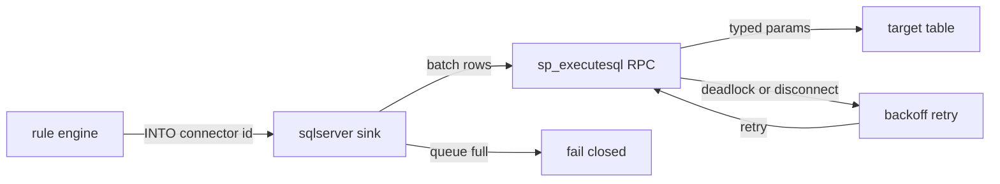

# SQL Server connector

The `sqlserver` name writes each rule result as one SQL Server table row. It is the documented console name for the `mssql` runtime. It sends typed rows through `sp_executesql` with the maintained driver.

Use it when relational rows must hold telemetry in SQL Server. You get one RPC per row in each batch with your own table mapping.



## Before you start

- Run SQL Server. Note the host and the database.
- Create the target table with the five columns.
- This kind ships in the default build. No feature flag is necessary.

## Settings

Set `kind` to `sqlserver` on the v1 route. The v1 route also accepts `mssql` and `azuresql`. Both routes run the `mssql` runtime. Set `type` to `sqlserver` on the v5 route. The v5 route also accepts `mssql`. It stores the posted type and registers the aliases `mssql:name` and `sqlserver:name`.

| Setting | Required | Meaning |
|---|---|---|
| `host` | yes | Server hostname or IP. An empty value is refused. The v5 route also reads `server` and `servers`, and defaults to `127.0.0.1:1433`. |
| `port` | no | TCP port. Default 1433. Port 0 is refused. The v5 route reads the port from the server string. |
| `database` | yes | Target database name. An empty name, `;`, or NUL is refused. The v5 route defaults to `telemetry`. |
| `table_template` | yes | Table name with `${topic}`, `${qos}`, `${timestamp}`. An unknown or unclosed variable is refused. The v5 route also reads `table` and defaults to `dbo.SensorEvents`. |
| `auth` | no | Object with `type`, `username`, `password`. Default is `integrated`, which the driver refuses. Use `sql_password`. An empty username is refused. The v5 route fixes SQL password auth and reads `username` and `password`. Its defaults are `sa` and `secret`. |
| `query_mode` | no | Row shape. Default is the fixed five-column insert. A custom shape needs `sql_template` with `$1..$5`. The v5 route fixes `insertjson`. |
| `trust_server_certificate` | no | Trust a self-signed server certificate. Default true. It governs TLS deployments only. The v5 route fixes true. |
| `batch_size` | no | Rows per batch. Default 200. A value of 0 is refused. `null` means no count bound. The v5 route fixes 1. |
| `batch_bytes` | no | Batch byte limit. Default 2097152. A value of 0 is refused. `null` means no byte bound. The v5 route fixes 2097152. |
| `linger_ms` | no | Linger before a partial batch flushes. Default 20. `null` means no time bound. The v5 route fixes 10. |
| `max_retries` | no | Retries on deadlocks and disconnects. Default 3. `null` means no bound. A value of 0 means no retry. The v5 route fixes 3. |
| `initial_backoff_ms` | no | Base retry delay in ms. Default 100. The first retry waits about 200 ms plus jitter, because `flush` increments the attempt before the wait. A value below 1 reads as 1. The v5 route fixes 100. |
| `max_backoff_ms` | no | Retry delay ceiling before jitter, in ms. Default 2500. Jitter adds up to half the grown delay. The jittered delay is capped at two times this value, so the default can reach about 3750 ms. A value below 1 reads as 1. The v5 route fixes 2000. |
| `timeout_ms` | no | Connect and query deadline in ms. Default 5000. A value below 1 reads as 1. The v5 route also reads `timeout` and `request_timeout_ms`. |

The v1 route reads the full settings above. The v5 route reads the server, the database, the table, the user, the password, and the timeout. It fixes the auth type, the row shape, the certificate trust, and the batch policy.

Example:

```json
{
  "id": "sqlserver-1",
  "kind": "sqlserver",
  "config": {
    "host": "127.0.0.1",
    "port": 1433,
    "database": "telemetry",
    "table_template": "dbo.SensorEvents",
    "auth": {"type": "sql_password", "username": "sa", "password": "secret"},
    "query_mode": {"mode": "insertjson"},
    "trust_server_certificate": true,
    "batch_size": 50,
    "batch_bytes": 65536,
    "linger_ms": 20,
    "max_retries": 2,
    "initial_backoff_ms": 10,
    "max_backoff_ms": 100,
    "timeout_ms": 5000
  }
}
```

> [!NOTE]
> The docs run creates the connector on both routes. The v1 calls post the `{id,kind,config}` shape. The v5 calls post a flat body. Creation validates only; it opens no socket. The send path needs a SQL Server instance. See the failure record in [Verification failures](../_verification/failures.md).

## Check that it works

Create the connector on both routes. The test also shows the aliases and the refusal of an empty host.

```toml test
[node]
id = "docs-connector-sqlserver"

[listeners.tcp]
bind = "0.0.0.0:1883"

[listeners.api]
bind = "0.0.0.0:18083"

[logging]
level = "warn"

[auth]
allow_anonymous = true
```

```sh test
python3 - <<'PY'
import json, os, urllib.request, urllib.error
port = os.environ.get("API_PORT", "18083")
key = os.environ["API_KEY"]

def call(method, path, body=None):
    data = None if body is None else json.dumps(body).encode()
    req = urllib.request.Request(
        f"http://127.0.0.1:{port}{path}", data=data, method=method,
        headers={"Authorization": f"Bearer {key}",
                 "Content-Type": "application/json"})
    try:
        with urllib.request.urlopen(req, timeout=5) as res:
            raw = res.read().decode()
            return res.status, (json.loads(raw) if raw else None)
    except urllib.error.HTTPError as err:
        raw = err.read().decode()
        try:
            return err.code, json.loads(raw)
        except ValueError:
            return err.code, raw

full = {
    "host": "127.0.0.1",
    "port": 1433,
    "database": "telemetry",
    "table_template": "dbo.SensorEvents",
    "auth": {"type": "sql_password", "username": "sa", "password": "secret"},
    "query_mode": {"mode": "insertjson"},
    "trust_server_certificate": True,
    "batch_size": 50,
    "batch_bytes": 65536,
    "linger_ms": 20,
    "max_retries": 2,
    "initial_backoff_ms": 10,
    "max_backoff_ms": 100,
    "timeout_ms": 5000,
}

status, created = call("POST", "/api/v1/connectors",
                       {"id": "sql-v1", "kind": "sqlserver", "config": full})
assert status == 201 and created["kind"] == "mssql", (status, created)

status, created = call("POST", "/api/v1/connectors",
                       {"id": "sql-alias", "kind": "azuresql",
                        "config": {**full, "port": None}})
assert status == 201 and created["kind"] == "mssql", (status, created)

status, created = call("POST", "/api/v1/connectors",
                       {"id": "sql-bad", "kind": "sqlserver",
                        "config": {**full, "host": ""}})
assert status == 400 and "host" in json.dumps(created), (status, created)

status, created = call("POST", "/api/v5/connectors",
                       {"name": "sql-v5", "type": "sqlserver",
                        "host": "127.0.0.1", "database": "telemetry",
                        "table": "dbo.SensorEvents", "username": "sa",
                        "password": "secret", "timeout_ms": 5000})
assert status == 201 and created["type"] == "sqlserver", (status, created)

status, created = call("POST", "/api/v5/connectors",
                       {"name": "sql-v5-bad", "type": "sqlserver",
                        "host": "", "database": "telemetry",
                        "table": "dbo.SensorEvents", "username": "sa",
                        "password": "secret"})
assert status == 400, (status, created)
print("mssql")
PY
```

```output
mssql
```

## Limits

- An empty `host`, `database`, or `table_template` is refused with 400.
- A `database` with `;` or NUL is refused with 400.
- A table result that is empty, starts with `.`, holds `..`, or holds `;` is refused.
- Characters outside letters, digits, `.`, `_`, and `-` become `_`.
- A custom `sql_template` must name `$1..$5`. An empty set, `$0`, or above `$5` is refused.
- A payload that is not UTF-8 or not JSON is refused. An empty topic is refused.
- Each row carries event time, topic, client id, QoS, and payload. Types are `DATETIMEOFFSET`, `NVARCHAR`, `NVARCHAR`, `BIGINT`, `NVARCHAR`.
- The production path uses `DriverMssqlTransport` through tiberius. When `trust_server_certificate` is true the driver calls `trust_cert` and accepts the server certificate. When it is false the driver uses default validation.
- Integrated auth fails closed. Use `sql_password` credentials. `ad_password` also uses SQL password credentials.
- Error 1205 retries with backoff. Other server errors fail fast and keep the row.
- A failed flush keeps rows and engages backoff. Flushes fail fast during backoff.
- The tier is enterprise. The kind ships in the default build.

## Next steps

- Feed the connector from a rule in [Actions](../rules/actions.md).
- See every kind in [Connectors](./index.md).
