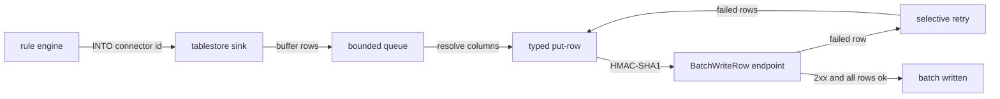

# Alibaba Tablestore connector

The `tablestore` connector writes each rule result to an Alibaba Cloud Tablestore table. It sends `BatchWriteRow` put-rows with primary-key columns and attribute columns. It signs each request with HMAC-SHA1 over the OTS headers and the body MD5.

Use it when a wide-column store must read broker telemetry. You get typed columns, a bounded row buffer, and selective row retry.



## Before you start

- Create a Tablestore instance, a table, and an access key pair.
- Note the endpoint, the instance name, and the table name.
- Define the primary-key columns and the attribute columns.
- This kind ships in the default build. No feature flag is necessary.

## Settings

Set `kind` to `tablestore` on the v1 route. The v1 route also accepts `ots` and `alibaba_tablestore`, and stores the runtime as `tablestore`. Set `type` to `tablestore` on the v5 route. The v5 route accepts only `tablestore`. It registers the aliases `tablestore:name` and `ots:name`.

| Setting | Required | Meaning |
|---|---|---|
| `endpoint` | yes | Instance endpoint with `http://` or `https://`. A value without a scheme is refused. The v5 route also reads `url`. |
| `instance_name` | yes | Tablestore instance identifier. An empty value is refused. The v5 route also reads `instance`. |
| `table_name` | yes | Target wide-column table. An empty value is refused. The v5 route also reads `table`. |
| `access_key_id` | yes | Alibaba Cloud access key id. An empty value is refused. The v5 route also reads `ak`. |
| `access_key_secret` | yes | Alibaba Cloud access key secret. An empty value is refused. The v5 route also reads `sk`. |
| `primary_keys` | yes | Non-empty array of primary-key mappings. Each mapping has `name`, `source`, and `data_type`. The v5 route fixes one string column `device_id` from `${client_id}`. |
| `attribute_columns` | no | Array of attribute mappings. Each mapping has `name`, `source`, and `data_type`. Default empty. The v5 route fixes one double column `temperature` from `${payload.temperature}`. |
| `batch_size` | no | Rows per flush. Default 200. A value of 0 is refused. `null` means no row limit. The v5 route fixes 1. |
| `buffer_capacity` | no | Buffered row ceiling. Default 10000. A value of 0 is refused. `null` uses the finite default 10000; it never means unlimited. The v5 route fixes `null`. |
| `linger_ms` | no | Linger flush window in ms. Default 100. A value below 1 reads as 1. The v5 route fixes 10. |
| `timeout_ms` | no | Request deadline in ms. Default 5000. A value below 1 reads as 1. The v5 route also reads `timeout`. |

The v1 route reads the full settings above. The v5 route reads the endpoint, the instance, the table, the access keys, and the timeout. It fixes the column map and the batch policy.

A mapping source is one of `${client_id}`, `${topic}`, `${timestamp}`, or `${payload.<dotted.path>}`. The `${client_id}` source reads the payload field `client_id`. The `${timestamp}` source reads the event time in milliseconds.

| Column type | Accepted value |
|---|---|
| `string` | A JSON string. |
| `integer` | A JSON integer, or a whole-valued float. |
| `double` | A JSON number. |
| `boolean` | A JSON boolean. |
| `binary` | A base64 JSON string. |

Example:

```json
{
  "id": "tablestore-1",
  "kind": "tablestore",
  "config": {
    "endpoint": "https://docs-instance.cn-hangzhou.ots.aliyuncs.com",
    "instance_name": "docs-instance",
    "table_name": "telemetry",
    "access_key_id": "AKID",
    "access_key_secret": "secret",
    "primary_keys": [
      {"name": "device_id", "source": "${client_id}", "data_type": "string"}
    ],
    "attribute_columns": [
      {"name": "temperature", "source": "${payload.temperature}", "data_type": "double"}
    ],
    "batch_size": 200,
    "buffer_capacity": 10000,
    "linger_ms": 100,
    "timeout_ms": 5000
  }
}
```

> [!NOTE]
> The docs run creates the connector on both routes. It sends one message to a local receiver. The receiver checks the path, the OTS headers, the signature, and the row body. The real service and its own signature check are not verified. See the record in [Verification failures](../_verification/failures.md).

## Check that it works

The test starts a local OTS receiver. It creates the connector on the v1 and v5 routes. It creates a forwarding rule and publishes one message. The receiver checks the path, the headers, the HMAC-SHA1 signature, and the row body.

```toml test
[node]
id = "docs-connector-tablestore"

[listeners.tcp]
bind = "0.0.0.0:1883"

[listeners.api]
bind = "0.0.0.0:18083"

[logging]
level = "warn"

[auth]
allow_anonymous = true
```

```sh test
python3 - <<'PY'
import base64, hashlib, hmac, json, os, socket, struct, threading, time, urllib.request, urllib.error
from http.server import BaseHTTPRequestHandler, HTTPServer

received = []

class Handler(BaseHTTPRequestHandler):
    def do_POST(self):
        length = int(self.headers.get("Content-Length", 0))
        body = self.rfile.read(length)
        received.append((self.path,
                         {k.lower(): v for k, v in self.headers.items()}, body))
        out = json.dumps({"tables": [{"rows": [{"is_ok": True}]}]}).encode()
        self.send_response(200)
        self.send_header("Content-Type", "application/json")
        self.send_header("Content-Length", str(len(out)))
        self.end_headers()
        self.wfile.write(out)
    def log_message(self, *args):
        pass

server = HTTPServer(("127.0.0.1", 0), Handler)
store_port = server.server_address[1]
threading.Thread(target=server.serve_forever, daemon=True).start()

mqtt_port = int(os.environ.get("MQTT_PORT", "1883"))
api_port = int(os.environ.get("API_PORT", "18083"))
key = os.environ["API_KEY"]

def call(method, path, body=None):
    data = None if body is None else json.dumps(body).encode()
    req = urllib.request.Request(
        f"http://127.0.0.1:{api_port}{path}", data=data, method=method,
        headers={"Authorization": f"Bearer {key}",
                 "Content-Type": "application/json"})
    try:
        with urllib.request.urlopen(req, timeout=10) as res:
            raw = res.read().decode()
            return res.status, (json.loads(raw) if raw else None)
    except urllib.error.HTTPError as err:
        raw = err.read().decode()
        try:
            return err.code, json.loads(raw)
        except ValueError:
            return err.code, raw

common = {
    "endpoint": f"http://127.0.0.1:{store_port}",
    "instance_name": "docs-instance",
    "table_name": "telemetry",
    "access_key_id": "AKID",
    "access_key_secret": "secret",
    "timeout_ms": 10000,
}
v1_config = {
    **common,
    "primary_keys": [
        {"name": "device_id", "source": "${client_id}", "data_type": "string"}
    ],
    "attribute_columns": [
        {"name": "temperature", "source": "${payload.temperature}",
         "data_type": "double"}
    ],
    "batch_size": 1,
    "buffer_capacity": 100,
    "linger_ms": 10,
}

status, created = call("POST", "/api/v1/connectors",
                       {"id": "ots-v1", "kind": "ots", "config": v1_config})
assert status == 201 and created["kind"] == "tablestore", (status, created)

status, created = call("POST", "/api/v5/connectors",
                       {"name": "ots-v5", "type": "tablestore", **common})
assert status == 201 and created["type"] == "tablestore", (status, created)

status, created = call("POST", "/api/v5/connectors",
                       {"name": "ots-bad", "type": "tablestore",
                        **{k: v for k, v in common.items()
                           if k != "access_key_secret"}})
assert status == 400 and "access_key_secret" in json.dumps(created), (status, created)

status, created = call("POST", "/api/v1/connectors",
                       {"id": "ots-bad2", "kind": "tablestore",
                        "config": {**common, "primary_keys": []}})
assert status == 400, (status, created)

status, rule = call("POST", "/api/v1/rules",
                    {"name": "ots-rule", "topic_filter": "docs/ots/in",
                     "actions": [{"type": "forwardconnector",
                                  "connector_id": "ots-v1"}]})
assert status == 201, (status, rule)

def packet(kind, body):
    return bytes([kind, len(body)]) + body

def field(data):
    return struct.pack(">H", len(data)) + data

pub = socket.create_connection(("127.0.0.1", mqtt_port), timeout=5)
pub.sendall(packet(0x10, b"\x00\x04MQTT\x04\x02\x00\x3c" + field(b"ots-pub")))
assert pub.recv(4) == b"\x20\x02\x00\x00"
payload = b'{"client_id": "sensor-7", "temperature": 21.5}'
pub.sendall(packet(0x30, field(b"docs/ots/in") + payload))

deadline = time.time() + 15
while not received and time.time() < deadline:
    time.sleep(0.1)
assert received, "no BatchWriteRow request arrived"
path, headers, body = received[0]
assert path == "/api/BatchWriteRow", path
assert headers.get("x-ots-apiversion") == "2015-12-31", headers
assert headers.get("x-ots-instancename") == "docs-instance", headers

md5 = base64.b64encode(hashlib.md5(body).digest()).decode()
assert headers.get("x-ots-contentmd5") == md5, headers
sts = (
    "/api/BatchWriteRow\nPOST\n" + md5 + "\n"
    "x-ots-apiversion:2015-12-31\n"
    "x-ots-date:" + headers["x-ots-date"] + "\n"
    "x-ots-instancename:docs-instance\n"
)
signature = base64.b64encode(
    hmac.new(b"secret", sts.encode(), hashlib.sha1).digest()).decode()
assert headers.get("authorization") == f"OTS AKID:{signature}", headers

doc = json.loads(body)
table = doc["tables"][0]
assert table["table_name"] == "telemetry", table
rows = table["rows"]
assert len(rows) == 1, rows
row = rows[0]
assert row["operation"] == "put", row
keys = {item["name"]: (item["type"], item["value"])
        for item in row["primary_keys"]}
attrs = {item["name"]: (item["type"], item["value"])
         for item in row["attributes"]}
assert keys == {"device_id": ("string", "sensor-7")}, keys
assert attrs["temperature"] == ("double", 21.5), attrs
print("delivered")
PY
```

```output
delivered
```

## Limits

- The endpoint must start with `http://` or `https://`. An empty instance, table, access key id, or access key secret is refused.
- `primary_keys` must not be empty. Each mapping name and source is checked.
- A source must be `${client_id}`, `${topic}`, `${timestamp}`, or `${payload.<path>}`. A typo is refused.
- A value that does not match its declared column type fails the row. An integer accepts a whole-valued float.
- A batch holds up to `batch_size` rows. The buffer holds at most `buffer_capacity` rows and fails closed when full.
- The sink sends every row to the one configured `table_name`. A failed row set requeues only the failed rows, up to 4 times. The first retry waits at least 200 ms; the delay doubles to a 2 s ceiling.
- A 429 or a 5xx answer retries the batch with backoff. A 4xx answer is terminal. A malformed response body is a dispatch error.
- A failed batch restores its rows in order and engages backoff.
- The sink runs behind the rule engine bounded queue. A slow endpoint never stalls publishers.
- The tier is enterprise. The kind ships in the default build.

## Next steps

- Feed the connector from a rule in [Actions](../rules/actions.md).
- See every kind in [Connectors](./index.md).
