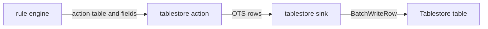

# Tablestore connector

The Tablestore connector writes rule results as rows in an Alibaba Cloud Tablestore table.

Use it for wide-column telemetry in Alibaba Cloud. The action names the table, the primary key tags and the attribute fields.



## Before you start

- Create a Tablestore instance and a table.
- Note the endpoint, instance name and access keys.
- This kind is not verified against the live service in the MVP.

## Settings

| Connector setting | Required | Meaning |
|---|---|---|
| `endpoint` | yes | Instance endpoint. |
| `instance_name` | yes | Instance name. |
| `access_key_id` | yes | Access key ID. |
| `access_key_secret` | yes | Access key secret. |

| Action setting | Required | Meaning |
|---|---|---|
| `table_name` | yes | Target table. |
| `measurement` | yes | Measurement name. |
| `fields` | yes | Non-empty list of `{column, value}` objects. |
| `tags` | no | Primary-key columns as name to template pairs. |
| `timestamp` | no | Timestamp template when `tags` is empty. |

Example action:

```json
{
  "name": "ots-events",
  "type": "tablestore",
  "connector": "ots-instance",
  "parameters": {
    "table_name": "events",
    "measurement": "telemetry",
    "tags": {"device": "${client_id}"},
    "fields": [{"column": "temp", "value": "${payload.temp}"}]
  }
}
```

## Limits

- A missing table, measurement or fields list answers 400 and names the field.
- The action needs a primary key. Set `tags`, or a `${...}` timestamp.
- A failed row batch counts one failed forward on the action.

## Next steps

- Feed the connector from a rule in [Actions](../rules/actions.md).
- See every kind in [Connectors](./index.md).

## Check that it works

Create the connector. The broker answers 201 with the kind, else 400 names the missing field. Both answers print `ok`.

```toml test
[node]
id = "docs-connector-tablestore"

[listeners.tcp]
bind = "0.0.0.0:1883"

[listeners.api]
bind = "0.0.0.0:18083"

[logging]
level = "warn"

[auth]
allow_anonymous = true
```

```sh test
python3 - <<'PY'
import json, os, urllib.request
port = os.environ.get("API_PORT", "18083")
key = os.environ["API_KEY"]
body = json.dumps({"name": "docs-ots-1", "type": "tablestore",
                   "endpoint": "http://127.0.0.1:9", "instance_name": "i",
                   "access_key_id": "ak", "access_key_secret": "sk"}).encode()
req = urllib.request.Request(
    f"http://127.0.0.1:{port}/api/v5/connectors", data=body, method="POST",
    headers={"Authorization": f"Bearer {key}", "Content-Type": "application/json"})
try:
    with urllib.request.urlopen(req, timeout=5) as res:
        status, created = res.status, json.load(res)
except urllib.error.HTTPError as err:
    status, created = err.code, json.load(err)
assert status in (201, 400), (status, created)
if status == 201:
    assert created["type"] == "tablestore", created
else:
    assert "table" in created["message"], created
print("ok")
PY
```

```output
ok
```
