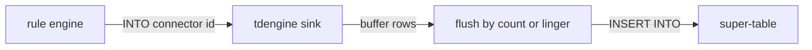
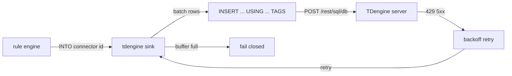

# TDengine connector

The TDengine connector writes rule results as super-table rows. It posts SQL inserts to the REST endpoint. It buffers rows and flushes by count or by linger.

Use it when time-series rows must land in TDengine. You get one insert per flush.



## Before you start

- Run TDengine. Note the endpoint, database, and super-table.
- Create the database and the super-table with its tags.

## Settings

Set `kind` to `tdengine`.

| Setting | Required | Meaning |
|---|---|---|
| `server` | yes | REST endpoint, `host:port`. Reads as `http`. |
| `database` | yes | Target database. |
| `stable` | yes | Super-table name. |
| `subtable` | yes | Sub-table template, for example `d_${client_id}`. |
| `metrics` | yes | Metric column templates, a non-empty object. |
| `tags` | yes | Tag column templates, a non-empty object. |
| `username` | no | TDengine user. Default `root`. Needs `password` too. |
| `password` | no | TDengine password. Default `taosdata`. Needs `username` too. |
| `token` | no | TDengine token. Uses token auth. Never mixes with `username`/`password`. |

The action may override `stable`, `subtable`, `metrics` and `tags` per target. Basic credentials over plain HTTP ride the maintained driver; token credentials stay on the REST transport.

### `server`

REST endpoint, `host:port`. Type: string. Required: yes. Reads as `http`. Absent: 400 naming `server`.

```sh test
python3 - <<'PY'
import json, os, urllib.request
port = os.environ.get("API_PORT", "18083")
key = os.environ["API_KEY"]
def post(body):
    req = urllib.request.Request(
        f"http://127.0.0.1:{port}/api/v5/connectors", data=json.dumps(body).encode(), method="POST",
        headers={"Authorization": f"Bearer {key}", "Content-Type": "application/json"})
    try:
        with urllib.request.urlopen(req, timeout=5) as res:
            return res.status, json.load(res)
    except urllib.error.HTTPError as err:
        return err.code, json.load(err)
status, body = post({"name": "td-server-bad", "type": "tdengine", "database": "power"})
assert status == 400 and "server" in body["message"], body
print("ok")
PY
```

```output
ok
```

### `database`

Target database. Type: string. Required: yes. Absent: 400 naming `database`.

```sh test
python3 - <<'PY'
import json, os, urllib.request
port = os.environ.get("API_PORT", "18083")
key = os.environ["API_KEY"]
def post(body):
    req = urllib.request.Request(
        f"http://127.0.0.1:{port}/api/v5/connectors", data=json.dumps(body).encode(), method="POST",
        headers={"Authorization": f"Bearer {key}", "Content-Type": "application/json"})
    try:
        with urllib.request.urlopen(req, timeout=5) as res:
            return res.status, json.load(res)
    except urllib.error.HTTPError as err:
        return err.code, json.load(err)
status, body = post({"name": "td-db-bad", "type": "tdengine", "server": "127.0.0.1:6041"})
assert status == 400 and "database" in body["message"], body
print("ok")
PY
```

```output
ok
```

### `stable`

Super-table name. Type: string. Required: yes. Absent: 400 naming `stable`.

```sh test
python3 - <<'PY'
import json, os, urllib.request
port = os.environ.get("API_PORT", "18083")
key = os.environ["API_KEY"]
def post(body):
    req = urllib.request.Request(
        f"http://127.0.0.1:{port}/api/v5/connectors", data=json.dumps(body).encode(), method="POST",
        headers={"Authorization": f"Bearer {key}", "Content-Type": "application/json"})
    try:
        with urllib.request.urlopen(req, timeout=5) as res:
            return res.status, json.load(res)
    except urllib.error.HTTPError as err:
        return err.code, json.load(err)
status, body = post({"name": "td-stable-bad", "type": "tdengine",
                     "server": "127.0.0.1:6041", "database": "power"})
assert status == 400 and "stable" in body["message"], body
print("ok")
PY
```

```output
ok
```

### `subtable`

Sub-table template. Type: string. Required: yes. Absent: 400 naming `subtable`.

```sh test
python3 - <<'PY'
import json, os, urllib.request
port = os.environ.get("API_PORT", "18083")
key = os.environ["API_KEY"]
def post(body):
    req = urllib.request.Request(
        f"http://127.0.0.1:{port}/api/v5/connectors", data=json.dumps(body).encode(), method="POST",
        headers={"Authorization": f"Bearer {key}", "Content-Type": "application/json"})
    try:
        with urllib.request.urlopen(req, timeout=5) as res:
            return res.status, json.load(res)
    except urllib.error.HTTPError as err:
        return err.code, json.load(err)
status, body = post({"name": "td-sub-bad", "type": "tdengine",
                     "server": "127.0.0.1:6041", "database": "power", "stable": "meters"})
assert status == 400 and "subtable" in body["message"], body
print("ok")
PY
```

```output
ok
```

### `metrics`

Metric column templates, a non-empty object. Type: object. Required: yes. Empty: 400 naming `metrics`.

```sh test
python3 - <<'PY'
import json, os, urllib.request
port = os.environ.get("API_PORT", "18083")
key = os.environ["API_KEY"]
def post(body):
    req = urllib.request.Request(
        f"http://127.0.0.1:{port}/api/v5/connectors", data=json.dumps(body).encode(), method="POST",
        headers={"Authorization": f"Bearer {key}", "Content-Type": "application/json"})
    try:
        with urllib.request.urlopen(req, timeout=5) as res:
            return res.status, json.load(res)
    except urllib.error.HTTPError as err:
        return err.code, json.load(err)
status, body = post({"name": "td-metrics-bad", "type": "tdengine",
                     "server": "127.0.0.1:6041", "database": "power", "stable": "meters",
                     "subtable": "d_one", "metrics": {}, "tags": {"location": "room1"}})
assert status == 400 and "metrics" in body["message"], body
print("ok")
PY
```

```output
ok
```

### `tags`

Tag column templates, a non-empty object. Type: object. Required: yes. Empty: 400 naming `tags`.

```sh test
python3 - <<'PY'
import json, os, urllib.request
port = os.environ.get("API_PORT", "18083")
key = os.environ["API_KEY"]
def post(body):
    req = urllib.request.Request(
        f"http://127.0.0.1:{port}/api/v5/connectors", data=json.dumps(body).encode(), method="POST",
        headers={"Authorization": f"Bearer {key}", "Content-Type": "application/json"})
    try:
        with urllib.request.urlopen(req, timeout=5) as res:
            return res.status, json.load(res)
    except urllib.error.HTTPError as err:
        return err.code, json.load(err)
status, body = post({"name": "td-tags-bad", "type": "tdengine",
                     "server": "127.0.0.1:6041", "database": "power", "stable": "meters",
                     "subtable": "d_one", "metrics": {"temp": "1"}, "tags": {}})
assert status == 400 and "tags" in body["message"], body
print("ok")
PY
```

```output
ok
```

### `username`

TDengine user. Type: string. Required: no. Default `root`. Needs `password` too.

```sh test
python3 - <<'PY'
import json, os, urllib.request
port = os.environ.get("API_PORT", "18083")
key = os.environ["API_KEY"]
def post(body):
    req = urllib.request.Request(
        f"http://127.0.0.1:{port}/api/v5/connectors", data=json.dumps(body).encode(), method="POST",
        headers={"Authorization": f"Bearer {key}", "Content-Type": "application/json"})
    try:
        with urllib.request.urlopen(req, timeout=5) as res:
            return res.status, json.load(res)
    except urllib.error.HTTPError as err:
        return err.code, json.load(err)
status, body = post({"name": "td-user-bad", "type": "tdengine",
                     "server": "127.0.0.1:6041", "database": "power", "stable": "meters",
                     "subtable": "d_one", "metrics": {"temp": "1"}, "tags": {"location": "room1"},
                     "username": "u"})
assert status == 400 and "username" in body["message"], body
print("ok")
PY
```

```output
ok
```

### `password`

TDengine password. Type: string. Required: no. Default `taosdata`. Needs `username` too.

```sh test
python3 - <<'PY'
import json, os, urllib.request
port = os.environ.get("API_PORT", "18083")
key = os.environ["API_KEY"]
def post(body):
    req = urllib.request.Request(
        f"http://127.0.0.1:{port}/api/v5/connectors", data=json.dumps(body).encode(), method="POST",
        headers={"Authorization": f"Bearer {key}", "Content-Type": "application/json"})
    try:
        with urllib.request.urlopen(req, timeout=5) as res:
            return res.status, json.load(res)
    except urllib.error.HTTPError as err:
        return err.code, json.load(err)
status, created = post({"name": "td-pw-ok", "type": "tdengine",
                        "server": "127.0.0.1:6041", "database": "power", "stable": "meters",
                        "subtable": "d_one", "metrics": {"temp": "1"}, "tags": {"location": "room1"},
                        "username": "u", "password": "p"})
assert status == 201, (status, created)
print("ok")
PY
```

```output
ok
```

### `token`

TDengine token. Type: string. Required: no. Uses token auth. Never mixes with Basic.

```sh test
python3 - <<'PY'
import json, os, urllib.request
port = os.environ.get("API_PORT", "18083")
key = os.environ["API_KEY"]
def post(body):
    req = urllib.request.Request(
        f"http://127.0.0.1:{port}/api/v5/connectors", data=json.dumps(body).encode(), method="POST",
        headers={"Authorization": f"Bearer {key}", "Content-Type": "application/json"})
    try:
        with urllib.request.urlopen(req, timeout=5) as res:
            return res.status, json.load(res)
    except urllib.error.HTTPError as err:
        return err.code, json.load(err)
status, created = post({"name": "td-token-ok", "type": "tdengine",
                        "server": "127.0.0.1:6041", "database": "power", "stable": "meters",
                        "subtable": "d_one", "metrics": {"temp": "1"}, "tags": {"location": "room1"},
                        "token": "tok-1"})
assert status == 201, (status, created)
status, body = post({"name": "td-token-bad", "type": "tdengine",
                     "server": "127.0.0.1:6041", "database": "power", "stable": "meters",
                     "subtable": "d_one", "metrics": {"temp": "1"}, "tags": {"location": "room1"},
                     "username": "u", "password": "p", "token": "tok-1"})
assert status == 400 and "token" in body["message"], body
print("ok")
PY
```

```output
ok
```

Example:

```json
{
  "name": "td-sink-1",
  "type": "tdengine",
  "server": "127.0.0.1:6041",
  "database": "power",
  "stable": "meters",
  "subtable": "d_one",
  "metrics": {"temp": "${payload.temperature}"},
  "tags": {"location": "room1"}
}
```

> [!NOTE]
> The docs run creates this shape. Creation validates only; it inserts nothing. The send path needs a TDengine server. See the failure record in [Verification failures](../_verification/failures.md).

## Check that it works

Create the connector. The broker answers 201 with the kind. It prints `ok`.

```toml test
[node]
id = "docs-connector-tdengine"

[listeners.tcp]
bind = "0.0.0.0:1883"

[listeners.api]
bind = "0.0.0.0:18083"

[logging]
level = "warn"

[auth]
allow_anonymous = true
```

```sh test
python3 - <<'PY'
import json, os, urllib.request
port = os.environ.get("API_PORT", "18083")
key = os.environ["API_KEY"]
body = json.dumps({"name": "td-sink-1", "type": "tdengine",
                   "server": "127.0.0.1:6041",
                   "database": "power", "stable": "meters",
                   "subtable": "d_one",
                   "metrics": {"temp": "${payload.temperature}"},
                   "tags": {"location": "room1"}}).encode()
req = urllib.request.Request(
    f"http://127.0.0.1:{port}/api/v5/connectors", data=body, method="POST",
    headers={"Authorization": f"Bearer {key}", "Content-Type": "application/json"})
try:
    with urllib.request.urlopen(req, timeout=5) as res:
        status, created = res.status, json.load(res)
except urllib.error.HTTPError as err:
    status, created = err.code, json.load(err)
assert status == 201, (status, created)
assert created["type"] == "tdengine", created
print("ok")
PY
```

```output
ok
```

## Limits

- The driver writes super-table rows only. Each write needs at least one tag column.
- A dead server backs off and retries. The bounded queue sheds past its bound.

## Next steps

- Feed the connector from a rule in [Actions](../rules/actions.md).
- See every kind in [Connectors](./index.md).

## Reference form (v1 API)

The reference form uses the v1 connector API. The v5 form above uses connector and action documents. This section keeps the reference page.

The TDengine connector writes each rule result as one super-table row. It renders one multi-table `INSERT INTO ... USING ... TAGS ...` statement per flush and posts it to the REST SQL interface. It authenticates with Basic or token auth.

Use it when metrics must land in TDengine time series. You get one HTTP post per batch with your own sub-table mapping.



### Before you start

- Run TDengine with the REST service enabled. Note the endpoint.
- Create the database. Note the super-table name.
- This kind ships in the default build. No feature flag is necessary. The tier is enterprise.

### Settings

Set `kind` to `tdengine`. The broker also accepts `td` and `taos`. It stores the kind as `tdengine`.

| Setting | Required | Meaning |
|---|---|---|
| `endpoint` | yes | HTTP base of the REST API, `http://` or `https://`. The sink posts to `{scheme://host:port}/rest/sql/{database}`. A bare host lands on the same URL. A bare host uses port 6041. |
| `database` | yes | Target database. It must match `[A-Za-z0-9_]+`. |
| `stable_name` | yes | Super-table name. It must match `[A-Za-z0-9_]+`. |
| `subtable_template` | yes | Sub-table template such as `d_${client_id}`. It accepts `${topic}`, `${client_id}`, `${qos}`, `${timestamp}` and `${payload.<field>}`. The resolved name must match `[A-Za-z0-9_]+`. |
| `auth` | no | Object with `type` `basic` (`username`, `password`) or `token` (`token`). Default is basic `root` / `taosdata`. An empty `username` or a blank token is refused. |
| `tags_template` | no | Tag column to value template. Columns sort at render. Default is empty. |
| `metrics_template` | no | Metric column to value template. Columns sort at render. Default is empty. |
| `batch_size` | no | Rows per flush. Default 500. A value of 0 is refused. `null` means no count bound. |
| `batch_bytes` | no | Batch byte limit over SQL text. Default 4194304. A value of 0 is refused. `null` means no byte bound. |
| `linger_ms` | no | Linger before a partial batch flushes. Default 20. `null` means no time bound. |
| `buffer_capacity` | no | Outer backlog row ceiling. Default 10000. `null` means the same finite default, never unlimited. A value of 0 is refused. |
| `max_retries` | no | Retries on transient faults. Default 4. `null` means no retry bound. 0 means no retry. |
| `initial_backoff_ms` | no | First retry delay. Default 100. A value below 1 reads as 1. |
| `max_backoff_ms` | no | Retry delay ceiling. Default 3000. A value below 1 reads as 1. |
| `timeout_ms` | no | Request deadline in ms. Default 5000. A value below 1 reads as 1. |

Example:

```json
{
  "id": "tdengine-1",
  "kind": "tdengine",
  "config": {
    "endpoint": "http://127.0.0.1:6041/rest/sql",
    "database": "power",
    "stable_name": "meters",
    "subtable_template": "d_${client_id}",
    "auth": {"type": "basic", "username": "root", "password": "taosdata"},
    "tags_template": {"location": "${payload.location}"},
    "metrics_template": {"temperature": "${payload.temperature}"},
    "batch_size": 50,
    "batch_bytes": 65536,
    "linger_ms": 20,
    "max_retries": 2,
    "initial_backoff_ms": 10,
    "max_backoff_ms": 100,
    "timeout_ms": 5000
  }
}
```

> [!NOTE]
> The docs run creates this shape. Creation validates only; it writes no row. The send path needs a TDengine server. See the failure record in [Verification failures](../_verification/failures.md).

### Check that it works

Create the connector. The broker answers 201 with the kind.

```toml test
# Reference form run.
[node]
id = "docs-connector-tdengine"

[listeners.tcp]
bind = "0.0.0.0:1883"

[listeners.api]
bind = "0.0.0.0:18083"

[logging]
level = "warn"

[auth]
allow_anonymous = true
```

```sh test
python3 - <<'PY'
import json, os, urllib.request
port = os.environ.get("API_PORT", "18083")
key = os.environ["API_KEY"]
body = json.dumps({"id": "tdengine-1", "kind": "tdengine",
                   "config": {"endpoint": "http://127.0.0.1:6041/rest/sql",
                              "database": "power",
                              "stable_name": "meters",
                              "subtable_template": "d_${client_id}",
                              "auth": {"type": "basic", "username": "root",
                                        "password": "taosdata"},
                              "tags_template": {"location": "${payload.location}"},
                              "metrics_template": {"temperature": "${payload.temperature}"},
                              "batch_size": 50, "batch_bytes": 65536,
                              "linger_ms": 20, "max_retries": 2,
                              "initial_backoff_ms": 10,
                              "max_backoff_ms": 100,
                              "timeout_ms": 5000}}).encode()
req = urllib.request.Request(
    f"http://127.0.0.1:{port}/api/v1/connectors", data=body, method="POST",
    headers={"Authorization": f"Bearer {key}", "Content-Type": "application/json"})
with urllib.request.urlopen(req, timeout=5) as res:
    assert res.status == 201
    print(json.load(res)["kind"])
PY
```

```output
tdengine
```

### Limits

- An endpoint without an `http://` or `https://` prefix is refused with 400.
- A `database` or `stable_name` outside `[A-Za-z0-9_]+` is refused with 400.
- An empty `subtable_template` is refused with 400. A resolved name with a slash or a space is refused.
- A tag or metric column outside `[A-Za-z0-9_]+` is refused with 400.
- An empty Basic `username` or a blank token is refused with 400.
- A `batch_size`, `batch_bytes` or `buffer_capacity` of 0 is refused with 400.
- A payload that is not a UTF-8 JSON object fails the row. An empty topic fails the row.
- Basic with a plaintext endpoint rides the driver transport. Token auth and `https` endpoints stay on the REST transport.
- Both transports post the same `INSERT INTO ... USING ... TAGS ...` text with the auth header. Tag and metric columns render sorted.
- Numbers and booleans ride raw. Strings ride single-quoted with `''` escaping. `NULL` renders as NULL.
- A 429 or 500 to 504 status retries with backoff. A 401 or 403 status fails fast. Other 4xx statuses fail fast. A server code other than 0 fails fast. Unknown errors fail fast and never loop.
- A failed flush keeps rows in order and engages backoff. Flushes fail fast during backoff.
- A full buffer fails closed with a connection error. Buffered rows stay queued.
- The production path uses `DriverTdengineTransport` through the maintained driver. The memory transport serves offline unit tests only.
- The connector runs behind the rule engine bounded queue. A slow server sheds load; it never stalls publishers.
- The tier is enterprise. The kind ships in the default build with no feature flag.

### Next steps

- Feed the connector from a rule in [Actions](../rules/actions.md).
- See every kind in [Connectors](./index.md).

## Known limits in this release

The broker accepts the fields in this list. The broker does not apply them in this release.

- `batch_bytes` (the batch size in bytes)
- `batch_size` (the batch size)
- `initial_backoff_ms` (the first retry wait time)
- `linger_ms` (the batch wait time)
- `max_backoff_ms` (the longest retry wait time)
- `max_retries` (the retry count)

To set batching, use `resource_opts` in the action. The broker applies `resource_opts`.

A later release applies these fields.
