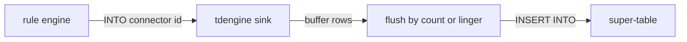

# TDengine connector

The TDengine connector writes rule results as super-table rows. It posts SQL inserts to the REST endpoint. It buffers rows and flushes by count or by linger.

Use it when time-series rows must land in TDengine. You get one insert per flush.



## Before you start

- Run TDengine. Note the endpoint, database, and super-table.
- Create the database and the super-table with its tags.

## Settings

Set `kind` to `tdengine`.

| Setting | Required | Meaning |
|---|---|---|
| `server` | yes | REST endpoint, `host:port`. Reads as `http`. |
| `database` | yes | Target database. |
| `stable` | yes | Super-table name. |
| `subtable` | yes | Sub-table template, for example `d_${client_id}`. |
| `metrics` | yes | Metric column templates, a non-empty object. |
| `tags` | yes | Tag column templates, a non-empty object. |
| `username` | no | TDengine user. Default `root`. Needs `password` too. |
| `password` | no | TDengine password. Default `taosdata`. Needs `username` too. |
| `token` | no | TDengine token. Uses token auth. Never mixes with `username`/`password`. |

The action may override `stable`, `subtable`, `metrics` and `tags` per target. Basic credentials over plain HTTP ride the maintained driver; token credentials stay on the REST transport.

### `server`

REST endpoint, `host:port`. Type: string. Required: yes. Reads as `http`. Absent: 400 naming `server`.

```sh test
python3 - <<'PY'
import json, os, urllib.request
port = os.environ.get("API_PORT", "18083")
key = os.environ["API_KEY"]
def post(body):
    req = urllib.request.Request(
        f"http://127.0.0.1:{port}/api/v5/connectors", data=json.dumps(body).encode(), method="POST",
        headers={"Authorization": f"Bearer {key}", "Content-Type": "application/json"})
    try:
        with urllib.request.urlopen(req, timeout=5) as res:
            return res.status, json.load(res)
    except urllib.error.HTTPError as err:
        return err.code, json.load(err)
status, body = post({"name": "td-server-bad", "type": "tdengine", "database": "power"})
assert status == 400 and "server" in body["message"], body
print("ok")
PY
```

```output
ok
```

### `database`

Target database. Type: string. Required: yes. Absent: 400 naming `database`.

```sh test
python3 - <<'PY'
import json, os, urllib.request
port = os.environ.get("API_PORT", "18083")
key = os.environ["API_KEY"]
def post(body):
    req = urllib.request.Request(
        f"http://127.0.0.1:{port}/api/v5/connectors", data=json.dumps(body).encode(), method="POST",
        headers={"Authorization": f"Bearer {key}", "Content-Type": "application/json"})
    try:
        with urllib.request.urlopen(req, timeout=5) as res:
            return res.status, json.load(res)
    except urllib.error.HTTPError as err:
        return err.code, json.load(err)
status, body = post({"name": "td-db-bad", "type": "tdengine", "server": "127.0.0.1:6041"})
assert status == 400 and "database" in body["message"], body
print("ok")
PY
```

```output
ok
```

### `stable`

Super-table name. Type: string. Required: yes. Absent: 400 naming `stable`.

```sh test
python3 - <<'PY'
import json, os, urllib.request
port = os.environ.get("API_PORT", "18083")
key = os.environ["API_KEY"]
def post(body):
    req = urllib.request.Request(
        f"http://127.0.0.1:{port}/api/v5/connectors", data=json.dumps(body).encode(), method="POST",
        headers={"Authorization": f"Bearer {key}", "Content-Type": "application/json"})
    try:
        with urllib.request.urlopen(req, timeout=5) as res:
            return res.status, json.load(res)
    except urllib.error.HTTPError as err:
        return err.code, json.load(err)
status, body = post({"name": "td-stable-bad", "type": "tdengine",
                     "server": "127.0.0.1:6041", "database": "power"})
assert status == 400 and "stable" in body["message"], body
print("ok")
PY
```

```output
ok
```

### `subtable`

Sub-table template. Type: string. Required: yes. Absent: 400 naming `subtable`.

```sh test
python3 - <<'PY'
import json, os, urllib.request
port = os.environ.get("API_PORT", "18083")
key = os.environ["API_KEY"]
def post(body):
    req = urllib.request.Request(
        f"http://127.0.0.1:{port}/api/v5/connectors", data=json.dumps(body).encode(), method="POST",
        headers={"Authorization": f"Bearer {key}", "Content-Type": "application/json"})
    try:
        with urllib.request.urlopen(req, timeout=5) as res:
            return res.status, json.load(res)
    except urllib.error.HTTPError as err:
        return err.code, json.load(err)
status, body = post({"name": "td-sub-bad", "type": "tdengine",
                     "server": "127.0.0.1:6041", "database": "power", "stable": "meters"})
assert status == 400 and "subtable" in body["message"], body
print("ok")
PY
```

```output
ok
```

### `metrics`

Metric column templates, a non-empty object. Type: object. Required: yes. Empty: 400 naming `metrics`.

```sh test
python3 - <<'PY'
import json, os, urllib.request
port = os.environ.get("API_PORT", "18083")
key = os.environ["API_KEY"]
def post(body):
    req = urllib.request.Request(
        f"http://127.0.0.1:{port}/api/v5/connectors", data=json.dumps(body).encode(), method="POST",
        headers={"Authorization": f"Bearer {key}", "Content-Type": "application/json"})
    try:
        with urllib.request.urlopen(req, timeout=5) as res:
            return res.status, json.load(res)
    except urllib.error.HTTPError as err:
        return err.code, json.load(err)
status, body = post({"name": "td-metrics-bad", "type": "tdengine",
                     "server": "127.0.0.1:6041", "database": "power", "stable": "meters",
                     "subtable": "d_one", "metrics": {}, "tags": {"location": "room1"}})
assert status == 400 and "metrics" in body["message"], body
print("ok")
PY
```

```output
ok
```

### `tags`

Tag column templates, a non-empty object. Type: object. Required: yes. Empty: 400 naming `tags`.

```sh test
python3 - <<'PY'
import json, os, urllib.request
port = os.environ.get("API_PORT", "18083")
key = os.environ["API_KEY"]
def post(body):
    req = urllib.request.Request(
        f"http://127.0.0.1:{port}/api/v5/connectors", data=json.dumps(body).encode(), method="POST",
        headers={"Authorization": f"Bearer {key}", "Content-Type": "application/json"})
    try:
        with urllib.request.urlopen(req, timeout=5) as res:
            return res.status, json.load(res)
    except urllib.error.HTTPError as err:
        return err.code, json.load(err)
status, body = post({"name": "td-tags-bad", "type": "tdengine",
                     "server": "127.0.0.1:6041", "database": "power", "stable": "meters",
                     "subtable": "d_one", "metrics": {"temp": "1"}, "tags": {}})
assert status == 400 and "tags" in body["message"], body
print("ok")
PY
```

```output
ok
```

### `username`

TDengine user. Type: string. Required: no. Default `root`. Needs `password` too.

```sh test
python3 - <<'PY'
import json, os, urllib.request
port = os.environ.get("API_PORT", "18083")
key = os.environ["API_KEY"]
def post(body):
    req = urllib.request.Request(
        f"http://127.0.0.1:{port}/api/v5/connectors", data=json.dumps(body).encode(), method="POST",
        headers={"Authorization": f"Bearer {key}", "Content-Type": "application/json"})
    try:
        with urllib.request.urlopen(req, timeout=5) as res:
            return res.status, json.load(res)
    except urllib.error.HTTPError as err:
        return err.code, json.load(err)
status, body = post({"name": "td-user-bad", "type": "tdengine",
                     "server": "127.0.0.1:6041", "database": "power", "stable": "meters",
                     "subtable": "d_one", "metrics": {"temp": "1"}, "tags": {"location": "room1"},
                     "username": "u"})
assert status == 400 and "username" in body["message"], body
print("ok")
PY
```

```output
ok
```

### `password`

TDengine password. Type: string. Required: no. Default `taosdata`. Needs `username` too.

```sh test
python3 - <<'PY'
import json, os, urllib.request
port = os.environ.get("API_PORT", "18083")
key = os.environ["API_KEY"]
def post(body):
    req = urllib.request.Request(
        f"http://127.0.0.1:{port}/api/v5/connectors", data=json.dumps(body).encode(), method="POST",
        headers={"Authorization": f"Bearer {key}", "Content-Type": "application/json"})
    try:
        with urllib.request.urlopen(req, timeout=5) as res:
            return res.status, json.load(res)
    except urllib.error.HTTPError as err:
        return err.code, json.load(err)
status, created = post({"name": "td-pw-ok", "type": "tdengine",
                        "server": "127.0.0.1:6041", "database": "power", "stable": "meters",
                        "subtable": "d_one", "metrics": {"temp": "1"}, "tags": {"location": "room1"},
                        "username": "u", "password": "p"})
assert status == 201, (status, created)
print("ok")
PY
```

```output
ok
```

### `token`

TDengine token. Type: string. Required: no. Uses token auth. Never mixes with Basic.

```sh test
python3 - <<'PY'
import json, os, urllib.request
port = os.environ.get("API_PORT", "18083")
key = os.environ["API_KEY"]
def post(body):
    req = urllib.request.Request(
        f"http://127.0.0.1:{port}/api/v5/connectors", data=json.dumps(body).encode(), method="POST",
        headers={"Authorization": f"Bearer {key}", "Content-Type": "application/json"})
    try:
        with urllib.request.urlopen(req, timeout=5) as res:
            return res.status, json.load(res)
    except urllib.error.HTTPError as err:
        return err.code, json.load(err)
status, created = post({"name": "td-token-ok", "type": "tdengine",
                        "server": "127.0.0.1:6041", "database": "power", "stable": "meters",
                        "subtable": "d_one", "metrics": {"temp": "1"}, "tags": {"location": "room1"},
                        "token": "tok-1"})
assert status == 201, (status, created)
status, body = post({"name": "td-token-bad", "type": "tdengine",
                     "server": "127.0.0.1:6041", "database": "power", "stable": "meters",
                     "subtable": "d_one", "metrics": {"temp": "1"}, "tags": {"location": "room1"},
                     "username": "u", "password": "p", "token": "tok-1"})
assert status == 400 and "token" in body["message"], body
print("ok")
PY
```

```output
ok
```

Example:

```json
{
  "name": "td-sink-1",
  "type": "tdengine",
  "server": "127.0.0.1:6041",
  "database": "power",
  "stable": "meters",
  "subtable": "d_one",
  "metrics": {"temp": "${payload.temperature}"},
  "tags": {"location": "room1"}
}
```

> [!NOTE]
> The docs run creates this shape. Creation validates only; it inserts nothing. The send path needs a TDengine server. See the failure record in [Verification failures](../_verification/failures.md).

## Check that it works

Create the connector. The broker answers 201 with the kind. It prints `ok`.

```toml test
[node]
id = "docs-connector-tdengine"

[listeners.tcp]
bind = "0.0.0.0:1883"

[listeners.api]
bind = "0.0.0.0:18083"

[logging]
level = "warn"

[auth]
allow_anonymous = true
```

```sh test
python3 - <<'PY'
import json, os, urllib.request
port = os.environ.get("API_PORT", "18083")
key = os.environ["API_KEY"]
body = json.dumps({"name": "td-sink-1", "type": "tdengine",
                   "server": "127.0.0.1:6041",
                   "database": "power", "stable": "meters",
                   "subtable": "d_one",
                   "metrics": {"temp": "${payload.temperature}"},
                   "tags": {"location": "room1"}}).encode()
req = urllib.request.Request(
    f"http://127.0.0.1:{port}/api/v5/connectors", data=body, method="POST",
    headers={"Authorization": f"Bearer {key}", "Content-Type": "application/json"})
try:
    with urllib.request.urlopen(req, timeout=5) as res:
        status, created = res.status, json.load(res)
except urllib.error.HTTPError as err:
    status, created = err.code, json.load(err)
assert status == 201, (status, created)
assert created["type"] == "tdengine", created
print("ok")
PY
```

```output
ok
```

## Limits

- The driver writes super-table rows only. Each write needs at least one tag column.
- A dead server backs off and retries. The bounded queue sheds past its bound.

## Next steps

- Feed the connector from a rule in [Actions](../rules/actions.md).
- See every kind in [Connectors](./index.md).
