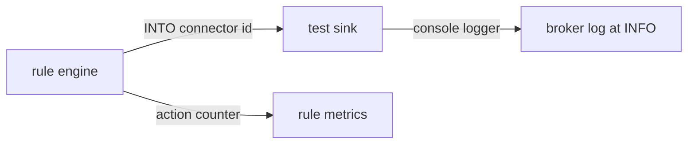

# Test connector

The `test` name is a unit-test helper. It names a recording sink in the connector crate tests. It has no production send path of its own. The v1 connector route rejects the name with 400. The v5 connector route accepts the name and registers the console logger sink.

Use it when a rule test must prove the forward path without an external system. You get one log line per result row and a live rule action counter.



## Before you start

- Set `logging.level` to `info` or `debug`. The `warn` level hides the console lines.
- Use the v5 route. The v1 route rejects this name.
- This kind ships in the default build. No feature flag is necessary.

## Settings

Set `type` to `test` on the v5 route. The v5 route treats the name as an offline kind. The v1 route does not accept the name.

The connector has no settings. The broker accepts an empty body next to `name` and `type`, and it ignores extra keys. The v5 route registers the name and an alias of the form `test:name`.

Example:

```json
{
  "name": "test-1",
  "type": "test"
}
```

> [!NOTE]
> The docs run creates this shape on the v5 route and sends one message through a rule. It reads the rule counters. It does not read the broker log. The log line text stays not verified. See the failure record in [Verification failures](../_verification/failures.md).

## Check that it works

The test shows the v1 refusal and the v5 create. It then runs the full path. It creates a forwarding rule, publishes one message, and waits for the rule action counter.

```toml test
[node]
id = "docs-connector-test"

[listeners.tcp]
bind = "0.0.0.0:1883"

[listeners.api]
bind = "0.0.0.0:18083"

[logging]
level = "info"

[auth]
allow_anonymous = true
```

```sh test
python3 - <<'PY'
import json, os, socket, struct, time, urllib.request, urllib.error
mqtt_port = int(os.environ.get("MQTT_PORT", "1883"))
api_port = int(os.environ.get("API_PORT", "18083"))
key = os.environ["API_KEY"]

def call(method, path, body=None):
    data = None if body is None else json.dumps(body).encode()
    req = urllib.request.Request(
        f"http://127.0.0.1:{api_port}{path}", data=data, method=method,
        headers={"Authorization": f"Bearer {key}",
                 "Content-Type": "application/json"})
    try:
        with urllib.request.urlopen(req, timeout=5) as res:
            raw = res.read().decode()
            return res.status, (json.loads(raw) if raw else None)
    except urllib.error.HTTPError as err:
        raw = err.read().decode()
        try:
            return err.code, json.loads(raw)
        except ValueError:
            return err.code, raw

status, body = call("POST", "/api/v1/connectors",
                    {"id": "test-v1", "kind": "test", "config": {}})
assert status == 400 and "unknown connector kind" in json.dumps(body), (status, body)

status, created = call("POST", "/api/v5/connectors",
                       {"name": "test-1", "type": "test"})
assert status == 201 and created["type"] == "test", (status, created)

status, rule = call("POST", "/api/v1/rules",
                    {"name": "docs-test-rule",
                     "topic_filter": "docs/test/in",
                     "actions": [{"type": "forwardconnector",
                                  "connector_id": "test-1"}]})
assert status == 201, (status, rule)
rule_id = rule["id"]

def packet(kind, body):
    return bytes([kind, len(body)]) + body

def field(data):
    return struct.pack(">H", len(data)) + data

pub = socket.create_connection(("127.0.0.1", mqtt_port), timeout=5)
pub.sendall(packet(0x10, b"\x00\x04MQTT\x04\x02\x00\x3c" + field(b"docs-test-pub")))
assert pub.recv(4) == b"\x20\x02\x00\x00"
pub.sendall(packet(0x30, field(b"docs/test/in") + b'{"temp": 42}'))

deadline = time.time() + 12
while time.time() < deadline:
    status, metrics = call("GET", f"/api/v5/rules/{rule_id}/metrics")
    assert status == 200, (status, metrics)
    if metrics["metrics"]["actions.success"] >= 1:
        break
    time.sleep(0.1)
else:
    raise AssertionError("the test action did not run")
print("ok")
PY
```

```output
ok
```

## Limits

- The name is a unit-test helper. The tests use a recording sink with this kind name.
- The v1 route answers 400 with `unknown connector kind`. The v5 route answers 201.
- The v5 route registers the console logger sink. The sink writes at INFO with the fields `connector`, `topic`, `qos`, and `payload`. The log message is `connector event`.
- The sink writes a payload preview at INFO. The docs harness reads no broker log file, so the log text stays not verified. See the failure record.
- `logging.level` must allow INFO. The `warn` level hides the line.
- The connector has no buffer, no retry, and no network connection.
- The connector runs behind the rule engine bounded queue. A slow log sink never stalls publishers.
- The tier is community. The kind ships in the default build.

## Next steps

- Feed the connector from a rule in [Actions](../rules/actions.md).
- See every kind in [Connectors](./index.md).
